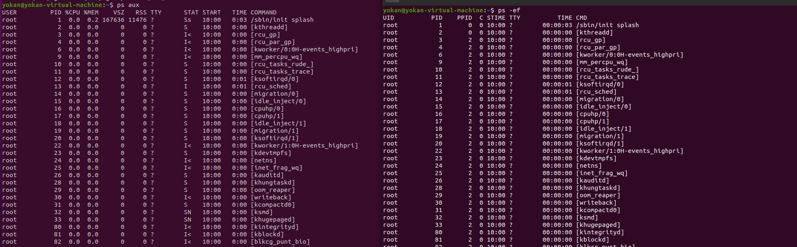

# 6、进程信息

```
ps aux   以用户的格式显示所有进程,包括非终端的进程
ps -ef   显示所有进程,显示UID,PPIP(父进程）,C与STIME栏位
ps -ef | grep java   查询某个应用的所有进程信息
top      实时显示占用最多的进程
```



> 如果想查看进程的CPU占用率和内存占用率，可以使用**aux**
>
> 如果想查看进程的父进程ID和完整的COMMAND命令，可以使用**-ef**

```
lsof -c $PID           查看进程关联文件
/proc/$PID/cmdline     完整命令行信息
/proc/$PID/comm        进程的命令名
/proc/$PID/cwd         进程当前工作目录的符号链接
/proc/$PID/exe         运行程序的符号链接
/proc/$PID/environ     进程的环境变量
/proc/$PID/fd          进程打开文件的情况
```
