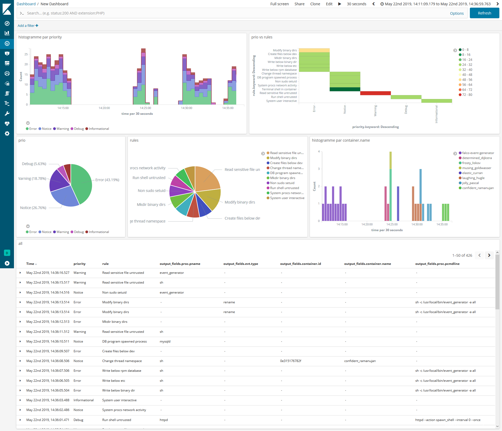
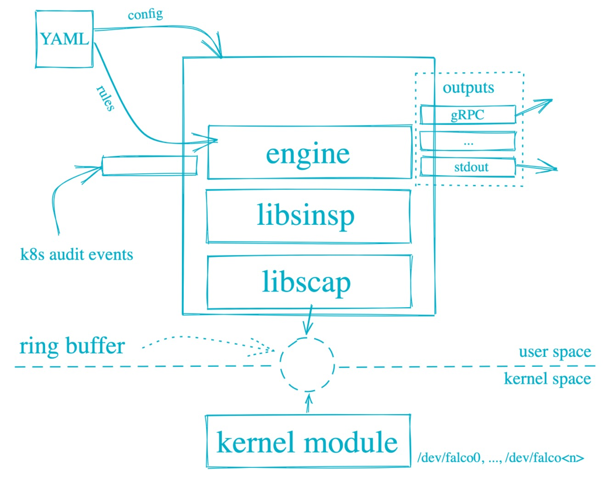
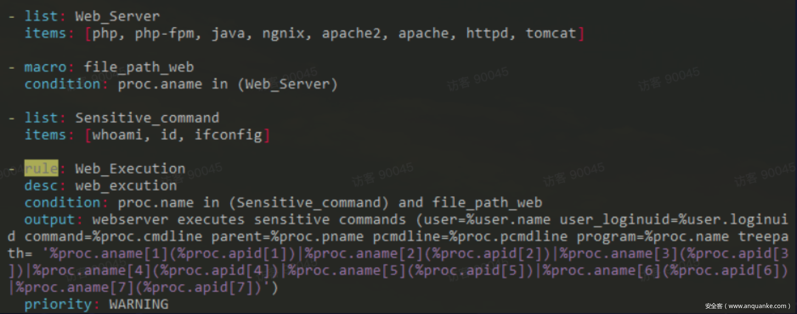
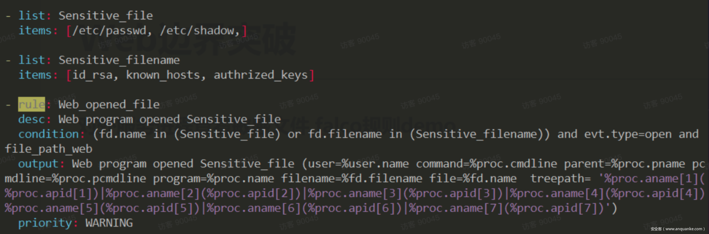
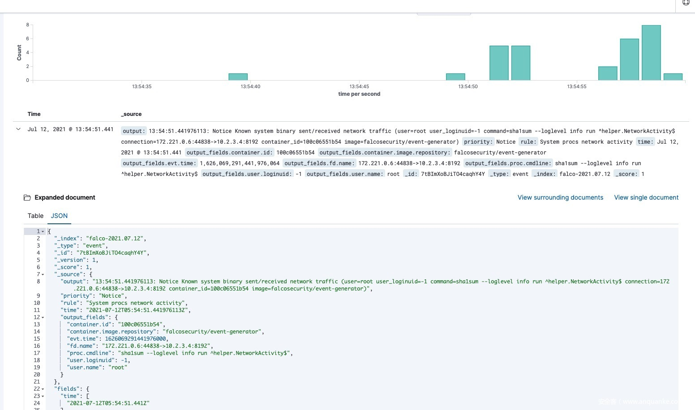

# Falco 之 K8S 入侵检测

> GitHub 仓库源文件：[点击打开网页渲染版](https://github.com/ben2023niao/ben-ops-notes/blob/main/doc/md/202304141557-%E5%AE%89%E5%85%A8%E4%B8%8E%E5%A0%A1%E5%9E%92%E6%9C%BA%2B%E5%AE%89%E5%85%A8%E8%BF%90%E7%BB%B4%2BKubernetes%2BApache-Falco%20%E4%B9%8B%20K8S%20%E5%85%A5%E4%BE%B5%E6%A3%80%E6%B5%8B.md)

效果图



Falco规则文件是包含三种类型元素的YAML文件：

Rules 、Macros、Lists

Rules就是生成告警的条件以及一下描述性输出字符串。Macros 是可以在规则或者其他宏中重复使用的规则条件片段。Lists 类似Python 列表，定义了一个变量集合。

Falco 使用了Sysdig， 在rule的 condition里面,任何 Sysdig 过滤器都可以在 Falco 中使用。

参考如下：

```
https://github.com/draios/sysdig/wiki/sysdig-user-guide#filtering
```

这是一个rule的 condition条件示例，在容器内运行 bash shell 时发出警报：

[container.id](http://container.id) != host and [proc.name](http://proc.name) = bash

第一个子句检查事件是否发生在容器中（Sysdig 事件有一个container字段，该字段等于”host”事件是否发生在host主机上）。第二个子句检查进程名称是否为bash。

举个完整的列子

```
- list: my_programs
 items: [ls, cat, bash]

- macro: access_file
 condition: evt.type=open

- rule: program_accesses_file
 desc: track whenever a set of programs opens a file
 condition: proc.name in (my_programs) and (access_file)
 output: a tracked program opened a file (user=%user.name command=%proc.cmdline file=%fd.name)
 priority: INFO
```

web应用进程java，php，apache，httpd，tomcat 中运行其他进程falco demo，图片来自，字节沙龙

web应用进程java，php，apache，httpd，tomcat 中读取查看敏感文件falco demo，图片来自，字节沙龙


```bash
#下面，我们修改falco 的配置，/etc/falco/falco.yaml

json_output: true
json_include_output_property: true
http_output:
 enabled: true
 url: "http://localhost:2801"
#启动falco
systemctl enable falco && systemctl start falco
```

<https://github.com/falcosecurity/falcosidekick.git>

falcosidekick 是一个管道工具，接受 Falco的事件并将它们发送到不同的持久化工具中。我们使用falcosidekick把falco post 过来的数据写入es ，也可以写入kafka。我们也读取kafka里面的东西完成告警， 也可以用 Prometheus 和falco-exporter 完成告警。如下图。

```
elasticsearch:
 hostport: "http://203.0.113.1:9200"
 index: "falco"
 type: "event"
 minimumpriority: ""
 suffix: "daily"
 mutualtls: false
 checkcert: true
 username: ""
 password: ""

kafka:
 hostport: ""
 topic: ""
 # minimumpriority: "debug"
```



## 批量部署&更新规则

我们在生产环境中需要批量部署和更新规则需求，所以我们可以使用saltstack 或者 ansible 下发对应shell脚本来完成我们的需求。

批量部署

```bash
#!/bin/bash
if [ -n "$(uname -a | grep Ubuntu)" ]; then # 按实际情况修改
 curl -s https://falco.org/repo/falcosecurity-3672BA8F.asc | apt-key add -
 echo "deb https://download.falco.org/packages/deb stable main" | tee -a /etc/apt/sources.list.d/falcosecurity.list
 apt-get update -y
 apt-get install -y falco
else
 rpm --import https://falco.org/repo/falcosecurity-3672BA8F.asc
 curl -s -o /etc/yum.repos.d/falcosecurity.repo https://falco.org/repo/falcosecurity-rpm.repo
 yum -y install falco
fi

systemctl enable falco && systemctl start falco
```

批量更新规则

```bash
#!/bin/bash
BDATE=`date +%Y%m%d%H%M%S`
URL=http://203.0.113.1:8888/falco_update.tar.gz

if [ -d /etc/falco_bak ]
then
 cp -r /etc/falco /etc/falco_bak/${BDATE}
 rm -rf /etc/falco_bak/falco_update.tar.gz
else
 mkdir /etc/falco_bak
 cp -r /etc/falco /etc/falco_bak/${BDATE}
fi

curl -o /etc/falco_bak/falco_update.tar.gz ${URL} && rm -rf /etc/falco
tar -xzvf /etc/falco_bak/falco_update.tar.gz -C /etc && systemctl restart falco
```

把规则falco_update.tar.gz，提前准备好，使用saltstack 推下去即可.saltstack demo 如下：

```
[root@localhost ~]$ cat /srv/salt/top.sls
base:
 '*':
 - exec_shell_install

[root@localhost ~]$ cat /srv/salt/exec_shell_install.sls

exec_shell_install:
 cmd.script:
 - source: salt://falco_install.sh
 - user: root

[root@localhost ~]$ salt '*' state.highstate
```

也可以使用ansible 推下去即可.ansible demo 如下：

```
[root@server81 work]# ansible servers -m shell -a "mkdir -p /var/falco_sh"
[root@server81 ansible]# ansible servers -m copy -a "src=/root/ansible/falco_install.sh  dest=/var/falco_sh/falco_install.sh mode=0755"
203.0.113.1 | CHANGED => {
[root@server81 ansible]# ansible servers -m shell -a "/var/falco_sh/falco_install.sh"
203.0.113.1 | CHANGED | rc=0 >>
```

## 可视化

Kibana是一个开源的分析与可视化平台，设计出来用于和Elasticsearch一起使用的。你可以用kibana搜索、查看存放在Elasticsearch中的数据。Kibana与Elasticsearch的交互方式是各种不同的图表、表格、地图等，直观的展示数据，从而达到高级的数据分析与可视化的目的。
Elasticsearch、Logstash和Kibana这三个技术就是我们常说的ELK技术栈，可以说这三个技术的组合是大数据领域中一个很巧妙的设计。一种很典型的MVC思想，模型持久层，视图层和控制层。Logstash担任控制层的角色，负责搜集和过滤数据。Elasticsearch担任数据持久层的角色，负责储存数据。而我们这章的主题Kibana担任视图层角色，拥有各种维度的查询和分析，并使用图形化的界面展示存放在Elasticsearch中的数据。

因为我们使用了， es 推荐使用kibana 做一下可视化， 也可以使用grafana 做可视化。demo 如下图：

