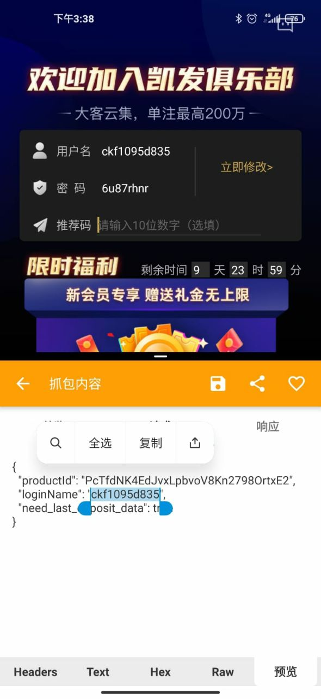
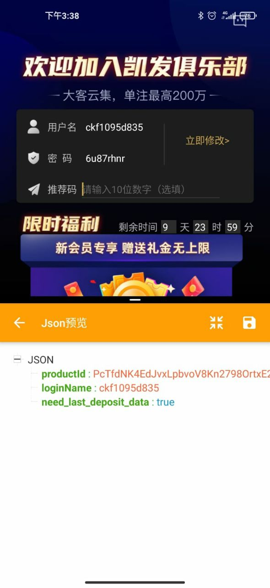

# java后台对json进行加密解密防恶意抓包串改方案

## 推荐使用方式二：三重加密算法 多重加密杜绝被破解由于热爱爬虫，爱分析数据，几个月前在手机上通过抓包软件，抓到某资源app的大量请求，捕获各种类型的api接口，获取了大量json数据，而且可以直接利用。于是发挥了我python爬虫的那点知识，不断循环爬取数据保存到数据库，最后爬取了近4万条可用有价值的数据。上周末本想继续爬取更新一波，发现json传输的数据都加密了，于是对json加密产生了兴趣，本想把这种传输方式应用到java-web中，发现前端并不是好处理来自后台传过来的加密json数据（知识尚浅？），所以在此只记录下java后端对json数据加密解密处理的代码逻辑，以下两种方式来源在页尾已注明。

## 方式一：AES加密

**方式一：AES加密** 展开源码

```python
import org.apache.commons.codec.binary.Base64;
import javax.crypto.*;
import javax.crypto.spec.SecretKeySpec;
import java.security.SecureRandom;
/**
 * Create by wjup on 2019/7/1 9:03
 */
public class AesUtil {
 public static void main(String[] args) throws Exception {
 // aes + base  -->  aes + base
 String content = "{\"mac\":\"123\",\"idfa\":\"123\",\"clientIp\":\"456\",insertTime\":\"test\"}";
 System.out.println("加密内容：" + content);
 String key = "123abc";
 System.out.println("加密密钥和解密密钥：" + key);
 String encrypt = aesEncrypt(content, key);
 System.out.println("加密后：" + encrypt);
 String decrypt = aesDecrypt(encrypt, key);
 System.out.println("解密后：" + decrypt);
 }
 /**
     * 编码
     *
     * @param bstr
     * @return String
     */
 public static String Base64encode(byte[] bstr) {
 return Base64.encodeBase64String(bstr);
 }
 /**
     * 解码
     *
     * @param str
     * @return string
     */
 public static byte[] Base64decode(String str) {
 return Base64.decodeBase64(str);
 }
 /*
     * AES加密
     * @param content 待加密的内容
     * @param encryptKey 加密密钥
     * @return 加密后的byte[]
     * @throws Exception
     */
 public static byte[] aesEncryptToBytes(String content, String encryptKey) throws Exception {
 KeyGenerator kgen = KeyGenerator.getInstance("AES");
 /*防止linux下 随机生成key*/
 SecureRandom random = SecureRandom.getInstance("SHA1PRNG");
 random.setSeed(encryptKey.getBytes());
 kgen.init(128, random);
 Cipher cipher = Cipher.getInstance("AES/ECB/PKCS5Padding");
 cipher.init(Cipher.ENCRYPT_MODE, new SecretKeySpec(kgen.generateKey().getEncoded(), "AES"));
 return cipher.doFinal(content.getBytes("UTF-8"));
 }
 /**
     * AES加密为base 64 code
     *
     * @param content    待加密的内容
     * @param encryptKey 加密密钥
     * @return 加密后的base 64 code
     * @throws Exception
     */
 public static String aesEncrypt(String content, String encryptKey) throws Exception {
 return Base64encode(aesEncryptToBytes(content, encryptKey));
 }
 /**
     * AES解密
     *
     * @param encryptBytes 待解密的byte[]
     * @param decryptKey   解密密钥
     * @return 解密后的String
     * @throws Exception
     */
 public static String aesDecryptByBytes(byte[] encryptBytes, String decryptKey) {
 byte[] decryptBytes = new byte[0];
 try {
 KeyGenerator kgen = KeyGenerator.getInstance("AES");
 /*防止linux下 随机生成key*/
 SecureRandom random = SecureRandom.getInstance("SHA1PRNG");
 random.setSeed(decryptKey.getBytes());
 kgen.init(128, random);
 Cipher cipher = Cipher.getInstance("AES/ECB/PKCS5Padding");
 cipher.init(Cipher.DECRYPT_MODE, new SecretKeySpec(kgen.generateKey().getEncoded(), "AES"));
 decryptBytes = cipher.doFinal(encryptBytes);
 return new String(decryptBytes, "UTF-8");
 } catch (Exception e) {
 e.printStackTrace();
 }
 return decryptKey;
 }
 /**
     * 将base 64 code AES解密
     *
     * @param encryptStr 待解密的base 64 code
     * @param decryptKey 解密密钥
     * @return 解密后的string
     * @throws Exception
     */
 public static String aesDecrypt(String encryptStr, String decryptKey) {
 return aesDecryptByBytes(Base64decode(encryptStr), decryptKey);
 }
}
```

## 方式二：三重加密算法

加密顺序：JSON字符串->Base64字符串->DES加密
Base64是一重加密

Base64里面我改进了算法，支持任意形式的字典表，所以这个地方是第二重加密

DES在Base64的基础上再次用秘钥加密。

有人问为什么还需要改Base64的字典表，其实原因就是DES的秘钥只能是8个字节，按照现在计算机的处理速度，24小时就破解了。

Base64的处理类，这里我把网上一个公开的类库做了改进，做了一个混排编码格式

**方式二：三重加密算法** 展开源码

```python
import java.io.ByteArrayOutputStream;
import java.io.IOException;
import java.io.OutputStream;
import java.util.HashMap;
/**
 * Create by wjup on 2019/7/1 9:08
 */
public class Base64 {
 private static final char[] legalChars = "9ghijk67sutJKLM8rvwx4EzAlnm3OUV+/aNbcdfePQRSTopqCDFG0125BHIWyXYZ"
 .toCharArray();//字典内顺序任意更改，只要内容保证不缺就行
 private static HashMap<Character, Integer> hashDecode = new HashMap<Character, Integer>();
 /**
     * data[]进行编码
     *
     * @param data
     * @return
     */
 public static String encode(byte[] data) {
 int start = 0;
 int len = data.length;
 StringBuffer buf = new StringBuffer(data.length * 3 / 2);
 int end = len - 3;
 int i = start;
 int n = 0;
 while (i <= end) {
 int d = ((((int) data[i]) & 0x0ff) << 16)
 | ((((int) data[i + 1]) & 0x0ff) << 8)
 | (((int) data[i + 2]) & 0x0ff);
 buf.append(legalChars[(d >> 18) & 63]);
 buf.append(legalChars[(d >> 12) & 63]);
 buf.append(legalChars[(d >> 6) & 63]);
 buf.append(legalChars[d & 63]);
 i += 3;
 if (n++ >= 14) {
 n = 0;
 buf.append(" ");
 }
 }
 if (i == start + len - 2) {
 int d = ((((int) data[i]) & 0x0ff) << 16)
 | ((((int) data[i + 1]) & 255) << 8);
 buf.append(legalChars[(d >> 18) & 63]);
 buf.append(legalChars[(d >> 12) & 63]);
 buf.append(legalChars[(d >> 6) & 63]);
 buf.append("=");
 } else if (i == start + len - 1) {
 int d = (((int) data[i]) & 0x0ff) << 16;
 buf.append(legalChars[(d >> 18) & 63]);
 buf.append(legalChars[(d >> 12) & 63]);
 buf.append("==");
 }
 return buf.toString();
 }
 public static byte[] decode(String s) {
 ByteArrayOutputStream bos = new ByteArrayOutputStream();
 try {
 decode(s, bos);
 } catch (IOException e) {
 throw new RuntimeException();
 }
 byte[] decodedBytes = bos.toByteArray();
 try {
 bos.close();
 bos = null;
 } catch (IOException ex) {
 System.err.println("Error while decoding BASE64: " + ex.toString());
 }
 return decodedBytes;
 }
 private static void decode(String s, OutputStream os) throws IOException {
 int i = 0;
 int len = s.length();
 while (true) {
 while (i < len && s.charAt(i) <= ' ') {
 i++;
 }
 if (i == len) {
 break;
 }
 int tri = (decode(s.charAt(i)) << 18)
 + (decode(s.charAt(i + 1)) << 12)
 + (decode(s.charAt(i + 2)) << 6)
 + (decode(s.charAt(i + 3)));
 os.write((tri >> 16) & 255);
 if (s.charAt(i + 2) == '=') {
 break;
 }
 os.write((tri >> 8) & 255);
 if (s.charAt(i + 3) == '=') {
 break;
 }
 os.write(tri & 255);
 i += 4;
 }
 }
 private static int decode(char c) {
 if (hashDecode.size() == 0) {
 for (int i = 0; i < 64; i++) {
 char ch = legalChars[i];
 hashDecode.put(ch, i);
 }
 }
 if (hashDecode.containsKey(c)) {
 return hashDecode.get(c);
 } else if (c == '=') {
 return 0;
 } else {
 throw new RuntimeException("unexpected code: " + c);
 }
 }
```

## 方式三：Des加密算法

**方式三：Des加密算法** 展开源码

```python
import javax.crypto.Cipher;
import javax.crypto.spec.IvParameterSpec;
import javax.crypto.spec.SecretKeySpec;
/**
 * Create by wjup on 2019/7/1 9:12
 */
public class DateSecret {
//    private static String keyCode = "12345678";//秘钥可以任意改，只要总长度是8个字节就行
 private static byte[] iv = {1, 2, 3, 4, 5, 6, 7, 8};
 /**
     * 加密
     * @param encryptString
     * @param keyCode 8位秘钥
     * @return
     * @throws Exception
     */
 public static String encryptDES(String encryptString,String keyCode) throws Exception {
 IvParameterSpec zeroIv = new IvParameterSpec(iv);
 SecretKeySpec key = new SecretKeySpec(keyCode.getBytes(), "DES");
 Cipher cipher = Cipher.getInstance("DES/CBC/PKCS5Padding");
 cipher.init(Cipher.ENCRYPT_MODE, key, zeroIv);
 byte[] encryptedData = cipher.doFinal(encryptString.getBytes("utf-8"));
 return Base64.encode(encryptedData);
 }
 /**
     * 解密
     * @param decryptString
     * @param keyCode 8位秘钥
     * @return
     * @throws Exception
     */
 public static String decryptDES(String decryptString,String keyCode) throws Exception {
 byte[] byteMi = Base64.decode(decryptString);
 IvParameterSpec zeroIv = new IvParameterSpec(iv);
 SecretKeySpec key = new SecretKeySpec(keyCode.getBytes(), "DES");
 Cipher cipher = Cipher.getInstance("DES/CBC/PKCS5Padding");
 cipher.init(Cipher.DECRYPT_MODE, key, zeroIv);
 byte decryptedData[] = cipher.doFinal(byteMi);
 return new String(decryptedData, "utf-8");
 }
 /**
     * 将二进制转换成16进制
     *
     * @param buf
     * @return String
     */
 public static String parseByte2HexStr(byte buf[]) {
 StringBuffer sb = new StringBuffer();
 for (int i = 0; i < buf.length; i++) {
 String hex = Integer.toHexString(buf[i] & 0xFF);
 if (hex.length() == 1) {
 hex = '0' + hex;
 }
 sb.append(hex.toUpperCase());
 }
 return sb.toString();
 }
 // 示例
 public static void main(String[] args) {
 try {
 // 加密
 String s = encryptDES("天王盖地虎","12345678");
 // 解密
 String s1 = decryptDES(s,"12345678");
 System.out.println("加密后："+s+"\n解密后："+s1);
 } catch (Exception e) {
 e.printStackTrace();
 }
 }
}
```

加密参考信息
<https://www.cnblogs.com/yanchaohui/p/11005037.html>
<https://blog.csdn.net/f2006116/article/details/53222328>
