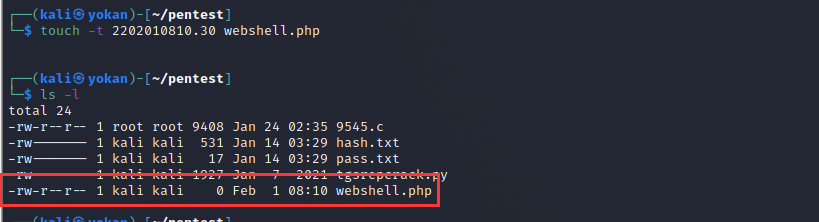

# 隐藏文件时间戳

> GitHub 仓库源文件：[点击打开网页渲染版](https://github.com/ben2023niao/ben-ops-notes/blob/main/doc/md/202304141557-%E5%AE%89%E5%85%A8%E4%B8%8E%E5%A0%A1%E5%9E%92%E6%9C%BA%2B%E5%AE%89%E5%85%A8%E8%BF%90%E7%BB%B4%2BLinux%2BPHP-%E9%9A%90%E8%97%8F%E6%96%87%E4%BB%B6%E6%97%B6%E9%97%B4%E6%88%B3.md)

Linux下藏后门必须要修改时间，否则很容易被发现，直接利用 touch 就可以了。

**利用方法**

比如参考 index.php 的时间，再赋给 webshell.php，结果两个文件的时间就一样了。

```
touch -r index.php webshell.php
```

或者直接将时间戳修改成某年某月某日。如下 2022年 02 月 01 日8时10分30秒。

```
touch -t 2202010810.30 webshell.php
touch -t 2202010810.30 webshell.php -c
//-t STAMP use [[CC]YY]MMDDhhmm[.ss] instead of current time
//-c 不创建文件
```


