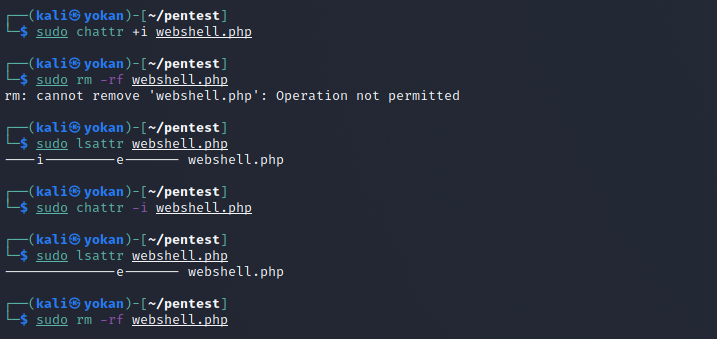

# 隐藏权限

在Linux中，使用chattr命令来防止root和其他管理用户误删除和修改重要文件及目录，此权限用ls -l是查看不出来的，从而达到隐藏权限的目的。

这个技巧常被用在后门，变成了一些难以清除的后门文件。

```
chattr +i evil.php  #锁定文件
rm -rf evil.php     #提示禁止删除

lsattr  evil.php    #属性查看
chattr -i evil.php  #解除锁定
rm -rf evil.php     #彻底删除文件
```

## 
