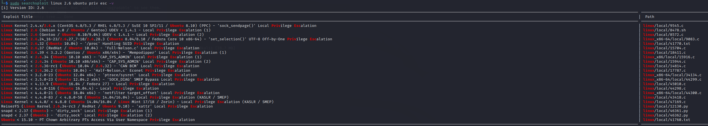

# SearchSploit

用kali自带的searchsploit来搜索exploitdb中的漏洞利用代码

> SearchSploit是一个**Exploit-DB**的命令行搜索工具，它还允许随身携带漏洞利用数据库的副本。
>
> 介绍：<https://xz.aliyun.com/t/2860>

**SearchSploit使用：**

更新SearchSploit:

```bash
apt update && apt -y full-upgrade
 searchsploit -u
```

基本搜索语法：

只需添加您想要查找的任意数量的搜索词：

```
searchsploit linux 2.6 ubuntu priv esc
Tip:如果你没有收到预期的结果，可以使用更通用的术语进行更广泛的搜索。如:Kernel 2.6.25 - >Kernel 2.6 / / Kernel 2.x。
Tip:不要使用缩写如:SQLi -> SQL Injection。
```



显示漏洞利用的完整路径:

```
-p, --path [EDB-ID]     显示漏洞利用的完整路径（如果可能，还将路径复制到剪贴板），后面跟漏洞ID号
```


不建议在本地的漏洞数据库中修改**exp**,建议使用**-m**参数复制那些有用的到当前的工作目录:

```
-m, --mirror [EDB-ID]   把一个exp拷贝到当前工作目录,参数后加目标id
```


**exp利用：**

将exp上传到目标技巧，编译运行（编译方法，在**源码的注释**里有）

```
gcc 9545.c -o exp
chmod 777 exp
./exp
```

> 当然，以上只是非常理想的情况，我们经常会遇到没有gcc的坑爹服务器。这时我们就需要在本地编译。本地编译时不止要看exp源码注释的编译参数，也需要手动调整一下编译的参数，比如给gcc 加-m 32来编译32位。编译问题繁多，有困难找谷歌。

最后强调利用内核漏洞的几个**注意点**：

1.读源码注释，有exp基本信息和编译方法，不然可能连编译都不会
2.读源码，不然费劲编译完才发现不适用
3.读源码，不然遇到一个删全盘的”exp“怎么办
