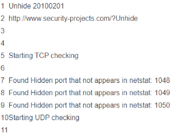

# 服务器被黑(隐藏进程)解决

**问题现象：服务器被黑客反反复复入侵，负载很高，top和ps 无法查看进程，有异常任务计划但是查不到进程没有日志记录排查困难**

**解决办法**

**unhide是一个小巧的网络取证工具，能够发现那些借助 rootkit、LKM 及其它技术隐藏的进程和TCP/UDP端口的病毒。这个工具在 Linux、UNIX 类、MS-Windows 等操作系统下都可以工作。**

Unhide 通过下述三项技术来发现隐藏的进程。

进程相关的技术，包括将/proc目录与/bin/ps命令的输出进行比较。
系统相关的技术，包括将/bin/ps命令的输出结果同从系统调用方面得到的信息进行比较。
穷举法相关的技术，包括对所有的进程 ID 进行暴力求解，该技术仅限于在基于 Linux2.6 内核的系统中使用。

绝大多数的 Rootkit 工具或者恶意软件借助内核来实现进程隐藏，这些进程只在内核内部可见。你可以使用unhide或者诸如rkhunter 等工具，扫描 rootkit 程序 、后门程序以及一些可能存在的本地漏洞。

**unhide查看隐藏进程和文件**

```bash
#!/bin/bash #!/bin/bash
yum -y install epel-release
yum -y install unhide

unhide sys >> unhide.log
unhide brute >> unhide.log
unhide proc >> unhide.log
unhide procall >> unhide.log
unhide procfs >> unhide.log
unhide quick >> unhide.log
unhide reverse >> unhide.log
unhide-tcp >> unhide.log
```

unhide-tcp **果然发现三个netstat ss 等命令无法显示的隐藏端口。**


