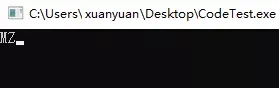
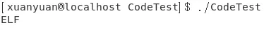
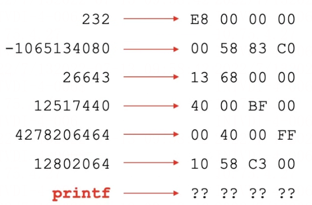
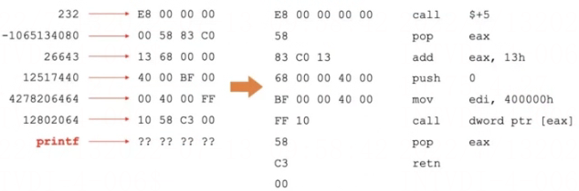
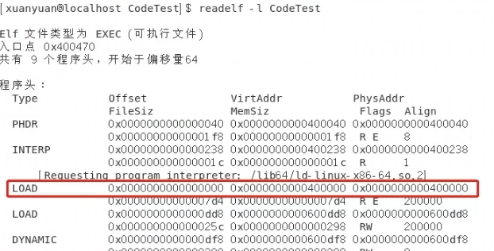
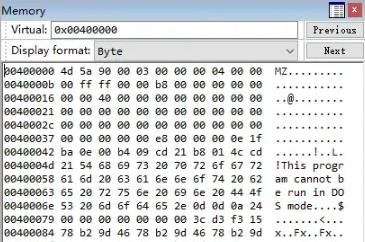

# 骚批代码触发编译器 BUG

编译器BUG ， 函数定义原则上是需要 ( ) 来包裹 ， main 直接变成了"变量"形式了
所以病毒可以通过函数注入实现

```c
#正常代码
int main(){
 f(正常函数功能)
}
#机器码注入main来欺骗编译器实现机器码特定病毒功能
void f[] = [恶意病毒功能机器码]
```

神奇的两行骚批（准确的说是一行）代码

```c
#include <stdio.h>
int main[] = { 232,-1065134080,26643,12517440,4278206464,12802064,(int)printf };
```

骚批换一种写法 汇编真相参考 <https://blog.csdn.net/masefee/article/details/6606813>

```c
#include <stdio.h>
int ______ = ( int )printf;
int main[ ] = { 232, -394045440,5138441,285147200,50008 };
```

神奇的两行骚批C++代码，猜猜看编译运行后，会输出什么？

可能，你会问：这TM连main函数都没有，能编译成功？

还真能！

咱们分别在Windows平台下的Visual Studio和Linux平台下的 g++ 进行编译，然后分别执行看看效果：

**Windows下：

**Linux下：**
**

不仅能编译成功，还能正常运行，在Windows上输出了一个**MZ**，在Linux上输出了一个**ELF**。

熟悉PE文件格式的同学可能知道，**MZ是PE文件开头的标志，另外，ELF也是Linux上的可执行文件开头的标志。**

也就是说：**上面这行代码执行后，把所在可执行文件头部的字符串给打印出来了！**

反汇编真相

看到这里，你可能有两个问题：

- 为什么没有main函数还能通过编译？
- 为什么会输出这么一串信息？

对于第一个问题，相信大家应该也猜到了个八九不离十。虽然代码中没有main函数，但是有一个main数组啊！会不会跟它有关系？

是的没错，对于编译器而言，函数也好，变量也好，最终都处理成了一个个的符号Symbol，而编译器并没有区分这个符号是来自一个函数还是一个数组。所以，我们用一个main数组，骗过了编译器。

也就是说：**编译器把main数组当成了main函数，把main数组中的数据当成了main函数的函数体指令。**

而要回答第二个问题，那就得看下这个main数组中的这一段奇怪的数字，到底是一段什么样的代码？

将main数组中的数值转换成16进制看看，按照一个int变量占4个字节对齐：

再进一步，使用反汇编引擎看看这段16进制数据是什么指令？


接下来，咱们逐条分析这些指令。

**call $+5**

这是一条非常重要的指令，请记住：**call指令是在执行函数调用，执行call指令的时候，会将下一条指令的地址压入线程的栈顶，用于函数返回时取出找到回去的路**，那下一条是谁？就是下面的**pop eax**这条指令，所以执行这个call指令时，会把下面那个pop eax指令的地址压入栈顶。

再者，call后面的目标地址是$+5，也就是这条call指令地址+5个字节的地方，同样是下面那条**pop eax**指令的地址，所以call的目标函数就是紧接着的下面pop eax指令开始的地方。

那这么费劲执行这个call $+5的意义何在？其实就是为了获取当前这段代码所在的内存空间地址，但是又没有办法直接读取指令寄存器EIP的值，所以借助一个call，把这段代码的地址压入到堆栈中，随后再取出来就能知道这段代码被放置在内存中哪个地址在执行了。

这个手法，是黑客编写shellcode的惯用伎俩。

**pop eax**

注意，执行到这里的时候，线程的栈顶存放的就是这条指令所在的位置，是上面那条call指令导致的结果。

接着，pop eax，将栈顶存放的这个地址取出来，放到eax寄存器中。现在eax中存放的就是当前指令的内存地址了。

**add eax, 13h**

上面费这么大劲拿到了这个地址有什么用呢？别急，看这条指令，给它加了13h，也就是十进制的19，回头看看main数组那个十六进制字节表，加了19后，正好是main数组最后一个元素所在的位置——里面存放了printf函数的地址。

所以，截止到这里，前面这三条指令的目的就是为了能拿到printf函数的地址。

**push 400000h**↵↵拿到printf函数以后，开始调用。这里给printf传了一个参数：0x00400000，也就是要打印的字符串地址。

**mov edi, 400000h**↵↵这里同样是在给printf函数传参，这里和上面那条，一个通过堆栈传参，一个通过寄存器传参数，是为了同时兼容Windows平台和Linux x64平台上的函数调用约定。

而之所以传递的字符串地址是0x00400000，是因为刚好，这个数字是两个平台上可执行文件加载的默认基地址。

Windows：

Linux：

```
(gdb) x /16c 0x00400000
0x400000: 127 '\177' 69 'E' 76 'L' 70 'F' 2 '\002' 1 '\001' 1 '\001' 0 '\000'
0x400008: 0 '\000' 0 '\000' 0 '\000' 0 '\000' 0 '\000' 0 '\000' 0 '\000' 0 '\000'
```

**call dword ptr [eax]**

还记得前面eax存储的是main数组的最后一个格子的地址，这个格子里面存放的是printf函数的地址。

于是，通过一个指针调用call，来调用printf，完成打印输出。

**pop eax**

函数调用完了，得进行堆栈平衡，前面传参压栈了，这里就得弹出来。

**retn**

注意这个retn指令，retn指令和call指令对应，call用于调用函数，将返回地址压栈，而retn指令则将栈顶的数据弹出来作为返回地址，跳回去执行。

还记得吗，现在这段代码是处于被第一个call指令调用的上下文中的，正常情况下，执行retn是不是应该返回到call指令后面？那岂不是又回去pop eax走一遍乱了套了？但注意，现在栈顶的那个返回地址已经提前被pop出来了（第二行那个pop eax），那现在执行retn，取出来的栈顶数据又是什么呢？

这个数据就是线程执行到整个main函数最开始的时候，栈顶保留的调用main函数的调用者的返回地址。所以这个retn不是返回到第一个call后面，而是返回到了上一级调用main函数的的那个地方。

至于具体是谁在调用main函数，这就不是这篇文章的重点了，属于Linux和Windows上各自的C/C++运行时库CRT函数的范畴。

到这里，你应该就能明白，这个程序是如何运行起来的，以及，为什么会有那样的输出信息。

## 几个注意事项

1. 首先，为了能够顺利通过编译，在Linux上，需要使用 g++而不是gcc进行编译，因为对main这个全局变量初始化时，C语言规定必须是常量，而不能是动态确定的（最后那个printf函数地址就是动态的），同时还得加上-fpermissive 编译选项。
2. 需要关闭模块的随机加载功能。现代操作系统为了抵抗安全攻击，可执行文件的加载基地址都进行了随机化，防止被猜测，而这段代码能够正常运行的前提是可执行文件加载基址是0x00400000。不能随机化，所以需要通过编译器来关闭。
3. 最后，根据前面的分析其实也知道了，其实程序把main数组中的数据当成了代码在执行。在现代操作系统的安全性保护下，默认情况下是拒绝执行数据所在的内存页面的，因为这些内存页面只有读写权限，而没有可执行权限，这一安全机制叫DEP/NX。所以为了正常运行，需要把这个关闭。对于g++，添加-z execstack 编译选项即可。

## 总结

其实这段代码的思路并非我的原创，在国外有一个**国际C语言混乱代码大赛**（IOCCC, The International Obfuscated C Code Contest）。这个比赛的特点就在于**写最骚的代码，实现最奇葩的效果**，其中就有这样的获奖案例。

后来，国内一个大牛也原创了自己的版本，参考链接：

> [https://blog.csdn.net/masefee...](https://link.segmentfault.com/?enc=nsp9HzqDbTEl0qrHElSICQ==.sX0WUe39jT/3v5T6penG31JTDLvscguSeNmmFKzf7TsdLvuZU/R6IUXSpY9D1hdyeWblkwGNaeJTMqtYxi4X7g==)

不过，这个版本仅适用于Windows平台，我在此基础之上，又改了现在这个版本，同时支持Windows和Linux平台。

这段代码本身没有任何意义，不具备实用价值，但透过代码去研究代码和程序背后执行的底层原理，了解CPU如何调用函数、传递参数，跳转，操作堆栈，这些才是这篇文章的意义所在。

给大家留个思考题，下面这行代码能正常运行起来吗，运行起来又做了什么呢？

```c
int main[] = {0xC3};
```

答案 ： int main[] = {0xC3}; 直接就 return 了
