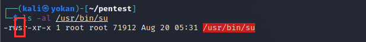
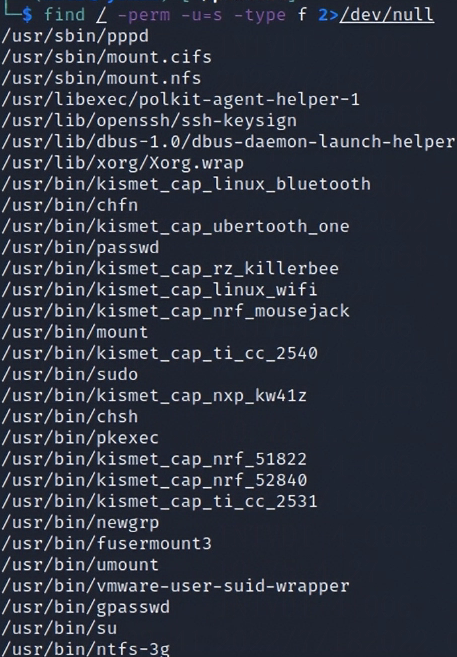

# Suid提权

> 什么是suid？suid全称是**S**et owner **U**ser **ID** up on execution。这是Linux给可执行文件的一个属性——**s标志**。通俗的理解为其他用户执行这个程序的时候可以用该程序所有者/组的权限。需要注意的是，**只有程序的所有者是0号或其他super user，同时拥有suid权限，才可以提权**。
>
> 推荐阅读P神的这篇文章：<https://www.leavesongs.com/PENETRATION/linux-suid-privilege-escalation.html>



常见的可用来提权的Linux 可执行文件有：

**Nmap, Vim, find, bash, more, less, nano, cp**

查看可以suid 提权的可执行文件：

```
find / -perm -u=s -type f 2>/dev/null
或者
find / -user root -perm -4000 -print 2>/dev/null
```



下面列举几个常见的设置了SUID的应用程序提权手段：
