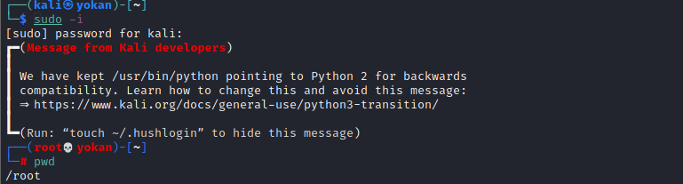

# sudo 有密码 提权

**有密码：**

如果知道sudo组用户的密码，可以直接**sudo -i**提权。

> sudo -i: 为了频繁的执行某些只有超级用户才能执行的权限，而不用每次输入密码，可以使用该命令。提示输入密码时该密码为当前账户的密码。没有时间限制。执行该命令后提示符变为“#”而不是“$”。想退回普通账户时可以执行“exit”或“logout” 。



**补充：**

直接在低权shell里面用sudo是不奏效的，这是因为出于安全考虑，linux要求用户必须从**终端设备**（tty）中输入密码，而不是标准输入（stdin）。换句话说，sudo在你输入密码的时候本质上是读取了键盘，而不是bash里面输入的字符。因此为了能够输入密码，我们必须模拟一个终端设备。

python就有这样的功能。在shell里面输入：

```
python -c 'import pty;pty.spawn("/bin/sh")'
```

**就用python建立了一个虚拟终端**，然后就可以使用sudo等等命令了。
