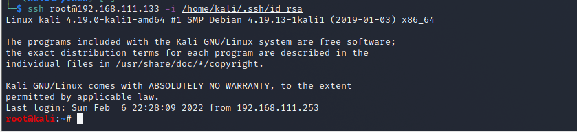

# SSH横向（linux）

**这个是Linux横向的重点，获取linux账号的明文密码作用很大，因为内网环境管理员可能就那么几个，不同服务器所设置的密码也有可能相同**。

## SSH私钥泄露

> 不了解SSH私钥登录的可以看这篇文章
>
> <https://www.runoob.com/w3cnote/set-ssh-login-key.html>

一般情况下SSH密钥存放在**~/.ssh/**目录下：


```
id_rsa 为私钥，id_rsa.pub 为公钥
```

**搜索包含SSH密钥的文件**：（下面命令不包含隐藏文件，也就是类似**.ssh**目录下的搜索不到）

```
grep -ir "BEGIN DSA PRIVATE KEY" /home/*
grep -ir "BEGIN DSA PRIVATE KEY" /*
grep -ir "BEGIN RSA PRIVATE KEY" /home/*
grep -ir "BEGIN RSA PRIVATE KEY" /*
grep -ir "BEGIN OPENSSH PRIVATE KEY" /home/*
grep -ir "BEGIN OPENSSH PRIVATE KEY" /*
```

如果找到密钥,则需要**确定该密钥用于哪个服务器**，关注一下几个文件：

```
/etc/hosts
/etc/ssh/ssh_config
~/.known_hosts
~/.bash_history
~/.ssh/config
```

**known_hosts**文件用于验证远程登陆系统的身份。ssh可以自动将密钥添加到用户文件，也可以手动添加。**该文件包含**用户已连接过所有主机的**远程机器ip**、**远程机器公钥**。一般，初次登陆，ssh会自动将远程主机的公钥添加到用户的known_hosts文件。known_hosts格式有两种，取决于你的**~/.ssh/config**文件中的**HashKnownHosts**字段的设置，有可能是明文也有可能是一段哈希字符串。如果没有**~/.ssh/config**文件，这取决于**/etc/ssh/ssh_config** 文件中的该字段。

> 修改 **/etc/ssh/ssh_config** 文件，
>
> **HashKnownHosts no**
>
> **HashKnownHosts yes**

**通过密钥进行登录**，

使用linux机器登录，用**-i**指定密钥文件的路径

