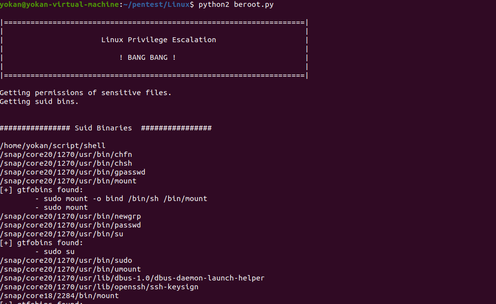
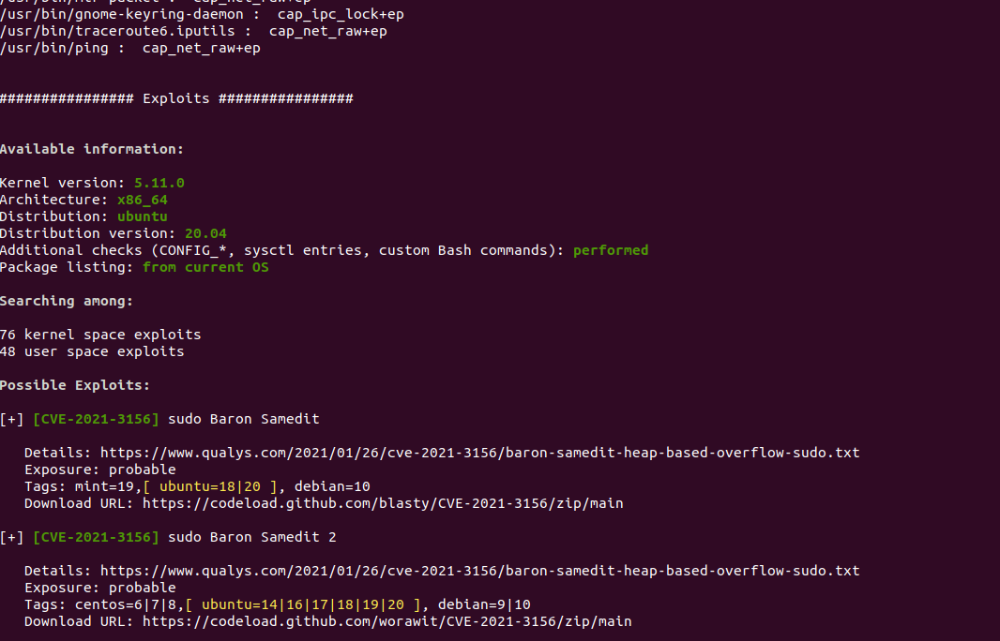

# BeRoot

> GitHub 仓库源文件：[点击打开网页渲染版](https://github.com/ben2023niao/ben-ops-notes/blob/main/doc/md/202304141557-%E5%AE%89%E5%85%A8%E4%B8%8E%E5%A0%A1%E5%9E%92%E6%9C%BA%2B%E5%AE%89%E5%85%A8%E8%BF%90%E7%BB%B4%2BLinux%2B%E7%9F%A5%E8%AF%86%E7%AC%94%E8%AE%B0-%E5%AE%89%E5%85%A8%E8%BF%90%E7%BB%B4%E8%AF%B4%E6%98%8E-BeRoot.md)

<https://github.com/AlessandroZ/BeRoot/tree/master/Linux>

BeRoot用于检查Linux和Mac OS上常见的错误配置，以找到一种方法来升级我们的特权。检查项包括GTFOBins中的二进制文件、通配符错误、suid、环境变量、NFS、sudo等等，详细可以去上面链接看。

