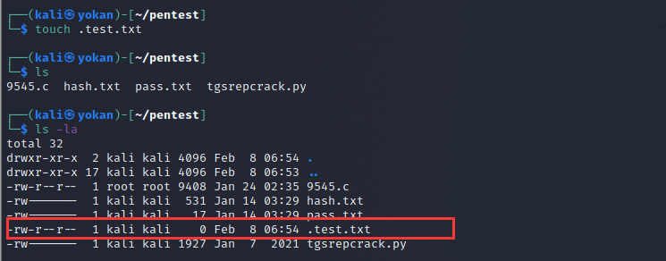
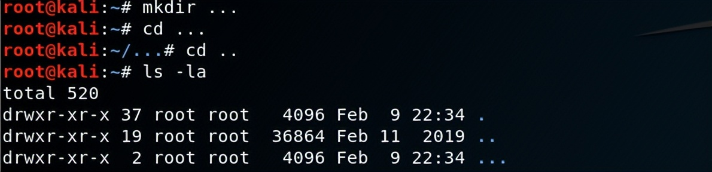
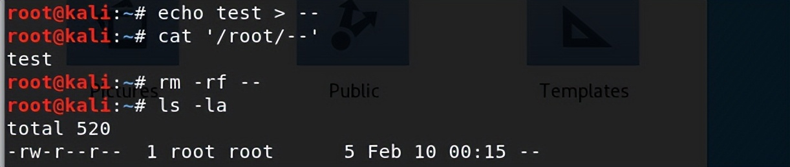
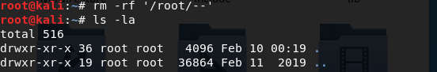
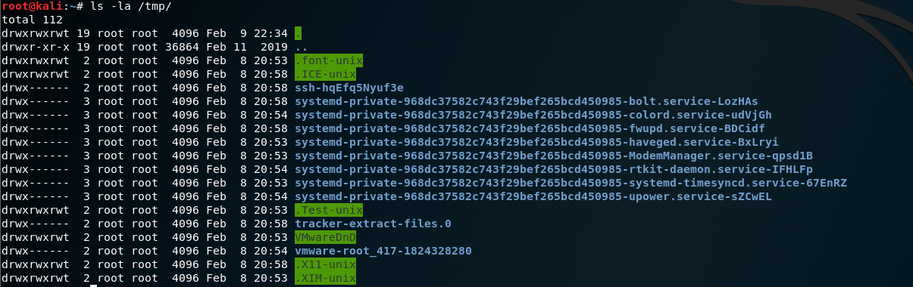

# 隐藏文件

Linux 下创建一个隐藏文件：**touch .test.txt**

touch 命令可以创建一个文件，文件名前面加一个 点 就代表是隐藏文件,如下图


一般的Linux下的隐藏目录使用命令**ls -l**是查看不出来的，只能查看到文件及文件夹，查看Linux下的隐藏文件需要用到命令：**ls -al**

linux中每个目录下其实都有.和..、分别代指的是当前目录和上级目录。 **建立...文件**也是一个比较好的隐藏方法“

## 

建立**参数混淆拦截rm**文件

```
echo 'test'  > --   //创建--文件，需要用绝对路径才能读取和删除
```

**rm -rf --** 命令执行了，文件没删除，命令也没有报错,可以误导管理员。

## 想要删除的话，使用**rm -rf '/root/--'**另外，我们可以看到在/tmp下，默认存在多个隐藏目录，这些目录是恶意文件常用来藏身的地方。如**/tmp/.font-unix/、/tmp/.ICE-unix/、/tmp/.Test-unix/、/tmp/.X11-unix/、/tmp/.XIM-unix/**
