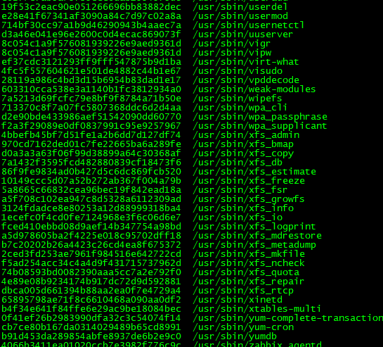
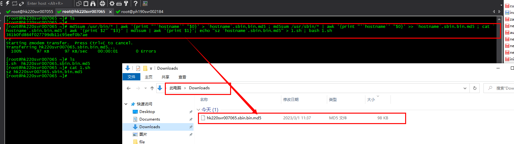
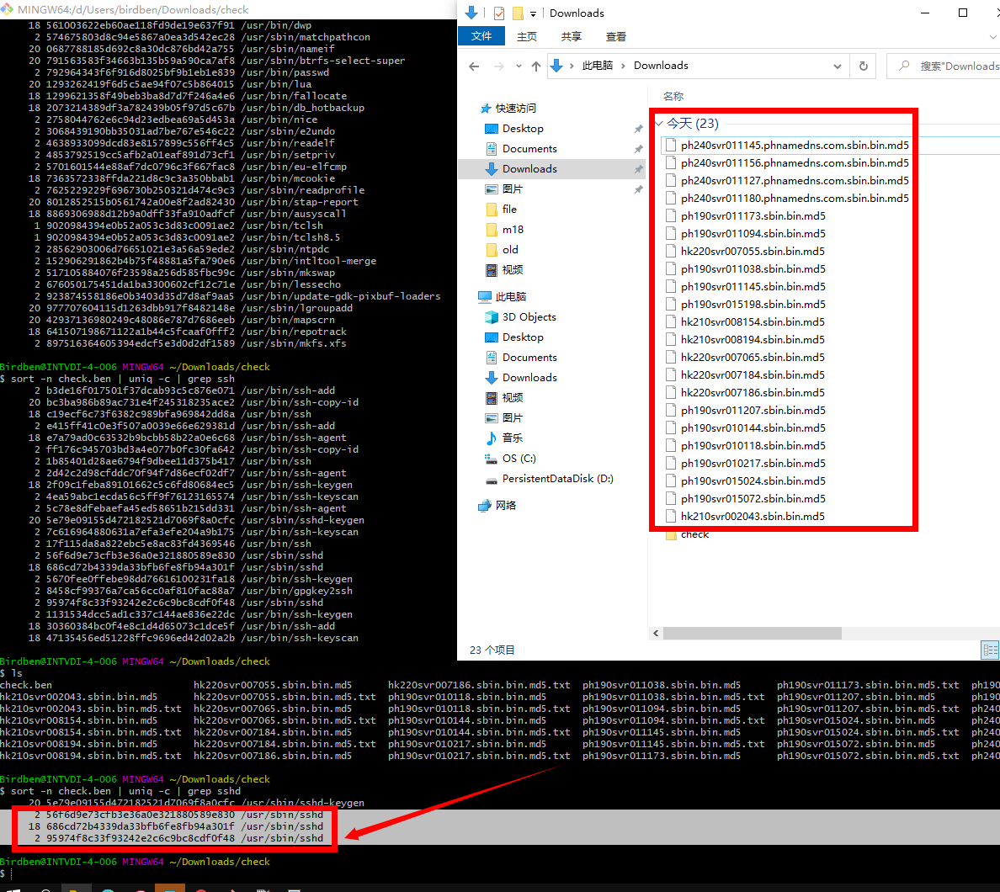
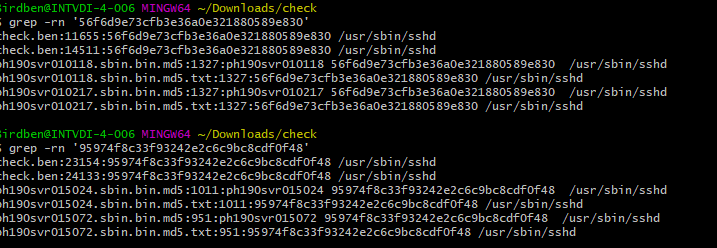
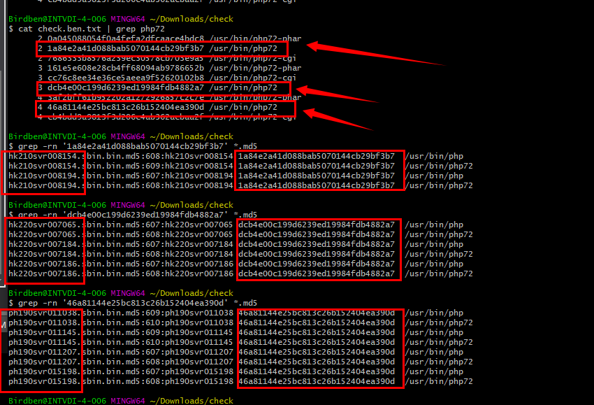
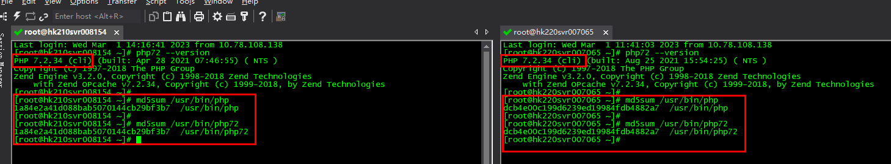
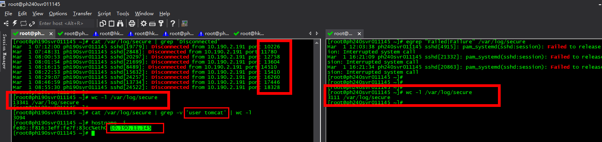

# 服务器被黑后保命技巧

> GitHub 仓库源文件：[点击打开网页渲染版](https://github.com/ben2023niao/ben-ops-notes/blob/main/doc/md/202304141557-%E5%AE%89%E5%85%A8%E4%B8%8E%E5%A0%A1%E5%9E%92%E6%9C%BA%2B%E5%AE%89%E5%85%A8%E8%BF%90%E7%BB%B4%2BPHP%2B%E6%97%A5%E5%BF%97%E5%88%86%E6%9E%90-%E6%9C%8D%E5%8A%A1%E5%99%A8%E8%A2%AB%E9%BB%91%E5%90%8E%E4%BF%9D%E5%91%BD%E6%8A%80%E5%B7%A7.md)



服务器被黑后全部系统命令都被篡改了，到处都感染挂马了

冷静了 3分钟 后
从另外一台干净同系统版本服务器上上传干净的基础命令 md5sum hostname awk echo > | vim yum

```
echo '79756d202d7920696e7374616c6c206c727a737a0a' | xxd -p -r | bash ; md5sum /usr/bin/* | awk '{print "'`hostname`' "$0}' > `hostname`.sbin.bin.md5 ; md5sum /usr/sbin/* | awk '{print "'`hostname`' "$0}' >> `hostname`.sbin.bin.md5 ; cat `hostname`.sbin.bin.md5 | awk '{print $2" "$3}' | md5sum | awk '{print $1}'; echo "sz `hostname`.sbin.bin.md5" > 1.sh ; bash 1.sh
```



然后本地电脑分析不同服务器之间 基础命令被篡改情况



就出现 /usr/sbin/sshd 的md5内容都不一样了。。。。被感染的机器就标记出来了





**几台机器 php72 全部版本一样 但是 md5 不一样！！！**



203.0.113.1
203.0.113.1
这2台机器系统安全日志有被爆破问题
wc -l /var/log/secure 其它机器正常都在3000条左右


然后就是整理出 /usr/bin/ /usr/sbin/ 下基础命令被篡改的 机器列表，商定换机器方案

后期一定要定时巡检全部机器 命令 重要文件的  md5 情况，发现被修改的需要第一时间发聩报警出来
