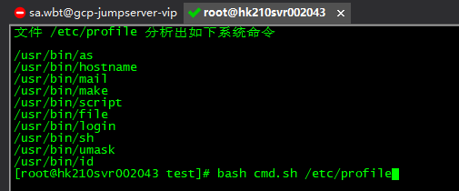
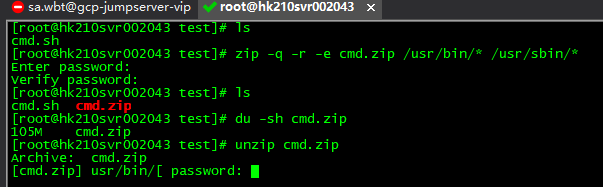
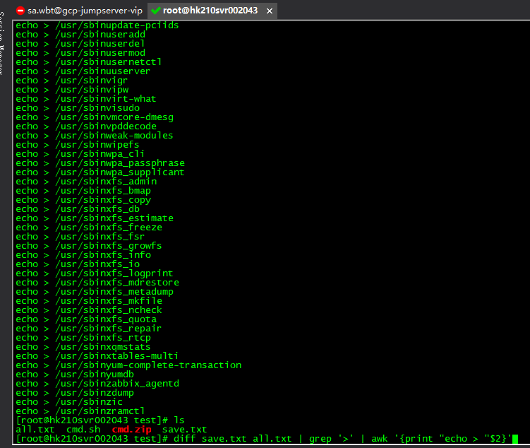

# 基础命令回收权限方案

步骤一 列出服务器的脚本 和重要环境文件 提取出里面的系统命令



**cmd.sh** 展开源码

```
cat $1 |\
tr -s ' ' '\n' |\
tr -s ';' '\n' |\
tr -s ':' '\n' |\
tr -s '-' '\n' |\
tr -s '_' '\n' |\
tr -s '+' '\n' |\
tr -s '#' '\n' |\
tr -s '"' '\n' |\
tr -s '=' '\n' |\
tr -s '.' '\n' |\
tr -s '/' '\n' |\
tr -s '$' '\n' |\
tr -s '!' '\n' |\
tr -s '@' '\n' |\
tr -s '%' '\n' |\
tr -s '\(' '\n' |\
tr -s '\)' '\n' |\
tr -s '{' '\n' |\
tr -s '}' '\n' |\
tr -s '[' '\n' |\
tr -s ']' '\n' |\
tr -s '|' '\n' |\
tr -s '#' '\n' |\
tr -s '~' '\n' |\
tr -s '^' '\n' |\
tr -s '*' '\n' |\
tr -s '&' '\n' |\
tr -s '?' '\n' |\
tr -s '>' '\n' |\
tr -s '<' '\n' |\
tr -s ',' '\n' |\
sed "s/ //g" |\
grep -v [0-9] |\
sort -n |\
uniq -c |\
sort -n |\
grep -v [A-Z] |\
grep [a-z] |\
grep -v '`' > tmp.txt

echo > which.txt
for i in `cat tmp.txt | awk '{print $2}'`;do which $i >> which.txt ;done
clear
echo "文件 $1 分析出如下系统命令"
cat which.txt

rm -f which.txt tmp.txt
```

步骤二 加密备份目前服务器基础命令 (当分发命名的机器挂壁时可使用备份恢复)



需要统一备份路径

步骤三 根据步骤一整理出的命令列表来最小化保留系统命令

**drop-cmd.sh**

```
#要保存的命令
cat > save.txt <<EOF
/usr/bin/as
/usr/bin/hostname
/usr/bin/mail
/usr/bin/make
/usr/bin/script
/usr/bin/file
/usr/bin/login
/usr/bin/sh
/usr/bin/umask
/usr/bin/ls
/usr/bin/pwd
/usr/bin/cd
/usr/bin/ip
/usr/bin/top
/usr/bin/free
/usr/bin/ssh
/usr/bin/sh
 /usr/bin/mv
/usr/bin/unzip
EOF
#全部系统命令
ls /usr/bin/ | awk '{print "/usr/bin"$0}' > all.txt
ls /usr/sbin/ | awk '{print "/usr/sbin"$0}' >> all.txt

#在全部命令里除开要保留的命令后生成清理脚本语句
diff save.txt all.txt | grep '>' | awk '{print "echo > "$2}' > /etc/profile.d/save-cmd.sh
```



生成的语句 保证每次登录就执行 和退出也执行

bash /etc/profile.d/save-cmd.sh
这句 添加到 /root/.bashrc 保证每次退出执行

步骤四  日常要登录服务器需要保留命令之外的权限时

1 提供 服务器ip  和需要的命令，并重命名本地 mv /usr/bin/假命令  /usr/bin/假命令.back

2 组长审批后交由值班进行分发

3 值班使用 salt 分发专员申请的命令覆盖到专业的服务器上(专员要提前重命名要被覆盖的命令)
