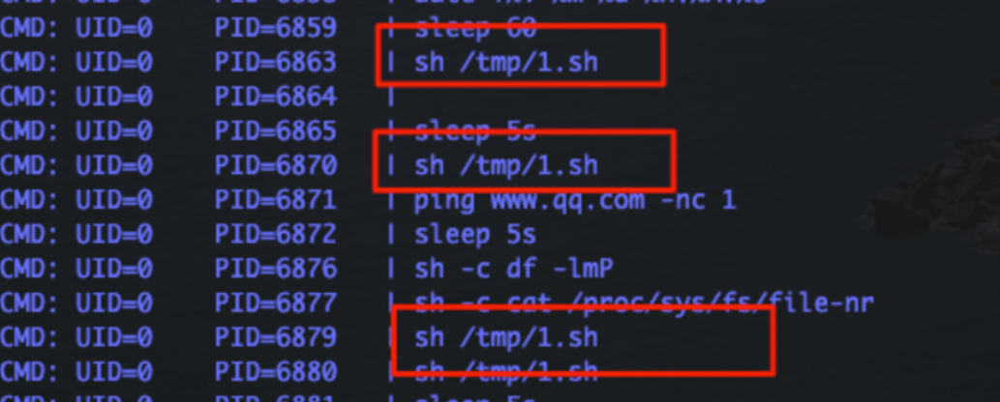
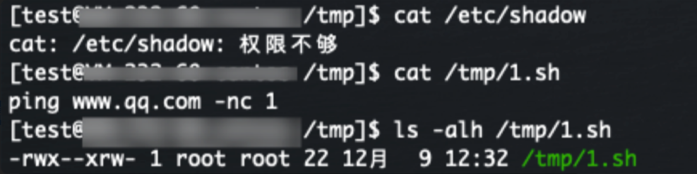
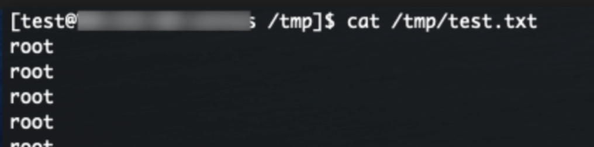

# 文件权限配置不当 提权

当某个进程启动权限为ROOT，对应文件编辑权限为普通用户时，我们可以利用该问题点进行提权。

pspy(<https://github.com/DominicBreuker/pspy>)工具提供了普通用户权限即可监听进程信息

测试环境：

首先我们创建一个while循环，并使用ROOT用户循环执行/tmp/1.sh。

利用：

我们获取普通用户权限时，利用pspy可以监控到ROOT用户在持续执行/tmp/1.sh：

尝试查看/tmp/1.sh文件内容和权限，发现我们当前用户具备读写权限：

我们尝试替换文件内容，查看是否会以ROOT权限启动其中命令：

发现成功提权，以ROOT权限启动自定义命令：

