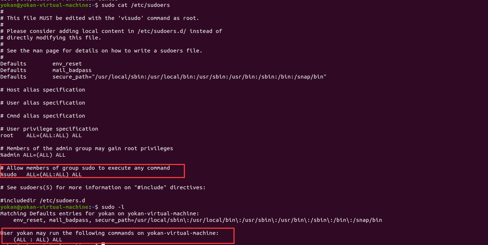

# 3、用户和权限信息

> GitHub 仓库源文件：[点击打开网页渲染版](https://github.com/ben2023niao/ben-ops-notes/blob/main/doc/md/202304141557-%E5%AE%89%E5%85%A8%E4%B8%8E%E5%A0%A1%E5%9E%92%E6%9C%BA%2B%E5%AE%89%E5%85%A8%E8%BF%90%E7%BB%B4%2B%E6%9D%83%E9%99%90%E7%AE%A1%E7%90%86%2B%E7%9F%A5%E8%AF%86%E7%AC%94%E8%AE%B0-3%E3%80%81%E7%94%A8%E6%88%B7%E5%92%8C%E6%9D%83%E9%99%90%E4%BF%A1%E6%81%AF.md)

```
whoami 当前用户名
id 当前用户信息
cat /etc/sudoers 可以使用sudo提升到root的用户
sudo -l 当前用户可以以root身份执行操作
```




yokan用户可以以root身份执行任意操作
